# 📘 Sổ Tay Toàn Diện Embedded Linux: Hệ Thống, Driver, Ngoại Vi, V4L2 & GStreamer

> **Mục tiêu tài liệu:** Hệ thống hóa toàn diện kiến thức **Embedded Linux từ cơ bản đến chuyên sâu** theo đúng lộ trình phát triển của một Embedded Linux Engineer: từ kiến trúc User Space (**File System, Process, Thread, IPC**) → Hệ thống khởi động & đóng gói (**U-Boot, Yocto Project**) → Lập trình Kernel & Ngoại vi (**Character Device Driver, GPIO, Device Tree, I2C, SPI, CAN + Hướng dẫn Bring-up thực chiến**) → Đa phương tiện (**V4L2, GStreamer**).  
> Mỗi phần đều bao gồm: **Lý thuyết nền tảng**, **Kiến trúc & Sơ đồ luồng (Mermaid)**, **Khung logic đặc trưng ngắn gọn** và **Ngân hàng câu hỏi phỏng vấn thực tế kèm đáp án trọng tâm**.

---

## 📑 Mục Lục Tổng Thể

1. [Phần 1: Linux File System (Hệ Thống Tập Tin & VFS)](#phần-1-linux-file-system-hệ-thống-tập-tin--vfs)
2. [Phần 2: Linux Process (Quản Lý Tiến Trình)](#phần-2-linux-process-quản-lý-tiến-trình)
3. [Phần 3: Linux Thread (Lập Trình Đa Luồng & Đồng Bộ Hóa)](#phần-3-linux-thread-lập-trình-đa-luồng--đồng-bộ-hóa)
4. [Phần 4: IPC — Inter-Process Communication (Giao Tiếp Liên Tiến Trình Chuyên Sâu)](#phần-4-ipc--inter-process-communication-giao-tiếp-liên-tiến-trình-chuyên-sâu)
5. [Phần 5: U-Boot & Chuỗi Khởi Động (Boot Process)](#phần-5-u-boot--chuỗi-khởi-động-boot-process)
6. [Phần 6: Yocto Project (Hệ Thống Xây Dựng Custom Linux Distro)](#phần-6-yocto-project-hệ-thống-xây-dựng-custom-linux-distro)
7. [Phần 7: Character Device Driver (Lập Trình Driver Ký Tự)](#phần-7-character-device-driver-lập-trình-driver-ký-tự)
8. [Phần 8: GPIO Subsystem (General Purpose Input/Output)](#phần-8-gpio-subsystem-general-purpose-inputoutput)
9. [Phần 9: Device Tree (Mô Tả Phần Cứng Chuẩn Hóa)](#phần-9-device-tree-mô-tả-phần-cứng-chuẩn-hóa)
10. [Phần 10: I2C Device Driver (Giao Tiếp Ngoại Vi I2C)](#phần-10-i2c-device-driver-giao-tiếp-ngoại-vi-i2c)
11. [Phần 11: SPI Subsystem (Serial Peripheral Interface)](#phần-11-spi-subsystem-serial-peripheral-interface)
12. [Phần 12: CAN Bus & SocketCAN (Giao Thức Mạng Ô Tô)](#phần-12-can-bus--socketcan-giao-thức-mạng-ô-tô)
13. [Phần 13: Hướng Dẫn Thực Chiến Step-by-Step Bring-Up Ngoại Vi (SPI & CAN)](#phần-13-hướng-dẫn-thực-chiến-step-by-step-bring-up-ngoại-vi-spi--can)
14. [Phần 14: V4L2 Framework (Video4Linux2 & Camera Pipeline)](#phần-14-v4l2-framework-video4linux2--camera-pipeline)
15. [Phần 15: GStreamer Framework (Kiến Trúc Multimedia Pipeline)](#phần-15-gstreamer-framework-kiến-trúc-multimedia-pipeline)

---

# Phần 1: Linux File System (Hệ Thống Tập Tin & VFS)

## 1.1. Triết Lý "Everything is a File" & Phân Loại File

Triết lý nền tảng của Unix/Linux là **trừu tượng hóa mọi tài nguyên thành tập tin (File)**. Nhờ đó, ứng dụng User Space chỉ cần dùng **một bộ System Call duy nhất** (`open`, `read`, `write`, `lseek`, `ioctl`, `mmap`, `close`) để làm việc với cả file văn bản trên flash, thiết bị phần cứng (`/dev/i2c-0`, `/dev/video0`), lẫn kênh giao tiếp IPC (Pipe, FIFO, Socket).

### 7 loại File trong Linux (ký tự đầu tiên khi gõ `ls -l`)

| Ký tự | Loại File | Bản chất & Đặc điểm | Ví dụ thực tế |
| :---: | :--- | :--- | :--- |
| **`-`** | **Regular File** | Chứa dữ liệu văn bản, mã nguồn hoặc nhị phân ELF | `/bin/busybox`, `/etc/fstab` |
| **`d`** | **Directory** | File danh mục ánh xạ `Tên File → Số Inode` | `/etc`, `/usr/lib` |
| **`c`** | **Character Device** | Thiết bị truy cập tuần tự từng byte, không qua block cache | `/dev/ttyS0`, `/dev/video0`, `/dev/gpiochip0` |
| **`b`** | **Block Device** | Thiết bị lưu trữ truy cập theo khối (512B/4KB), có Page Cache | `/dev/mmcblk0p2`, `/dev/sda1` |
| **`l`** | **Symbolic Link** | Con trỏ mềm lưu đường dẫn trỏ tới một file khác | `/bin/sh -> busybox` |
| **`s`** | **Socket** | Điểm kết nối giao tiếp liên tiến trình cục bộ (`AF_UNIX`) | `/run/systemd/private`, `/tmp/dlt.sock` |
| **`p`** | **Named Pipe (FIFO)** | Đường ống truyền dữ liệu một chiều giữa các tiến trình | `/tmp/sensor_fifo` |

---

## 1.2. Cấu Trúc Cây Thư Mục FHS & Các Hệ Thống Tập Tin Ảo (Virtual FS)

Trên Embedded Linux, cây thư mục gốc `/` tuân theo chuẩn **FHS (Filesystem Hierarchy Standard)**:
- **`/bin`, `/sbin`, `/usr`:** Chứa các công cụ dòng lệnh và thư viện thực thi (thường được gom gọn qua **BusyBox**).
- **`/etc`:** Toàn bộ file cấu hình tĩnh của hệ thống và kịch bản khởi động.
- **`/lib`:** Thư viện động (`.so`) cốt lõi (`libc.so`, `ld-linux.so`) và Kernel Modules (`/lib/modules/<kernel-ver>/`).
- **`/var`, `/tmp`:** Dữ liệu biến động và file tạm (thường mount bằng **`tmpfs` trên RAM** để tránh ghi nhiều làm hỏng Flash eMMC/NAND).

### Ba Virtual Filesystems sống còn cho Embedded Engineer
1. **`/proc` (procfs):** Tồn tại hoàn toàn trên RAM, phản ánh trạng thái thời gian thực của Kernel và từng tiến trình (`/proc/cpuinfo`, `/proc/meminfo`, `/proc/interrupts`, `/proc/cmdline`, `/proc/<PID>/maps`, `/proc/<PID>/fd/`).
2. **`/sys` (sysfs):** Biểu diễn mô hình thiết bị phân cấp của Kernel (*Bus – Device – Driver – Class*). Cho phép kiểm tra và cấu hình phần cứng trực tiếp từ user space (`/sys/class/net/can0`, `/sys/bus/i2c/devices/`, `/sys/class/leds/`).
3. **`/dev` (devtmpfs):** Chứa các device node do `udev` (hoặc `mdev` trên BusyBox) tự động tạo ra khi driver đăng ký thiết bị. Mỗi node gắn với cặp số **Major Number** (định danh Driver) và **Minor Number** (định danh thiết bị cụ thể do Driver đó quản lý).

---

## 1.3. Kiến Trúc VFS & Mối Quan Hệ 3 Bảng Nội Bộ trong Kernel

Khi ứng dụng gọi `fd = open("/data/log.txt", O_RDWR)`, yêu cầu đi qua lớp **VFS (Virtual File System)**. Kernel quản lý các file đang mở thông qua **3 bảng cấu trúc dữ liệu liên kết chặt chẽ**:

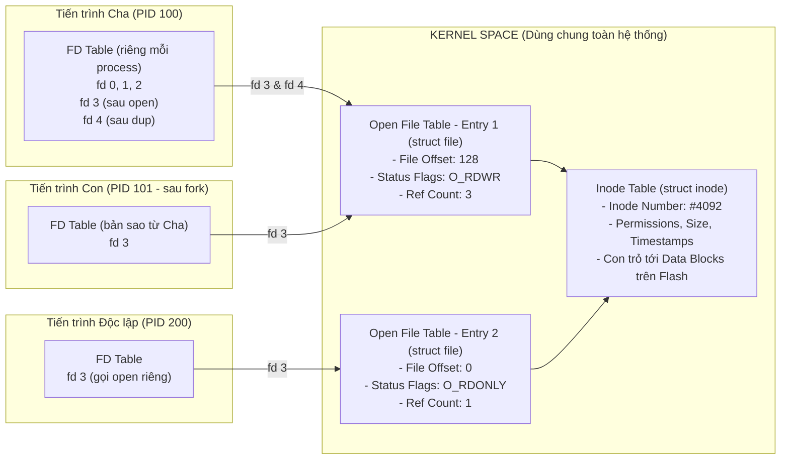

**Giải thích bản chất kiến trúc 3 bảng:**
1. **File Descriptor Table (Bảng FD — riêng cho từng Process):** Nằm trong `task_struct` của mỗi tiến trình. Chỉ là mảng ánh xạ số nguyên `fd` (0, 1, 2, 3...) tới một con trỏ `struct file` trong Open File Table.
2. **Open File Table (Bảng File đang mở — toàn cục trong Kernel):** Mỗi lần gọi `open()` thành công sẽ tạo **1 entry mới** (`struct file`) lưu vị trí con trỏ đọc/ghi hiện tại (`f_pos` / **File Offset**), cờ mở (`O_RDWR`, `O_APPEND`), bộ đếm tham chiếu (`f_count`) và con trỏ `f_op` (`file_operations`).
   - Khi gọi `dup(fd)` hoặc `fork()`: Không tạo entry mới trong Open File Table mà chỉ trỏ chung vào entry cũ và tăng `Ref Count`. Vì vậy **Cha và Con sau `fork()` chia sẻ chung `File Offset`** (cha đọc 100 byte thì con đọc tiếp từ byte 101).
   - Khi một tiến trình khác gọi `open()` độc lập trên cùng file: Tạo entry riêng trong Open File Table nên có **`File Offset` độc lập**, không ảnh hưởng nhau.
3. **Inode Table (Bảng Inode — duy nhất cho mỗi file vật lý):** Đại diện cho bản thân file trên thiết bị lưu trữ (kích thước, quyền `rwx`, UID/GID, vị trí các block dữ liệu). *Lưu ý:* **Tên file không nằm trong Inode** mà nằm trong dữ liệu của thư mục cha (`dentry`).

---

## 1.4. Page Cache, Đảm Bảo Toàn Vẹn Dữ Liệu & File Locking

- **Page Cache & Dirty Pages:** Khi ứng dụng gọi `write()`, dữ liệu chưa được ghi ngay xuống chip Flash eMMC/NAND mà được lưu vào vùng đệm RAM gọi là **Page Cache** và đánh dấu là **Dirty Page**, sau đó hàm `write()` trả về ngay để tăng tốc độ. Một luồng nhân chạy ngầm sẽ định kỳ đẩy các trang này xuống đĩa.
- **Nguy cơ mất điện đột ngột (Power Loss) trên thiết bị nhúng:** Nếu rút nguồn trước khi Dirty Page được ghi xuống Flash, dữ liệu sẽ mất hoặc gây lỗi filesystem. Đối với dữ liệu quan trọng (cấu hình, mã lỗi DTC, nhật ký giao dịch), bắt buộc phải gọi:
  - `fsync(fd)`: Ép ghi cả dữ liệu lẫn metadata (inode) xuống phần cứng lưu trữ ngay lập tức.
  - `fdatasync(fd)`: Chỉ ép ghi phần dữ liệu (bỏ qua metadata không thiết yếu) → nhanh hơn `fsync`.
- **Khóa File (File Locking):** Để ngăn nhiều tiến trình ghi đè làm hỏng cùng một file:
  - `flock(fd, LOCK_EX | LOCK_NB)`: Khóa ở **cấp độ toàn bộ file** (thường dùng tạo file `/tmp/app.lock` để đảm bảo một daemon chỉ chạy duy nhất 1 instance).
  - `fcntl(fd, F_SETLK, &fl)`: Khóa chi tiết đến **từng vùng byte (Byte-range locking)**.

### Khung logic thao tác File an toàn trên Embedded Linux
```c
int fd = open("/data/config.bin", O_WRONLY | O_CREAT | O_TRUNC, 0644);
flock(fd, LOCK_EX);                 /* Khóa độc quyền trước khi ghi */
write(fd, &cfg, sizeof(cfg));       /* Ghi vào Page Cache của Kernel */
fdatasync(fd);                      /* Ép đẩy từ RAM Page Cache xuống Flash vật lý */
flock(fd, LOCK_UN);                 /* Mở khóa */
close(fd);
```

---

## 1.5. 🎯 Câu Hỏi Phỏng Vấn Thực Tế: Linux File System

> **Câu 1: Sự khác biệt giữa hàm thư viện C (`fopen`, `fread`, `fwrite`) và System Call (`open`, `read`, `write`) là gì? Khi nào dùng cái nào?**
> - **Trả lời:** Các hàm `fopen`/`fwrite` thuộc thư viện chuẩn `glibc`, hoạt động trên con trỏ `FILE*` và có thêm một **User-space Buffer** (thường 4KB). Khi ghi vài byte bằng `fwrite`, dữ liệu nằm trong RAM của User Space, khi đầy buffer mới gọi system call `write()` một lần → giảm số lần Context Switch sang Kernel, rất tối ưu khi đọc/ghi file văn bản/log nhỏ liên tục. Ngược lại, `open`/`read`/`write` là **System Call trực tiếp** thao tác trên số nguyên `fd` (File Descriptor) không qua đệm user-space → bắt buộc dùng khi giao tiếp với **Device Driver (`/dev/*`), Pipe, Socket** nơi dữ liệu cần phản hồi tức thời.

> **Câu 2: Hard Link và Soft Link (Symbolic Link) khác nhau như thế nào ở mức Inode?**
> - **Trả lời:**
>   - **Hard Link:** Là một tên file mới trong thư mục nhưng **trỏ trực tiếp vào cùng số Inode** với file gốc (làm tăng `Link Count` của Inode lên 1). Nếu xóa file gốc, dữ liệu vẫn còn nguyên vẹn cho đến khi xóa hết mọi Hard Link (`Link Count == 0`). Hard Link không thể trỏ qua phân vùng (filesystem) khác và không dùng được cho thư mục.
>   - **Soft Link (Symlink):** Là một file hoàn toàn mới có **Inode riêng**, nội dung bên trong chỉ lưu chuỗi đường dẫn trỏ tới tên file gốc. Nếu xóa file gốc, Symlink bị đứt (*dangling link*). Symlink có thể trỏ xuyên phân vùng và trỏ tới thư mục.

> **Câu 3: Trên hệ thống Embedded Linux hay bị rút nguồn đột ngột, thiết kế phân vùng File System như thế nào để không bị hỏng (corrupt) RootFS?**
> - **Trả lời:** Tách flash thành nhiều phân vùng: (1) **RootFS (`/`)** được mount ở chế độ **Read-Only** (dùng `squashfs` hoặc `ext4 ro`) để không bao giờ bị hỏng khi sập nguồn; (2) File tạm và log runtime (`/tmp`, `/run`, `/var/log`) đặt trên **`tmpfs` (RAM)**; (3) Phân vùng dữ liệu cần lưu trữ bền vững (`/data`) mount riêng bằng filesystem có cơ chế Journaling hoặc Copy-on-Write chống sập nguồn (`ext4` với `data=journal`, `UBIFS` cho raw NAND, hoặc `LittleFS` cho NOR), kết hợp gọi `fsync()` sau mỗi lần cập nhật cấu hình.

---

# Phần 2: Linux Process (Quản Lý Tiến Trình)

## 2.1. Phân Biệt Program vs. Process & Bố Cục Bộ Nhớ Ảo

- **Program (Chương trình):** Tệp nhị phân tĩnh (định dạng **ELF**) nằm trên bộ nhớ Flash/ổ đĩa.
- **Process (Tiến trình):** Một thực thể đang chạy của chương trình trong RAM, được Kernel quản lý bằng cấu trúc **`struct task_struct`** (PCB - Process Control Block), có mã định danh **PID** duy nhất và không gian bộ nhớ ảo cô lập nhờ phần cứng **MMU**.

### Bố cục Không gian Địa chỉ Ảo (Process Memory Layout)

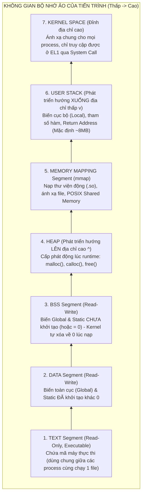

> **Điểm lưu ý về file ELF trên Flash:** Phân vùng **BSS** không tốn dung lượng lưu trữ trên file nhị phân ELF (file ELF chỉ ghi nhận kích thước BSS cần dùng); khi nạp chương trình vào RAM, trình nạp của Kernel mới cấp phát RAM và điền 0 vào vùng BSS.

---

## 2.2. Vòng Đời Tiến Trình: `fork()`, `exec()`, `wait()`, `exit()`

Trong Linux, các tiến trình tạo thành một cây phân cấp bắt đầu từ **PID 1 (`systemd` hoặc `init`)**. Việc tạo và chạy một tiến trình mới được tách thành hai bước riêng biệt: **nhân bản (`fork`)** và **thay thế mã thực thi (`exec`)**.

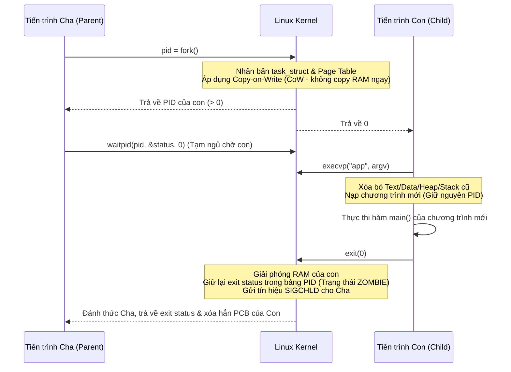

**Bản chất cơ chế Copy-on-Write (CoW) trong `fork()`:**
- Nếu `fork()` phải copy hàng trăm MB RAM của cha sang con ngay lập tức, hệ thống sẽ cực chậm — nhất là khi ngay sau đó con gọi `exec()` xóa sạch bộ nhớ cũ.
- Với **CoW**, Kernel chỉ sao chép **Page Table** và đánh dấu mọi trang RAM của cả cha và con là **Read-Only**. Cả hai đọc chung RAM vật lý. Chỉ khi một bên thực hiện lệnh **ghi**, MMU mới phát sinh *Page Fault* để Kernel cấp phát riêng 1 trang vật lý mới (4KB) cho bên ghi.

---

## 2.3. Tiến Trình Mồ Côi (Orphan) vs. Tiến Trình Ma (Zombie)

| Tiêu chí | Orphan Process (Tiến trình Mồ côi) | Zombie Process (`<defunct>` / Trạng thái `Z`) |
| :--- | :--- | :--- |
| **Nguyên nhân** | Tiến trình **Cha kết thúc trước** trong khi Con vẫn đang chạy | Tiến trình **Con đã kết thúc (`exit`)**, nhưng Cha còn sống mà **chưa gọi `wait()`/`waitpid()`** |
| **Mức độ nguy hại** | **Không gây hại** (Hoặc được dùng chủ đích khi tạo Daemon chạy ngầm) | **Nguy hiểm:** Dù đã trả hết RAM, nó vẫn chiếm 1 slot `task_struct` và 1 mã **PID** trong Kernel. Tích tụ nhiều sẽ gây cạn kiệt PID, làm hệ thống không tạo thêm process/thread được nữa |
| **Cơ chế xử lý** | Kernel tự động chuyển quyền làm cha của nó về cho **PID 1 (`init`/`systemd`)**; khi nó kết thúc, PID 1 sẽ tự gọi `wait()` thu dọn | Bắt buộc tiến trình Cha phải thu hồi mã thoát, hoặc khi Cha chết thì PID 1 mới tiếp quản và dọn Zombie |

### Khung logic chuẩn chống Zombie Process trong Daemon/Server
```c
/* Cách 1: Bắt tín hiệu SIGCHLD và thu dọn non-blocking bằng vòng lặp while */
void sigchld_handler(int signo) {
    while (waitpid(-1, NULL, WNOHANG) > 0); /* Dọn sạch mọi con đã thoát cùng lúc */
}

/* Cách 2 (Tối ưu nhất trên Linux nếu Cha không cần đọc exit code của Con): */
signal(SIGCHLD, SIG_IGN); /* Báo Kernel tự động xóa PCB của con ngay khi con exit */
```

---

## 2.4. 🎯 Câu Hỏi Phỏng Vấn Thực Tế: Linux Process

> **Câu 1: Tại sao trong `sigchld_handler` bắt buộc phải dùng vòng lặp `while (waitpid(-1, NULL, WNOHANG) > 0)` thay vì gọi `wait()` một lần?**
> - **Trả lời:** Vì tín hiệu chuẩn `SIGCHLD` **không có hàng đợi (Signal Coalescing)**. Nếu 5 tiến trình con kết thúc cùng một lúc khi cha đang bận, cha chỉ nhận được **1 lần `SIGCHLD`**. Nếu chỉ gọi `wait()` một lần thì chỉ thu dọn được 1 con, 4 con còn lại biến thành Zombie. Ngoài ra phải dùng cờ `WNOHANG` để không làm treo (block) tiến trình cha nếu các con khác vẫn đang chạy.

> **Câu 2: Làm thế nào để giết (kill) một Zombie Process đang xuất hiện trên hệ thống?**
> - **Trả lời:** **Không thể dùng `kill -9 <PID_Zombie>` để giết một Zombie Process** vì bản thân tiến trình đó đã chết rồi! Có 2 cách xử lý trên thực tế:
>   1. Gửi tín hiệu `kill -SIGCHLD <PID_Cha>` để nhắc tiến trình cha gọi `wait()` (nếu cha có đăng ký handler).
>   2. Nếu tiến trình cha bị lỗi code không chịu `wait()`, ta phải **kill tiến trình Cha (`kill <PID_Cha>`)**. Khi cha chết, các Zombie con trở thành Orphan, được **PID 1 (`systemd`/`init`)** nhận nuôi và gọi `wait()` dọn sạch ngay lập tức.

> **Câu 3: Sự khác biệt giữa `exit()` và `_exit()` là gì?**
> - **Trả lời:** `_exit()` là **System Call** chấm dứt tiến trình ngay lập tức ở tầng Kernel, đóng các File Descriptor nhưng **không flush các bộ đệm I/O của thư viện C** (`stdout`, `FILE*`). Ngược lại, `exit()` là hàm của `glibc`: nó gọi các hàm dọn dẹp đã đăng ký qua `atexit()`, **flush toàn bộ stdio buffers**, rồi mới gọi `_exit()`. Trong tiến trình con ngay sau `fork()` (ví dụ khi `exec()` thất bại hoặc trong Signal Handler), bắt buộc dùng `_exit()` để tránh flush trùng lặp buffer của cha.

---

# Phần 3: Linux Thread (Lập Trình Đa Luồng & Đồng Bộ Hóa)

## 3.1. Kiến Trúc Thread & So Sánh Process vs. Thread

Trong nhân Linux, **Thread** được hiện thực dưới dạng **Lightweight Process (LWP)** thông qua cùng system call `clone()` với cờ chia sẻ tài nguyên (`CLONE_VM | CLONE_FS | CLONE_FILES | CLONE_SIGHAND`).

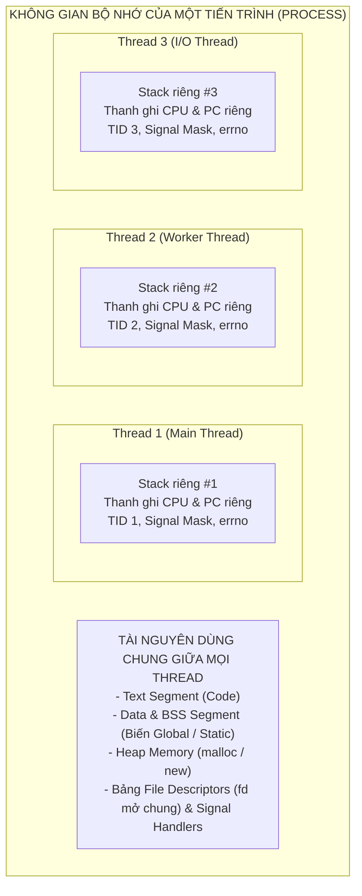

### Bảng so sánh bản chất: Process vs. Thread

| Tiêu chí | Tiến trình (Process) | Luồng (Thread) |
| :--- | :--- | :--- |
| **Không gian bộ nhớ** | Cô lập hoàn toàn (Page Table riêng) | Dùng chung không gian địa chỉ ảo (Page Table chung), chỉ khác **Stack** |
| **Chi phí Context Switch** | **Nặng:** Phải nạp lại thanh ghi Page Table (`TTBR` trên ARM) và **flush bộ đệm TLB** | **Rất nhẹ & nhanh:** Giữ nguyên Page Table và tận dụng nguyên vẹn TLB & Cache |
| **Giao tiếp dữ liệu** | Phải qua các cơ chế IPC của Kernel | Đọc/ghi trực tiếp biến toàn cục hoặc con trỏ Heap (cần đồng bộ Mutex) |
| **Tính cô lập lỗi (Fault Isolation)** | **Rất cao:** 1 process bị Segfault không ảnh hưởng các process khác | **Thấp:** 1 thread truy cập con trỏ lỗi (`SIGSEGV`) sẽ làm **sập toàn bộ Process** |

**Concurrency (Đồng thời) vs. Parallelism (Song song):**
- **Concurrency:** Nhiều thread luân phiên chia sẻ thời gian (*time-slicing*) trên **1 nhân CPU** (xen kẽ nhau).
- **Parallelism:** Nhiều thread thực thi **cùng một thời điểm vật lý** trên **nhiều nhân CPU (Multi-core SMP)**.

---

## 3.2. Vòng Đời POSIX Thread (`pthread`) & Quản Lý Tài Nguyên

Một thread sau khi được tạo bằng `pthread_create()` có 2 chế độ kết thúc:
1. **Joinable (Mặc định):** Khi thread kết thúc, vùng nhớ Stack và mã trả về của nó vẫn được giữ lại cho đến khi một thread khác gọi **`pthread_join(tid, &retval)`** để thu hồi (nếu quên gọi `pthread_join` sẽ gây **rò rỉ bộ nhớ — Memory Leak** tương tự như Zombie Process!).
2. **Detached (`pthread_detach(tid)`):** Báo cho hệ thống tự động giải phóng toàn bộ tài nguyên Stack ngay khi thread đó kết thúc; không thể gọi `pthread_join` trên thread đã detach.

---

## 3.3. Đồng Bộ Hóa Luồng: Race Condition, Mutex, Condition Variable & RWLock

### 1. Race Condition & Critical Section
Thao tác đơn giản như `count++` ở mức mã máy ARM gồm 3 lệnh tách biệt: `LDR` (đọc từ RAM vào thanh ghi) → `ADD` (cộng 1) → `STR` (ghi từ thanh ghi ra RAM). Nếu 2 thread cùng thực hiện mà bị ngắt giữa chừng, giá trị ghi sau sẽ đè mất kết quả của luồng trước. Đoạn code truy cập tài nguyên dùng chung đó gọi là **Critical Section**.

### 2.Các công cụ đồng bộ hóa cốt lõi

| Cơ chế | Bản chất hoạt động | Trường hợp sử dụng điển hình |
| :--- | :--- | :--- |
| **Mutex (`pthread_mutex_t`)** | Khóa độc quyền có **quyền sở hữu (Ownership)**: luồng nào `lock` thì chỉ luồng đó mới được `unlock`. Hỗ trợ **Priority Inheritance** | Bảo vệ biến toàn cục, cấu trúc dữ liệu, cổng phần cứng dùng chung |
| **Condition Variable (`pthread_cond_t`)** | Luôn đi kèm Mutex. Giúp luồng **ngủ chờ sự kiện** (`pthread_cond_wait` tự động nhả mutex khi ngủ và khóa lại khi thức) mà không tốn CPU | Bài toán **Producer – Consumer** (luồng xử lý ngủ chờ luồng nhận frame camera/CAN đẩy dữ liệu vào hàng đợi) |
| **Read-Write Lock (`pthread_rwlock_t`)** | Cho phép **nhiều luồng cùng Đọc** đồng thời, nhưng khi **Ghi thì độc quyền tuyệt đối** | Bảng cấu hình hệ thống, bảng định tuyến: tần suất đọc rất nhiều, tần suất cập nhật rất ít |
| **Spinlock (`pthread_spinlock_t`)** | Vòng lặp bận (*Busy-waiting*) kiểm tra khóa liên tục trên CPU thay vì đi ngủ | Chỉ dùng trên hệ đa nhân (SMP) khi thời gian giữ khóa cực ngắn (vài chục nano-giây) và không muốn tốn chi phí Context Switch (rất phổ biến trong Kernel Interrupt Context) |

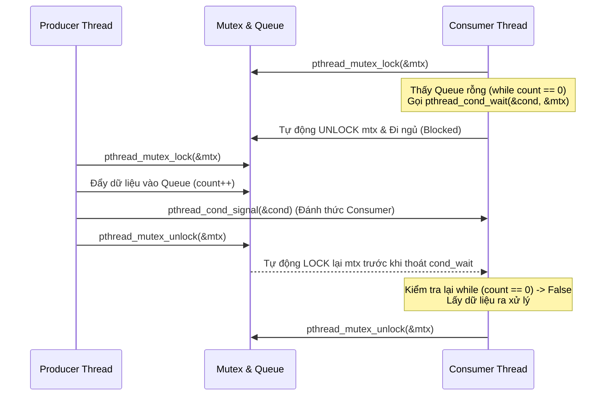

### Khung logic chuẩn Producer–Consumer với Mutex & Condition Variable
```c
/* CONSUMER: Luôn kiểm tra điều kiện trong vòng lặp WHILE để chống Spurious Wakeup */
pthread_mutex_lock(&mtx);
while (queue_is_empty()) {
    pthread_cond_wait(&cond_not_empty, &mtx); /* Nhả mtx & ngủ; khi thức dậy tự khóa lại mtx */
}
item = pop_queue();
pthread_mutex_unlock(&mtx);

/* PRODUCER: Đẩy dữ liệu và phát tín hiệu đánh thức */
pthread_mutex_lock(&mtx);
push_queue(item);
pthread_cond_signal(&cond_not_empty);
pthread_mutex_unlock(&mtx);
```

---

## 3.4. Deadlock & Priority Inversion

### Deadlock (Bế tắc)
Xảy ra khi 2 luồng chờ khóa chéo nhau (Thread 1 giữ khóa A chờ khóa B; Thread 2 giữ khóa B chờ khóa A).
- **4 điều kiện cần và đủ (Coffman):** *Mutual Exclusion*, *Hold and Wait*, *No Preemption*, *Circular Wait*.
- **Giải pháp triệt để trong dự án:**
  1. **Lock Ordering:** Quy định mọi hàm trong dự án bắt buộc khóa Mutex theo đúng một thứ tự cố định (luôn khóa A trước B).
  2. Dùng `pthread_mutex_trylock()` hoặc `pthread_mutex_timedlock()` — nếu không lấy được khóa thứ 2 thì nhả khóa thứ 1 ra và thử lại sau.

### Priority Inversion (Đảo ngược độ ưu tiên — Cực kỳ quan trọng trong Real-Time Embedded)
- **Hiện tượng:** Thread **Thấp (L)** đang giữ Mutex. Thread **Cao (H)** cần Mutex đó nên bị chặn. Đúng lúc này, Thread **Trung bình (M)** (không cần Mutex) chạy chiếm CPU và搶 quyền của Thread L → làm Thread L không chạy tiếp để nhả khóa được → gián tiếp làm Thread **Trung bình (M)** chạy trước cả Thread **Cao (H)**!
- **Giải pháp:** Bật thuộc tính **`PTHREAD_PRIO_INHERIT` (Priority Inheritance)** cho Mutex. Khi Thread H bị chặn bởi Mutex do Thread L giữ, Kernel lập tức **nâng tạm thời độ ưu tiên của Thread L lên ngang bằng Thread H** để L chạy xong nhanh nhất, nhả khóa cho H, rồi L mới trở về mức ưu tiên gốc.

---

## 3.5. 🎯 Câu Hỏi Phỏng Vấn Thực Tế: Linux Thread

> **Câu 1: Tại sao khi gọi `pthread_cond_wait(&cond, &mtx)` bắt buộc phải đặt điều kiện kiểm tra trong vòng lặp `while (condition_is_false)` chứ không được dùng câu lệnh `if`?**
> - **Trả lời:** Có 2 lý do cốt tử:
>   1. **Spurious Wakeup (Thức giấc giả):** Theo chuẩn POSIX và kiến trúc đa nhân Linux, một luồng đang ngủ ở `pthread_cond_wait` có thể bị đánh thức ngẫu nhiên do tín hiệu hệ thống dù chưa ai gọi `cond_signal`.
>   2. **Stolen Wakeup (Bị luồng khác giành mất dữ liệu):** Khi có nhiều Consumer, Producer vừa gọi `cond_signal` hoặc `cond_broadcast`, một Consumer khác nhanh hơn có thể đã chạy vào lấy mất phần tử trong queue trước khi luồng hiện tại kịp khóa lại Mutex. Dùng `while` đảm bảo khi thức dậy luồng luôn kiểm tra lại xem dữ liệu có thực sự còn trong queue hay không.

> **Câu 2: Sự khác biệt cốt lõi giữa Mutex và Binary Semaphore (khởi tạo bằng 1) là gì?**
> - **Trả lời:** Điểm khác biệt lớn nhất là **Quyền sở hữu (Ownership) và Mục đích sử dụng**:
>   - **Mutex dùng để Khóa bảo vệ tài nguyên (Locking):** Có khái niệm chủ sở hữu — chỉ luồng nào đã gọi `lock()` mới có quyền gọi `unlock()`. Nhờ biết rõ ai đang giữ khóa, Mutex hỗ trợ được **Priority Inheritance** chống đảo ngược độ ưu tiên.
>   - **Semaphore dùng để Báo hiệu đồng bộ (Signaling):** Không có chủ sở hữu — Luồng A (hoặc Interrupt) có thể gọi `sem_post()` để đánh thức Luồng B đang chờ ở `sem_wait()`.

> **Câu 3: Hàm Thread-Safe và Hàm Reentrant (Tái nhập) khác nhau như thế nào?**
> - **Trả lời:**
>   - **Thread-Safe:** Hàm có thể được gọi đồng thời bởi nhiều luồng mà không làm hỏng dữ liệu chung (thường nhờ dùng **Mutex** bên trong hàm).
>   - **Reentrant:** Hàm có thể bị ngắt giữa chừng (ví dụ bởi **Signal Handler** hoặc **ISR** trên cùng 1 luồng) rồi được gọi lại ngay trước khi lần gọi đầu tiên kết thúc mà vẫn chạy đúng. Hàm Reentrant **tuyệt đối không được dùng biến toàn cục/static và không được dùng Mutex** (vì nếu đang giữ Mutex mà bị Signal ngắt rồi gọi lại chính hàm đó sẽ tự khóa chết — Deadlock!). Do đó, mọi hàm Reentrant đều Thread-Safe, nhưng hàm Thread-Safe dùng Mutex thì **không** Reentrant.

---

# Phần 4: IPC — Inter-Process Communication (Giao Tiếp Liên Tiến Trình Chuyên Sâu)

> *Tham khảo và tổng hợp chi tiết từ bộ tài liệu thực hành `EMB_LINUX` (`04-IPC-Signal`, `06-IPC-Socket`, `08-IPC-Pipes-FIFOs`, `09-IPC-Message-Queues`, `10-IPC-Shared-Memory`, `11-IPC-Semaphore`).*

## 4.1. Phân Loại Tổng Thể Các Cơ Chế IPC trong Linux

Vì mỗi tiến trình có không gian địa chỉ bộ nhớ ảo hoàn toàn cô lập, chúng không thể đọc/ghi trực tiếp biến của nhau mà phải giao tiếp thông qua **7 cơ chế IPC** do Linux Kernel cung cấp, chia làm 3 nhóm chức năng:

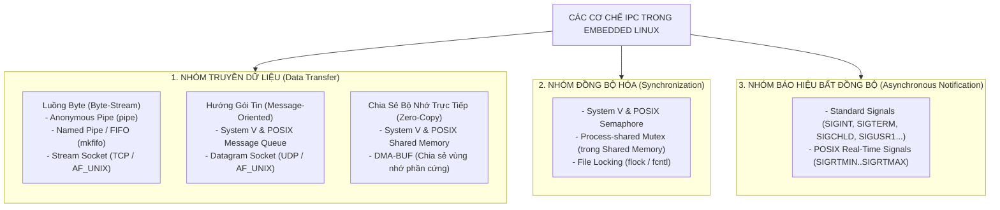

---

## 4.2. Cơ Chế 1 & 2: Anonymous Pipe (`pipe`) và Named Pipe (`FIFO`)

### 1. Anonymous Pipe (Đường ống vô danh)
- **Cơ chế hoạt động:** Là một bộ đệm vòng (Circular Buffer, mặc định **64KB** trên Linux) nằm trong RAM của Kernel. Hàm `pipe(int fds[2])` tạo ra một cặp File Descriptor: **`fds[1]` chuyên để Ghi (Write-end)** và **`fds[0]` chuyên để Đọc (Read-end)**.
- **Đặc tính cốt lõi:**
  - **Đơn công (Half-duplex / Unidirectional):** Dữ liệu chỉ chảy theo 1 chiều. Nếu muốn giao tiếp 2 chiều giữa Cha và Con, phải tạo **2 pipe riêng biệt**.
  - **Chỉ dùng cho tiến trình có quan hệ huyết thống (Cha – Con hoặc Anh – Em):** Vì không có tên trên filesystem, các tiến trình phải kế thừa cặp `fds[0]` và `fds[1]` thông qua lệnh `fork()`.
  - **Đảm bảo tính nguyên tử (Atomicity):** Mọi thao tác `write()` có kích thước $\le$ `PIPE_BUF` (**4096 bytes**) được Kernel cam kết ghi nguyên khối, không bị xen kẽ dữ liệu ngay cả khi nhiều tiến trình cùng ghi.
  - **Hành vi đồng bộ tự động:**
    - Đọc khi Pipe rỗng → `read()` tự động **block** chờ đến khi có dữ liệu.
    - Ghi khi Pipe đầy → `write()` tự động **block** chờ đến khi bên đọc lấy bớt dữ liệu.
    - Tất cả đầu ghi `fds[1]` đã đóng → `read()` trả về **`0` (EOF)**.
    - Tất cả đầu đọc `fds[0]` đã đóng mà cố tình gọi `write()` → Kernel bắn tín hiệu **`SIGPIPE`** (mặc định làm tắt tiến trình ghi) và trả về lỗi `EPIPE`.

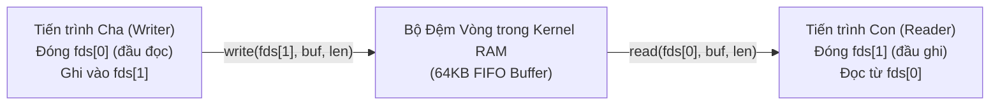

> [!IMPORTANT]
> **Quy tắc sống còn khi lập trình Pipe:** Gọi `pipe()` trước `fork()`, và ngay sau `fork()` **mỗi bên phải đóng ngay đầu fd mà mình không dùng**. Nếu tiến trình Con (Reader) quên gọi `close(fds[1])`, khi Cha đóng `fds[1]`, Con vẫn sẽ bị treo vĩnh viễn ở hàm `read()` vì Kernel thấy bộ đếm tham chiếu của đầu ghi vẫn $= 1$ (chính do Con đang giữ)!

### 2. Named Pipe / FIFO (Đường ống định danh)
- **Cơ chế hoạt động:** Được tạo bằng lệnh `mkfifo("/tmp/my_fifo", 0666)`. Về bản chất truyền dữ liệu trong RAM Kernel thì giống hệt Pipe, nhưng nó **có một node định danh trên File System** (loại file `p`).
- **Điểm khác biệt với Pipe:** Cho phép **bất kỳ các tiến trình độc lập nào** (không cần quan hệ cha–con) giao tiếp với nhau chỉ bằng cách gọi `open("/tmp/my_fifo", ...)`.
- **Hành vi Blocking Open:** Mặc định, tiến trình gọi `open(fifo, O_RDONLY)` sẽ bị **block ngay tại hàm `open()`** cho đến khi có một tiến trình khác gọi `open(fifo, O_WRONLY)` (trừ khi truyền cờ `O_NONBLOCK`).
- **Kỹ thuật Đóng khung thông điệp (Message Framing):** Vì Pipe và FIFO đều là **Byte Stream (luồng byte không có ranh giới gói tin)** — nếu bên gửi gọi `write()` 2 lần liên tiếp 10 byte và 20 byte, bên nhận gọi `read()` 1 lần có thể lấy gộp cả 30 byte. Do đó trên thực tế phải áp dụng 1 trong 3 cách:
  1. *Fixed-length struct:* Luôn gửi/nhận một `struct` có kích thước cố định.
  2. *Length-prefixed:* Gửi 4 byte Header ghi độ dài `len`, theo sau là đúng `len` byte Payload.
  3. *Delimiter-based:* Phân tách bằng ký tự kết thúc như `\n`.

| Đặc điểm | Ưu điểm của Pipe / FIFO | Nhược điểm | Trường hợp sử dụng |
| :--- | :--- | :--- | :--- |
| **Pipe & FIFO** | API cực kỳ đơn giản (`read`/`write`), Kernel tự đồng bộ blocking/EOF, hỗ trợ `select`/`poll`/`epoll` | Chỉ truyền 1 chiều, là Byte Stream nên không giữ ranh giới gói tin, không có độ ưu tiên tin nhắn, tốn 2 lần copy (User → Kernel → User) | **Pipe:** Nối luồng dữ liệu Cha–Con, Shell pipeline (`dmesg \| grep usb`).<br/>**FIFO:** Gửi luồng dữ liệu cảm biến/log một chiều từ Daemon thu thập sang tiến trình xử lý. |

---

## 4.3. Cơ Chế 3: Message Queue (Hàng Đợi Thông Điệp — System V & POSIX)

### Cơ chế hoạt động
Khác với Pipe (luồng byte vô định hình), **Message Queue** là một danh sách liên kết các **gói thông điệp (Messages)** được Kernel lưu trữ. Mỗi lần gọi gửi là 1 gói hoàn chỉnh; mỗi lần gọi nhận sẽ lấy ra đúng 1 gói nguyên vẹn (**bảo toàn ranh giới gói tin — Preserves Message Boundaries**).

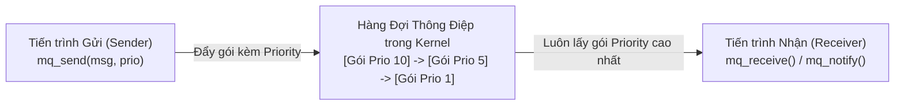

### Hai chuẩn lập trình: System V vs. POSIX Message Queue
1. **System V Message Queue (`<sys/msg.h>`):**
   - Định danh qua khóa số nguyên `key_t` (tạo từ `ftok()`) → mở bằng `msgget()`.
   - Mỗi gói tin bắt buộc là một struct có trường đầu tiên `long mtype > 0`.
   - Khi nhận bằng `msgrcv()`, tham số `msgtyp` cho phép **lọc theo loại gói tin** (`msgtyp == 0`: lấy gói đầu tiên; `msgtyp > 0`: lấy gói đúng loại `mtype`; `msgtyp < 0`: lấy gói có `mtype` nhỏ nhất $\le |msgtyp|$).
2. **POSIX Message Queue (`<mqueue.h>` — Chuẩn hiện đại khuyên dùng cho Embedded Linux):**
   - Định danh bằng tên giống file bắt đầu bởi `/` (ví dụ `/can_cmd_queue`), hiển thị trực quan trong **`/dev/mqueue`**.
   - Mỗi thông điệp có một **Độ ưu tiên thực sự (`unsigned int msg_prio`)**: Hàng đợi luôn tự động sắp xếp để hàm `mq_receive()` **lấy ra thông điệp có độ ưu tiên cao nhất trước** (ví dụ: lệnh phanh khẩn cấp `prio=100` sẽ vượt lên trước các gói cập nhật nhiệt độ `prio=10`).
   - Hỗ trợ **Timeout nguyên bản** (`mq_timedsend`, `mq_timedreceive`) giúp chống treo tiến trình.
   - Hỗ trợ **Thông báo bất đồng bộ (`mq_notify`)**: Tiến trình nhận không cần tốn 1 luồng đứng chờ mà đăng ký để Kernel tự bắn Signal hoặc tạo Thread callback ngay khi có tin nhắn mới rơi vào hàng đợi rỗng.

### Khung logic đặc trưng của POSIX Message Queue
```c
struct mq_attr attr = { .mq_flags = 0, .mq_maxmsg = 10, .mq_msgsize = 256 };
mqd_t mq = mq_open("/cmd_queue", O_CREAT | O_RDWR, 0666, &attr);

/* Sender: Gửi gói tin cảnh báo với độ ưu tiên cao (prio = 50) */
mq_send(mq, (const char *)&alert_pkt, sizeof(alert_pkt), 50);

/* Receiver: Luôn nhận được gói có prio cao nhất hiện có trong queue */
unsigned int prio;
mq_receive(mq, (char *)&recv_pkt, sizeof(recv_pkt), &prio);
```

| Đặc điểm | Ưu điểm của Message Queue | Nhược điểm | Trường hợp sử dụng |
| :--- | :--- | :--- | :--- |
| **Message Queue** | Giữ nguyên ranh giới từng gói tin; gửi/nhận bất đồng bộ; hỗ trợ **Độ ưu tiên (Priority)** và lọc theo loại (`mtype`); có `mq_timedreceive` chống treo | Vẫn tốn 2 lần copy qua Kernel; giới hạn kích thước mỗi tin nhắn và tổng số tin trong queue (`mq_maxmsg`, mặc định hệ thống thường là 10) | Truyền **lệnh điều khiển (Command), sự kiện trạng thái (Event/Alarm)** có phân cấp độ ưu tiên giữa các service trong hệ thống nhúng. |

---

## 4.4. Cơ Chế 4: Shared Memory (Bộ Nhớ Chia Sẻ — Cơ Chế IPC Nhanh Nhất)

### Tại sao Shared Memory là cơ chế IPC nhanh nhất?
Ở mọi cơ chế IPC khác (Pipe, FIFO, Message Queue, Socket), việc truyền 1 khung hình từ Tiến trình A sang Tiến trình B đòi hỏi **2 lần sao chép dữ liệu và 2 lần chuyển ngữ cảnh System Call**:
`RAM User A` $\xrightarrow{\text{copy 1 (write)}}$ `RAM Kernel Buffer` $\xrightarrow{\text{copy 2 (read)}}$ `RAM User B`.

Với **Shared Memory**, Kernel cấp phát một vùng **RAM vật lý chung** rồi cấu hình bảng phân trang (MMU Page Table) của cả Tiến trình A và Tiến trình B cùng ánh xạ địa chỉ ảo của chúng trỏ thẳng vào vùng RAM vật lý đó (`MAP_SHARED`).
- Ngay khi Tiến trình A ghi dữ liệu vào con trỏ bộ nhớ, Tiến trình B đọc được ngay lập tức (**Zero-Copy, không cần bất kỳ System Call nào trong lúc truyền dữ liệu!**).

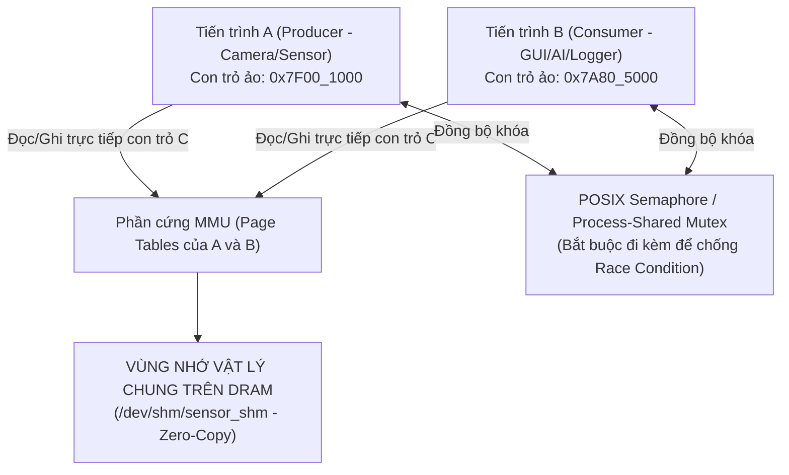

### System V vs. POSIX Shared Memory
- **System V (`shmget` → `shmat` → `shmdt` → `shmctl(IPC_RMID)`):** Quản lý bằng khóa `key_t`, kiểm tra và xóa thủ công qua lệnh `ipcs -m` / `ipcrm -m`.
- **POSIX (`shm_open` → `ftruncate` → `mmap(MAP_SHARED)` → `munmap` → `shm_unlink`):** Chuẩn hiện đại, tạo file ảo trực tiếp trong **`/dev/shm/`** (trên `tmpfs`), thống nhất hoàn toàn với cơ chế `mmap` của Linux.

### Nhược điểm chí mạng & Giải pháp đồng bộ
- **Shared Memory hoàn toàn KHÔNG có cơ chế đồng bộ nội tại:** Nếu Producer đang ghi dở nửa cấu trúc dữ liệu mà Consumer nhảy vào đọc sẽ gây **Data Corruption (Race Condition)**.
- **Giải pháp bắt buộc:** Luôn ghép cặp Shared Memory với một trong hai cơ chế đồng bộ:
  1. **POSIX Semaphore** (Named Semaphore `sem_open` hoặc Unnamed Semaphore `sem_init(&shm->sem, 1, 1)` đặt ngay bên trong struct của Shared Memory với cờ `pshared = 1`).
  2. **POSIX Mutex liên tiến trình** đặt trong Shared Memory (khởi tạo với thuộc tính `pthread_mutexattr_setpshared(&attr, PTHREAD_PROCESS_SHARED)` và cờ `PTHREAD_MUTEX_ROBUST` để tự phục hồi nếu một tiến trình giữ khóa bị crash).

### Khung logic đặc trưng: POSIX Shared Memory + Unnamed Semaphore
```c
struct shm_layout {
    sem_t sem;                  /* Semaphore đặt trực tiếp trong vùng nhớ chia sẻ */
    uint8_t frame_data[4096];
};

int fd = shm_open("/cam_shm", O_CREAT | O_RDWR, 0666);
ftruncate(fd, sizeof(struct shm_layout));
struct shm_layout *shm = mmap(NULL, sizeof(*shm), PROT_READ | PROT_WRITE, MAP_SHARED, fd, 0);
sem_init(&shm->sem, 1, 1);      /* pshared = 1: Cho phép đồng bộ giữa các Process khác nhau */

/* Khi truy cập dữ liệu từ bất kỳ tiến trình nào: */
sem_wait(&shm->sem);
memcpy(shm->frame_data, new_data, 4096);
sem_post(&shm->sem);
```

| Đặc điểm | Ưu điểm của Shared Memory | Nhược điểm | Trường hợp sử dụng |
| :--- | :--- | :--- | :--- |
| **Shared Memory** | **Tốc độ nhanh tuyệt đối (Zero-Copy)**, không tốn System Call khi truyền, dung lượng truyền cực lớn (hàng chục MB) | Không có đồng bộ hóa sẵn (bắt buộc tự quản lý Semaphore/Mutex), dễ rò rỉ bộ nhớ trên `/dev/shm` nếu tiến trình crash mà không `shm_unlink` | Chia sẻ **khung hình Video/Camera, buffer âm thanh, bảng cơ sở dữ liệu cảm biến thời gian thực** kích thước lớn giữa nhiều tiến trình. |

---

## 4.5. Cơ Chế 5: Semaphore (Đồng Bộ Hóa Liên Tiến Trình)

### Cơ chế hoạt động
**Semaphore** là một biến đếm nguyên tử không âm (`S >= 0`) nằm trong Kernel, hoạt động dựa trên 2 thao tác nguyên tử của Dijkstra:
- **`Wait / P / Decrement` (`sem_wait`):** Nếu `S > 0` thì giảm `S = S - 1` và đi tiếp ngay. Nếu `S == 0` thì tiến trình lập tức **ngủ chờ (Blocked)** cho đến khi `S > 0`.
- **`Post / V / Increment` (`sem_post`):** Tăng `S = S + 1`; nếu có tiến trình đang ngủ chờ thì Kernel đánh thức nó dậy.

**Phân loại theo chức năng:**
1. **Binary Semaphore (`S` khởi tạo bằng `1` hoặc `0`):** Khởi tạo `= 1` để làm khóa bảo vệ vùng dữ liệu dùng chung (Critical Section); khởi tạo `= 0` để làm cờ báo hiệu sự kiện (tiến trình A chờ ở `sem_wait` cho đến khi tiến trình B hoàn tất công việc rồi gọi `sem_post`).
2. **Counting Semaphore (`S` khởi tạo bằng `N`):** Quản lý một nhóm có `N` tài nguyên giống nhau (ví dụ: một Buffer Pool có 8 slot trống).

**So sánh System V vs. POSIX Semaphore:**
- **System V (`semget`, `semop`, `semctl`):** Quản lý theo cả một mảng tập hợp (Semaphore Set), API khá phức tạp nhưng có một tính năng cực kỳ giá trị là cờ **`SEM_UNDO`** — nếu một tiến trình đang giữ khóa semaphore mà bị crash đột ngột (`SIGKILL` / `SIGSEGV`), Kernel tự động hoàn tác (cộng trả lại giá trị semaphore) để **chống Deadlock toàn hệ thống**.
- **POSIX (`sem_open` cho Named Semaphore trên `/dev/shm/sem.*`, hoặc `sem_init` cho Unnamed Semaphore):** API cực kỳ gọn nhẹ, trực quan, hỗ trợ chờ có thời hạn `sem_timedwait()`.

---

## 4.6. Cơ Chế 6: Socket (Network Socket & Unix Domain Socket)

Socket là cơ chế IPC linh hoạt nhất, cung cấp giao tiếp **hai chiều (Full-Duplex)** thông qua một File Descriptor duy nhất và hỗ trợ mở rộng từ giao tiếp cục bộ trên cùng board sang giao tiếp qua mạng giữa nhiều ECU/máy tính.

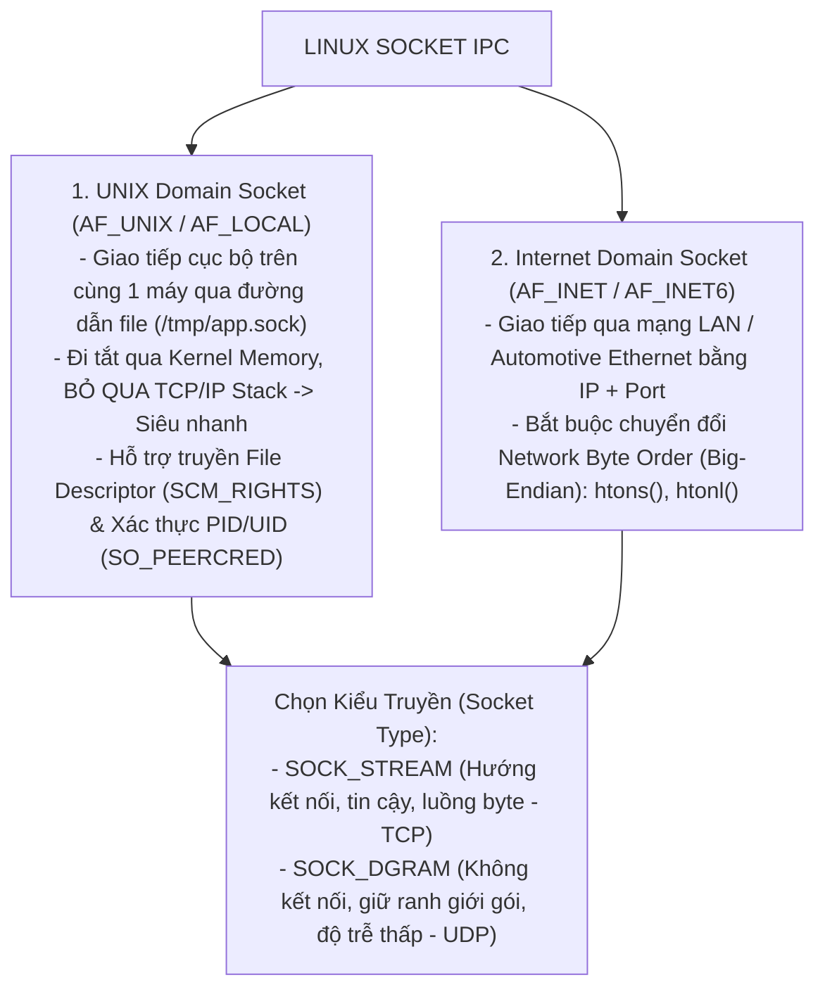

### Luồng hoạt động Client – Server (Stream Socket)
- **Server:** `socket()` → `setsockopt(SO_REUSEADDR)` → `bind()` → `listen()` → `accept()` (tạo ra `client_fd` riêng cho từng kết nối) → `recv()`/`send()` → `close()`.
- **Client:** `socket()` → `connect()` → `send()`/`recv()` → `close()`.
- *(Lưu ý với `AF_UNIX`: Trước khi gọi `bind("/tmp/app.sock")`, Server bắt buộc phải gọi `unlink("/tmp/app.sock")` để xóa file socket cũ còn sót lại, tránh lỗi `EADDRINUSE`).*

### Hai siêu năng lực độc quyền của Unix Domain Socket (`AF_UNIX`) trên Embedded Linux
1. **Truyền File Descriptor giữa các tiến trình độc lập (`SCM_RIGHTS`):** Tiến trình A (ví dụ Camera Daemon) mở `/dev/video0` và xuất frame thành một **`dmabuf_fd`**, sau đó gửi trực tiếp `dmabuf_fd` này qua Unix Domain Socket sang Tiến trình B (Wayland Compositor / GStreamer App). Tiến trình B nhận được một `fd` hợp lệ trỏ thẳng tới cùng vùng nhớ DMA vật lý mà không cần copy một byte hình ảnh nào!
2. **Xác thực danh tính tiến trình ngang hàng (`SO_PEERCRED`):** Server có thể gọi `getsockopt(client_fd, SOL_SOCKET, SO_PEERCRED, &cred, &len)` để Kernel cung cấp chính xác `PID`, `UID`, `GID` của tiến trình Client nhằm kiểm tra phân quyền bảo mật.

---

## 4.7. Cơ Chế 7: Signal (Ngắt Phần Mềm Bất Đồng Bộ)

### Cơ chế hoạt động & Vòng đời
**Signal** là một **ngắt phần mềm (Software Interrupt)** do Kernel gửi tới một tiến trình để báo hiệu một sự kiện bất đồng bộ (lỗi phần cứng `SIGSEGV`/`SIGFPE`, người dùng nhấn `Ctrl+C` `SIGINT`, tiến trình con kết thúc `SIGCHLD`, ghi vào pipe đứt `SIGPIPE`, hoặc từ lệnh `kill(pid, sig)`).

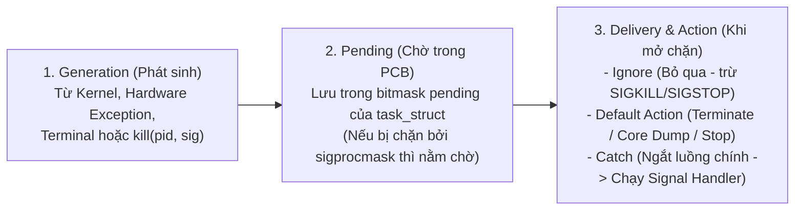

### Quy tắc an toàn cốt tử khi lập trình Signal
1. **Hai tín hiệu bất khả xâm phạm:** **`SIGKILL (9)`** và **`SIGSTOP (19)`** không bao giờ có thể bị bắt (catch), bị bỏ qua (`SIG_IGN`) hay bị chặn (`sigprocmask`).
2. **Luôn dùng `sigaction()` thay cho `signal()`:** `sigaction()` chuẩn hóa hành vi trên mọi hệ thống POSIX, tự động chặn chính signal đó trong khi handler đang chạy, cho phép tự động khởi động lại các system call bị ngắt (`SA_RESTART`) và đọc thông tin người gửi (`SA_SIGINFO` → `info->si_pid`).
3. **Quy tắc Async-Signal-Safety (Chống Deadlock trong Signal Handler):**
   - Signal có thể ngắt tiến trình ngay giữa lúc hàm `main()` đang giữ khóa nội bộ của `printf()` hoặc `malloc()`. Nếu bên trong Signal Handler lại gọi `printf()` hoặc `malloc()`, tiến trình sẽ **tự treo cứng (Deadlock)**!
   - **Giải pháp chuẩn:** Trong Signal Handler chỉ được gọi các hàm *Async-Signal-Safe* (như `write()`, `_exit()`) hoặc tốt nhất là **chỉ gán một biến cờ `volatile sig_atomic_t stop_flag = 1;`** rồi để vòng lặp chính xử lý.

---

## 4.8. Bảng Tổng Hợp So Sánh & Lựa Chọn 7 Cơ Chế IPC

| Cơ chế IPC | Tốc độ | Ranh giới gói tin | Quan hệ Process | Hướng truyền | Khi nào nên chọn trong dự án thực tế? |
| :--- | :---: | :---: | :--- | :---: | :--- |
| **Anonymous Pipe** | Trung bình | ❌ Không (Byte Stream) | Bắt buộc Cha–Con | 1 chiều | Truyền luồng dữ liệu nhanh gọn giữa tiến trình Cha và Con sau `fork()` |
| **Named Pipe (FIFO)** | Trung bình | ❌ Không (Byte Stream) | Mọi tiến trình | 1 chiều | Đẩy luồng dữ liệu tuần tự 1 chiều giữa 2 tiến trình độc lập |
| **Message Queue** | Nhanh | ✅ Có (Theo gói) | Mọi tiến trình | Đa chiều | Gửi **lệnh điều khiển, sự kiện** cần sắp xếp theo **Độ ưu tiên (Priority)** |
| **Shared Memory** | **Nhanh nhất (Zero-Copy)** | Tự định nghĩa | Mọi tiến trình | Đa chiều | Chia sẻ **dữ liệu lớn (Camera Frame, Audio, Sensor Map)** tần suất cao |
| **Semaphore** | Rất nhanh | N/A (Chỉ là biến đếm) | Mọi tiến trình | Đồng bộ | Làm khóa bảo vệ cho **Shared Memory** hoặc giới hạn số lượng tài nguyên |
| **Unix Domain Socket** | Rất nhanh | Cả Stream & Datagram | Mọi tiến trình | **2 chiều (Full-duplex)** | Mô hình **Client–Server cục bộ** nhiều kết nối, hoặc cần **truyền File Descriptor (`dmabuf_fd`)** |
| **Network Socket (TCP/UDP)** | Phụ thuộc mạng | TCP: Stream<br/>UDP: Gói tin | Cùng máy hoặc **Qua mạng** | **2 chiều (Full-duplex)** | Giao tiếp giữa các board/ECU qua Ethernet, kết nối Cloud hoặc công cụ Debug trên PC |
| **Signal** | Cực nhanh | Chỉ mang mã số hiệu | Mọi tiến trình | 1 chiều | Báo hiệu sự kiện khẩn cấp, tắt ứng dụng an toàn (`SIGTERM`), nạp lại cấu hình (`SIGHUP`), thu dọn con (`SIGCHLD`) |

---

## 4.9. 🎯 Câu Hỏi Phỏng Vấn Thực Tế: IPC

> **Câu 1: Tại sao trong Signal Handler tuyệt đối không được gọi `printf()` hay `malloc()`? Nếu muốn truyền sự kiện từ Signal Handler vào vòng lặp `select()`/`epoll()` của chương trình chính thì làm thế nào?**
> - **Trả lời:** `printf()` và `malloc()` sử dụng các khóa `mutex` nội bộ của `glibc` để bảo vệ bộ đệm stdout và vùng nhớ Heap. Nếu luồng chính đang ở giữa hàm `malloc()` (đang giữ khóa) mà bị Signal ngắt, rồi Signal Handler lại gọi `malloc()` hoặc `printf()`, luồng sẽ chờ chính khóa mà nó đang giữ → **Deadlock vĩnh viễn**.
> - **Kỹ thuật Self-Pipe Trick (hoặc `signalfd`):** Tạo một Pipe (hoặc `eventfd`). Trong Signal Handler chỉ gọi hàm an toàn `write(pipe_fd[1], "x", 1)`. Còn vòng lặp chính của ứng dụng dùng `epoll()`/`select()` theo dõi `pipe_fd[0]` cùng với các socket khác để xử lý signal một cách đồng bộ và an toàn 100%.

> **Câu 2: Nếu một tiến trình đang giữ khóa đồng bộ của Shared Memory mà bị crash (`SIGKILL` / `SIGSEGV`), làm sao để các tiến trình khác không bị Deadlock?**
> - **Trả lời:** Có 2 giải pháp công nghiệp:
>   1. Nếu dùng **System V Semaphore**, bật cờ **`SEM_UNDO`** trong cấu trúc `sembuf` khi gọi `semop()`. Kernel sẽ tự động hoàn trả giá trị semaphore khi tiến trình giữ nó bị chấm dứt.
>   2. Nếu dùng **POSIX Mutex đặt trong Shared Memory**, cấu hình thuộc tính **`PTHREAD_MUTEX_ROBUST`** (`pthread_mutexattr_setrobust`). Khi tiến trình giữ khóa bị chết, tiến trình tiếp theo gọi `pthread_mutex_lock()` sẽ không bị treo mà nhận về mã trả về đặc biệt **`EOWNERDEAD`**, cho phép nó khôi phục lại trạng thái dữ liệu hợp lệ rồi gọi `pthread_mutex_consistent()` để tiếp tục vận hành.

> **Câu 3: Khi nào bạn chọn Unix Domain Socket (`AF_UNIX`) thay vì POSIX Message Queue hoặc FIFO?**
> - **Trả lời:** Chọn **Unix Domain Socket** khi: (1) Cần mô hình **Client–Server nhiều kết nối đồng thời**, nơi mỗi Client có một kênh giao tiếp **2 chiều (Full-duplex)** riêng biệt sau lệnh `accept()` (với FIFO hay Message Queue, nhiều client cùng đọc/ghi trên 1 kênh sẽ bị trộn lẫn gói trả lời); (2) Cần **truyền File Descriptor (`SCM_RIGHTS`)** như chia sẻ `dmabuf_fd` của camera/GPU giữa các tiến trình; hoặc (3) Cần xác thực bảo mật `PID/UID` của client qua `SO_PEERCRED`.

---

# Phần 5: U-Boot & Chuỗi Khởi Động (Boot Process)

## 5.1. Tại Sao Cần Chuỗi Khởi Động Đa Tầng (Multi-Stage Bootloader)?

Khi vừa cấp nguồn (Power-On Reset), nhân CPU của một SoC nhúng (như NXP i.MX8, TI AM335x/AM62x, Renesas R-Car, Telechips TCC8030) **không thể chạy trực tiếp Linux Kernel** vì 3 lý do phần cứng:
1. **DRAM ngoài chưa hoạt động:** Linux Kernel nặng hàng chục MB cần nằm trong DRAM, nhưng tại thời điểm mới cấp nguồn, bộ điều khiển DDR (DRAM Controller) chưa được cấu hình tần số, timing, điện áp nên DRAM hoàn toàn chưa truy cập được. Chỉ có một vùng nhớ tĩnh siêu nhỏ bên trong chip là **Internal SRAM (OCRAM: 64KB – 256KB)** là sẵn sàng hoạt động.
2. **CPU chưa biết đọc Kernel từ đâu:** Kernel nằm trên eMMC, SD Card, QSPI NOR Flash hay mạng TFTP đều đòi hỏi phải có driver khởi tạo ngoại vi lưu trữ đó.
3. **Môi trường thực thi chưa sẵn sàng:** Cây xung nhịp (Clock/PLL), Pin Muxing, Power Domain và chế độ bảo mật (ARM TrustZone EL3) chưa được thiết lập.

Vì vậy, quá trình khởi động bắt buộc phải chia thành **4 giai đoạn nối tiếp nhau**, giai đoạn trước mồi cho giai đoạn sau:

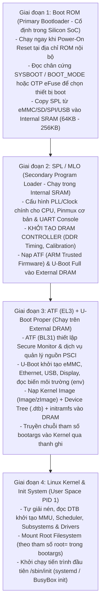

---

## 5.2. Kiến Trúc U-Boot, Biến Môi Trường & FIT Image

### 1. Vai trò cốt lõi của U-Boot Proper (Full Bootloader)
Sau khi chạy trên DRAM rộng rãi, U-Boot thực hiện cơ chế **Self-Relocation** (tự dời chính nó lên vùng địa chỉ đỉnh cao của DRAM) để nhường toàn bộ vùng địa chỉ thấp cho việc nạp Linux Kernel.
- **Biến môi trường trọng yếu (`U-Boot Environment`):**
  - `bootcmd`: Chuỗi lệnh tự động chạy khi hết thời gian đếm ngược `bootdelay` (ví dụ: đọc `Image` và `.dtb` từ phân vùng FAT/ext4 của eMMC vào RAM rồi gọi `booti`).
  - `bootargs`: Chuỗi tham số dòng lệnh truyền thẳng sang Linux Kernel (ví dụ: `console=ttyLP0,115200 root=/dev/mmcblk0p2 rootwait rw earlycon`).
- **Quy ước truyền tham số từ U-Boot sang Linux Kernel:**
  - Trên **ARM32**: Thanh ghi `r0 = 0`, `r1 = Machine ID`, `r2 = Địa chỉ vật lý của DTB trong RAM` (lệnh `bootz` hoặc `bootm`).
  - Trên **ARM64 (AArch64)**: Thanh ghi `x0 = Địa chỉ vật lý của DTB trong RAM`, `x1 = x2 = x3 = 0` (lệnh `booti <kernel_addr> <initrd_addr> <dtb_addr>`).

### 2. Secure Boot & FIT Image (`Flattened Image Tree`)
Trong các sản phẩm thương mại và Automotive, thay vì nạp rời rạc 3 file (`Image`, `.dtb`, `initramfs`), U-Boot sử dụng định dạng **FIT Image (`.itb`)** — đóng gói tất cả vào một tệp duy nhất theo cú pháp giống Device Tree, kèm theo **mã băm (SHA256) và chữ ký số (RSA-2048/4096 hoặc ECDSA)**:

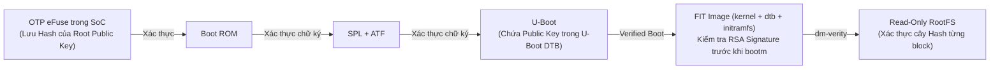

### 3. Cơ chế A/B Partition OTA Rollback trên U-Boot
U-Boot phối hợp với hệ thống cập nhật OTA (như SWUpdate, RAUC, Mender) thông qua các biến môi trường lưu trong Flash (`boot_slot`, `upgrade_available`, `boot_count`, `boot_limit=3`). Mỗi lần thử boot vào phân vùng mới, U-Boot tăng `boot_count`. Nếu Kernel bị Panic hoặc ứng dụng không khởi động được để xóa cờ `upgrade_available`, sau 3 lần Watchdog reset, U-Boot tự động **Rollback** về phân vùng cũ đang hoạt động tốt.

---

## 5.3. 🎯 Câu Hỏi Phỏng Vấn Thực Tế: U-Boot & Boot Process

> **Câu 1: Tại sao SoC Embedded Linux phải chia Bootloader thành 2 phần là SPL (Secondary Program Loader) và U-Boot Full mà không nạp thẳng U-Boot ngay từ đầu?**
> - **Trả lời:** Vì U-Boot Full có kích thước lớn (~500KB – 1MB), trong khi lúc mới bật nguồn **DRAM ngoài chưa được khởi tạo**. Boot ROM bên trong SoC chỉ có thể nạp code vào **Internal SRAM (OCRAM)** có dung lượng rất nhỏ (thường chỉ 64KB – 256KB). Do đó, phải có **SPL** (bản rút gọn tối đa của U-Boot, chỉ nặng vài chục KB vừa khít SRAM) chạy trước để cấu hình DDR Controller đánh thức DRAM ngoài, sau đó SPL mới đọc U-Boot Full nạp vào DRAM.

> **Câu 2: Khi board dừng lại ở dòng chữ `"Starting kernel ..."` trên Serial Console mà không in thêm bất kỳ dòng nào nữa, nguyên nhân là gì và bạn debug như thế nào?**
> - **Trả lời:** Dòng `"Starting kernel ..."` là thông điệp cuối cùng của U-Boot ngay trước khi nhảy vào điểm nhập của Kernel. Treo tại đây thường do 4 nguyên nhân:
>   1. **Thiếu hoặc sai `console=` trong `bootargs`:** Kernel thực ra vẫn đang chạy nhưng in log ra cổng UART khác hoặc chưa tới giai đoạn khởi tạo driver UART chuẩn. **Cách debug:** Thêm `earlycon` (hoặc `earlyprintk`) vào `bootargs` để Kernel dùng thẳng thanh ghi UART mà U-Boot đã mở nhằm in log ngay từ dòng code đầu tiên.
>   2. **Sai Device Tree (`.dtb`):** DTB khai báo sai dung lượng/địa chỉ RAM hoặc sai xung clock làm Kernel crash ngay khi bật MMU.
>   3. **Đè bộ nhớ (Address Overlap):** Địa chỉ nạp Kernel (`kernel_addr_r`) và địa chỉ nạp DTB (`fdt_addr_r`) quá gần nhau; khi Kernel tự giải nén bị ghi đè làm hỏng cấu trúc DTB.
>   4. **Bật sai kiến trúc/endianness hoặc quên tắt Cache/MMU trước khi nhảy** (U-Boot chuẩn tự động tắt D-Cache và MMU trước khi gọi Kernel).

> **Câu 3: Khi nào hệ thống bắt buộc phải dùng `initramfs` (Initial RAM Filesystem) thay vì mount thẳng RootFS từ eMMC/SD?**
> - **Trả lời:** Dùng `initramfs` khi Kernel cần thực hiện các bước chuẩn bị ở User Space **trước khi** có thể mount được RootFS thật, ví dụ: (1) RootFS được **mã hóa (`dm-crypt` / LUKS)** hoặc bảo vệ toàn vẹn bằng **`dm-verity`** cần script mở khóa; (2) Driver của ổ cứng/RAID/Network (NFS) chứa RootFS quá lớn, được build dưới dạng module `.ko` nằm trong `initramfs`; hoặc (3) Hệ thống cần một môi trường **Recovery / Factory Reset / OTA Update** tối giản chạy hoàn toàn trên RAM.

---

# Phần 6: Yocto Project (Hệ Thống Xây Dựng Custom Linux Distro)

## 6.1. Kiến Trúc Tổng Thể của Yocto Project & BitBake

**Yocto Project** là bộ khung công nghiệp tiêu chuẩn dùng để **xây dựng một bản phân phối Linux hoàn chỉnh từ mã nguồn (Custom Embedded Linux Distribution)** — sinh ra đồng bộ cả **Cross-Toolchain, Bootloader (U-Boot), Linux Kernel, Device Tree, Root Filesystem** và **SDK** cho đội phát triển ứng dụng.

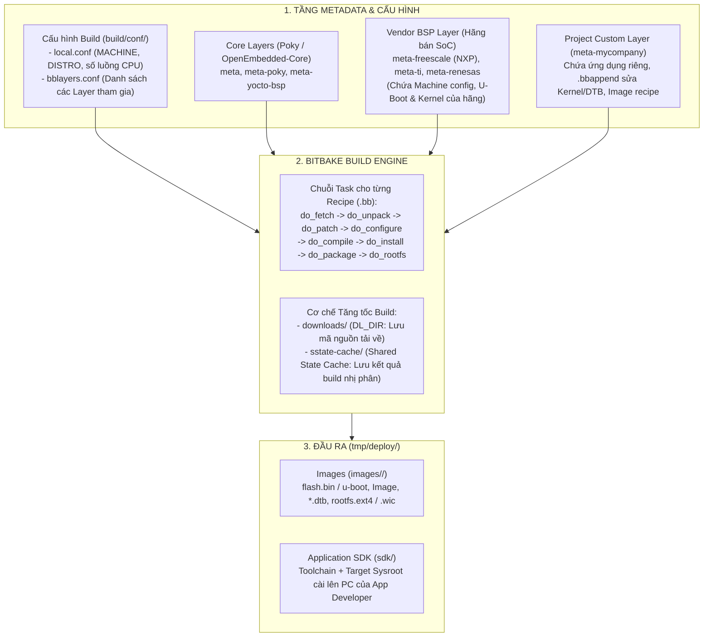

---

## 6.2. Các Khái Niệm Cốt Lõi: Layer, Recipe (`.bb`), Append (`.bbappend`) & Class

1. **Kiến trúc Phân lớp (Layers — `meta-*`):**
   - Mỗi Layer có một độ ưu tiên (`BBFILE_PRIORITY`). Nguyên tắc vàng trong Yocto là **tuyệt đối không bao giờ sửa trực tiếp file trong Layer của Poky hay của hãng SoC (BSP)**. Mọi tùy chỉnh của dự án phải đặt trong một layer riêng (ví dụ `meta-custom`) để dễ dàng nâng cấp BSP hoặc tái sử dụng.
2. **Recipe (`.bb`):** Là bản thiết kế hướng dẫn BitBake cách lấy mã nguồn (`SRC_URI`), các thư viện phụ thuộc lúc biên dịch (`DEPENDS`), các gói phụ thuộc lúc chạy trên board (`RDEPENDS:${PN}`), và quy trình biên dịch/cài đặt.
3. **Append File (`.bbappend`):** Dùng để **vá thêm patch, thay đổi file cấu hình `.config` hoặc thêm file Device Tree `.dts` mới** vào một Recipe có sẵn ở Layer khác (ví dụ tạo `linux-imx_%.bbappend` trong `meta-custom` để thêm bản vá driver cho Kernel của NXP).
4. **Class (`.bbclass`):** Chứa logic build dùng chung được kế thừa qua từ khóa `inherit` (ví dụ: `inherit cmake`, `inherit autotools`, `inherit systemd`, `inherit module` khi viết recipe cho Out-of-tree Kernel Module).

### Khung logic đặc trưng của một Recipe (`.bb`) chuẩn
```bitbake
SUMMARY = "Automotive CAN & Camera Service"
LICENSE = "CLOSED"

SRC_URI = "git://git.mycompany.com/can-service.git;protocol=https;branch=main \
           file://0001-fix-can-timeout.patch \
           file://can-service.service"
SRCREV = "a1b2c3d4e5f6..."               # Commit hash cố định để đảm bảo build lặp lại (Reproducible)
S = "${WORKDIR}/git"

DEPENDS = "gstreamer1.0 libgpiod"        # Phụ thuộc lúc biên dịch (Header & thư viện liên kết)
RDEPENDS:${PN} = "can-utils bash"        # Phụ thuộc lúc chạy trên Target RootFS

inherit cmake systemd                    # Tự động sinh do_configure & do_compile bằng CMake
SYSTEMD_SERVICE:${PN} = "can-service.service"
```

---

## 6.3. So Sánh Yocto Project vs. Buildroot

| Tiêu chí | Yocto Project | Buildroot |
| :--- | :--- | :--- |
| **Triết lý thiết kế** | Xây dựng một **Bản phân phối (Distro)** hoàn chỉnh dựa trên **Quản lý gói (`.ipk`/`.rpm`/`.deb`)** và hệ thống Layer | Xây dựng trực tiếp một **RootFS Image** tinh gọn dựa trên **`Makefile` & `Kconfig` (`make menuconfig`)** |
| **Tính mở rộng & Bảo trì** | **Rất cao:** Tách biệt rõ BSP, Middleware và App bằng các Layer + `.bbappend`; cực dễ quản lý nhiều biến thể board | Trung bình: Mọi thứ chung trong một cây cấu hình (hoặc `BR2_EXTERNAL`), khó quản lý nếu có hàng chục biến thể sản phẩm |
| **Thời gian Build & Độ khó** | Học khó; build lần đầu lâu (1–3 giờ) nhưng các lần sau cực nhanh nhờ **`sstate-cache`** | Học rất nhanh; cấu hình đơn giản như Linux Kernel; build từ đầu nhanh (15–30 phút) |
| **Khi nào chọn?** | Dự án công nghiệp lớn, Automotive (IVI, Digital Cluster, ADAS), cần cung cấp SDK chuẩn và duy trì vòng đời 5–10 năm | Thiết bị nhúng nhỏ gọn, RAM/Flash hạn chế, làm Prototype/PoC nhanh hoặc sản phẩm đơn nhiệm |

---

## 6.4. 🎯 Câu Hỏi Phỏng Vấn Thực Tế: Yocto Project

> **Câu 1: Sự khác biệt giữa `DEPENDS` và `RDEPENDS` trong một Yocto Recipe là gì? Nếu khai báo thiếu một trong hai sẽ gây ra lỗi ở giai đoạn nào?**
> - **Trả lời:**
>   - **`DEPENDS` (Build-time Dependencies):** Các thư viện/công cụ phải được BitBake biên dịch và đặt vào `recipe-sysroot` **trước khi** chạy `do_configure`/`do_compile` của recipe hiện tại (ví dụ cần file header `.h` và `.so` để trình biên dịch link). Nếu thiếu `DEPENDS` → **lỗi ngay lúc Compile/Link (`fatal error: xxx.h: No such file or directory`)**.
>   - **`RDEPENDS:${PN}` (Run-time Dependencies):** Các gói phần mềm, script, plugin hoặc file cấu hình phải được cài đặt cùng vào **RootFS của board đích** ở bước `do_rootfs` để chương trình chạy được trên board (ví dụ ứng dụng dùng GStreamer cần plugin `gstreamer1.0-plugins-good` lúc chạy). Nếu thiếu `RDEPENDS` → build vẫn thành công nhưng **lỗi khi chạy thực tế trên board**.

> **Câu 2: Làm thế nào để thêm một bản vá (patch) hoặc một file Device Tree `.dts` mới cho Linux Kernel trong Yocto mà không sửa trực tiếp vào BSP Layer của hãng?**
> - **Trả lời:** Trong layer riêng của dự án (`meta-custom/recipes-kernel/linux/`), tạo một file **`<tên-kernel-recipe>_%.bbappend`** (ví dụ `linux-imx_%.bbappend`) cùng thư mục con chứa file `.patch` hoặc `.dts`:
>   1. Khai báo `FILESEXTRAPATHS:prepend := "${THISDIR}/files:"`.
>   2. Thêm `SRC_URI += "file://0001-add-custom-board-dts.patch file://enable-can.cfg"` (trong đó `.cfg` là **Kernel Configuration Fragment** chỉ chứa vài dòng `CONFIG_CAN=y` cần bật thêm mà không cần ghi đè cả file `defconfig`).
>   3. Nếu có file `.dts` mới cho board, bổ sung `KERNEL_DEVICETREE:append = " freescale/imx8mm-myboard.dtb"` trong cấu hình Machine hoặc `.bbappend`.

> **Câu 3: Khi đang phát triển và sửa code liên tục cho một package hoặc Kernel trong Yocto, công cụ nào giúp bạn sửa code, test biên dịch nhanh và tự động xuất ra file `.patch` mà không phải sửa trong thư mục `tmp/work/`?**
> - **Trả lời:** Sử dụng công cụ **`devtool`** chuẩn của Yocto:
>   - `devtool modify <recipe-name>`: Trích xuất mã nguồn của recipe ra một thư mục `workspace/sources/<recipe-name>` được quản lý bằng Git.
>   - Sửa code trực tiếp tại đó, chạy `devtool build <recipe-name>` để biên dịch thử và `devtool deploy-target <recipe-name> root@<board-ip>` để đẩy thẳng binary qua SSH lên board test trong vài giây.
>   - Sau khi test xong, chỉ cần `git commit` thay đổi và gõ `devtool finish <recipe-name> <meta-custom-layer>` — Yocto sẽ tự động xuất commit đó thành file `.patch` và cập nhật luôn file `.bb` / `.bbappend` trong layer của bạn!

---

# Phần 7: Character Device Driver (Lập Trình Driver Ký Tự)

## 7.1. Kiến Trúc Character Device Driver trong Linux Kernel

Trong 3 nhóm thiết bị của Linux (**Character Device, Block Device, Network Device**), **Character Device** là loại phổ biến nhất trong thế giới nhúng (chiếm hơn 80% các ngoại vi: GPIO, UART, I2C, SPI, Sensor, V4L2 Camera, ALSA Audio, Watchdog). Nó cho phép User Space giao tiếp trực tiếp với phần cứng thông qua một **device node trong `/dev/*`** mà không đi qua bộ đệm khối (Block Page Cache).

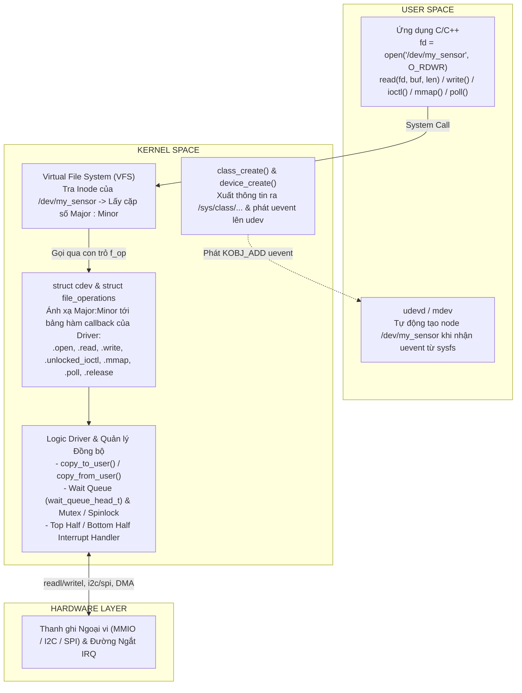

---

## 7.2. Các Thành Phần Cốt Lõi Khi Viết Character Device Driver

### 1. Cặp số Định danh Thiết bị: `dev_t` (Major & Minor Number)
- **Major Number (12 bit):** Định danh **Driver nào** quản lý thiết bị này.
- **Minor Number (20 bit):** Định danh **thiết bị vật lý thứ mấy** do cùng một Driver đó điều khiển (ví dụ `/dev/ttyS0` và `/dev/ttyS1` có cùng Major của UART driver nhưng có Minor lần lượt là `0` và `1`).
- **Best Practice:** Không bao giờ gán cứng số Major (*Static allocation*), mà luôn dùng **`alloc_chrdev_region(&dev_num, 0, count, "my_dev")`** để Kernel tự cấp phát động một số Major còn trống.

### 2. Năm Bước Chuẩn Đăng Ký Một Character Device Driver
1. **Xin cấp phát số `dev_t` (Major/Minor):** `alloc_chrdev_region()`.
2. **Khởi tạo & Đăng ký cấu trúc `struct cdev`:** Gắn bảng hàm `file_operations` vào `cdev` qua `cdev_init()` và đăng ký với VFS bằng `cdev_add()`.
3. **Tạo Class trong `/sys/class/`:** `class_create()`.
4. **Tạo Device Node tự động trong `/dev/`:** `device_create()` (kích hoạt `udev` tự tạo file `/dev/my_dev` mà không cần người dùng gõ lệnh `mknod` thủ công).
   *(Mẹo tinh gọn: Nếu driver chỉ cần đúng 1 Minor number, có thể dùng **`struct miscdevice` (`misc_register`)** — nó dùng chung số Major `10` và tự động gom gọn cả 4 bước trên chỉ trong 1 hàm duy nhất!)*
5. **Hiện thực các hàm callback trong `struct file_operations`**.

### Khung logic đặc trưng của một Character Driver hiện đại
```c
struct my_drv_data {
    struct cdev cdev;
    struct mutex lock;              /* Bảo vệ truy cập đồng thời từ nhiều tiến trình */
    wait_queue_head_t read_wq;      /* Hàng đợi cho tiến trình ngủ chờ khi chưa có dữ liệu */
    uint8_t kbuf[256];
    bool data_ready;
};

static int my_open(struct inode *inode, struct file *filp) {
    /* Dùng macro container_of lấy lại struct dữ liệu riêng từ con trỏ cdev trong inode */
    struct my_drv_data *priv = container_of(inode->i_cdev, struct my_drv_data, cdev);
    filp->private_data = priv;      /* Lưu vào private_data để dùng ở read/write/ioctl */
    return 0;
}

static ssize_t my_read(struct file *filp, char __user *ubuf, size_t len, loff_t *off) {
    struct my_drv_data *priv = filp->private_data;
    /* Ngủ chờ đến khi Interrupt báo data_ready == true (hỗ trợ Ctrl+C thoát chờ) */
    if (wait_event_interruptible(priv->read_wq, priv->data_ready))
        return -ERESTARTSYS;

    mutex_lock(&priv->lock);
    len = min(len, sizeof(priv->kbuf));
    if (copy_to_user(ubuf, priv->kbuf, len)) { /* BẮT BUỘC dùng copy_to_user */
        mutex_unlock(&priv->lock);
        return -EFAULT;
    }
    priv->data_ready = false;
    mutex_unlock(&priv->lock);
    return len;
}
```

---

## 7.3. Các Cơ Chế Nâng Cao: `ioctl`, `poll/select`, `mmap` & `container_of`

1. **`unlocked_ioctl` (Lệnh điều khiển ngoại vi):**
   - `read()` và `write()` chỉ dùng để truyền luồng dữ liệu. Khi cần cấu hình thông số phần cứng (đặt tốc độ baudrate, xóa bộ đệm, cài ngưỡng cảm biến), ta dùng `ioctl()`.
   - Để tránh trùng mã lệnh giữa các driver trong hệ thống, mã lệnh `ioctl` phải được tạo bằng bộ macro chuẩn của Linux: `_IO(magic, nr)`, `_IOR(magic, nr, type)` (User đọc từ Kernel), `_IOW(magic, nr, type)` (User ghi xuống Kernel), `_IOWR(magic, nr, type)`.
2. **`poll()` / `select()` / `epoll()` & Wait Queue:**
   - Để ứng dụng User Space có thể theo dõi cùng lúc nhiều thiết bị (`/dev/my_sensor`, SocketCAN, Pipe) mà không bị block cứng, driver cài đặt hàm `.poll` gọi **`poll_wait(filp, &priv->read_wq, wait)`**. Khi phần cứng có ngắt dữ liệu mới và gọi `wake_up_interruptible(&priv->read_wq)`, hàm `epoll_wait()` trên User Space sẽ lập tức thức dậy.
3. **`mmap()` (Ánh xạ bộ nhớ Zero-Copy):**
   - Cho phép ánh xạ trực tiếp vùng nhớ Kernel hoặc vùng nhớ DMA vật lý (`remap_pfn_range` / `dma_mmap_coherent`) lên không gian địa chỉ ảo của User Space — nền tảng cốt lõi của **V4L2 Camera Buffer** và **Framebuffer**.
4. **Macro huyền thoại `container_of(ptr, type, member)`:**
   - Là kỹ thuật lập trình hướng đối tượng bằng ngôn ngữ C trong Linux Kernel: từ địa chỉ con trỏ của một trường thành phần (`ptr`, ví dụ `inode->i_cdev`), trừ đi độ lệch byte (`offsetof(type, member)`) để tìm ra địa chỉ của cấu trúc cha (`struct my_drv_data`) chứa toàn bộ dữ liệu riêng của thiết bị đó.

---

## 7.4. 🎯 Câu Hỏi Phỏng Vấn Thực Tế: Character Device Driver

> **Câu 1: Tại sao trong hàm `.read` / `.write` của Driver bắt buộc phải dùng `copy_to_user()` và `copy_from_user()` mà không được dùng `memcpy()`?**
> - **Trả lời:** Có 3 lý do sống còn:
>   1. **Chống lỗi Page Fault làm sập Kernel:** Vùng nhớ mà con trỏ User truyền xuống có thể chưa được cấp phát RAM vật lý thực sự (Demand Paging) hoặc đã bị swap ra ngoài. `copy_to_user()` có cơ chế **Exception Table Fixup** để bắt Page Fault an toàn, nạp lại trang nhớ hoặc trả về lỗi `-EFAULT` thay vì gây **Kernel Oops/Panic**.
>   2. **Chống lỗ hổng bảo mật (Privilege Escalation):** Nếu một ứng dụng độc hại cố tình truyền một địa chỉ thuộc vùng nhớ **Kernel Space** vào hàm `read()`, `copy_to_user()` (nhờ kiểm tra `access_ok()`) sẽ chặn lại, không cho phép ứng dụng ghi đè lên bộ nhớ của Kernel.
>   3. **Bảo vệ phần cứng kiến trúc ARM (PAN - Privileged Access Never):** Các CPU ARM hiện đại bật tính năng phần cứng **PAN**, cấm tuyệt đối việc CPU đang ở EL1 (Kernel) truy cập trực tiếp địa chỉ ảo của EL0 (User); nếu dùng `memcpy()` sẽ lập tức bị phần cứng sinh lỗi Permission Fault.

> **Câu 2: Khi nào trong Kernel Driver bạn dùng `Mutex` và khi nào bắt buộc phải dùng `Spinlock`?**
> - **Trả lời:**
>   - **Dùng `Mutex` (`struct mutex`):** Khi đang ở trong **Process Context** (như trong các hàm `open`, `read`, `write`, `ioctl`, `probe`, hoặc `Workqueue`) — tức là nơi **được phép ngủ (sleep)**, hoặc khi thời gian giữ khóa lâu, hoặc bên trong vùng khóa có gọi các hàm có thể ngủ (`copy_to_user`, giao tiếp I2C/SPI, cấp phát `GFP_KERNEL`).
>   - **Bắt buộc dùng `Spinlock` (`spin_lock_irqsave`):** Khi đang ở trong **Interrupt Context (Top Half ISR, Softirq, Tasklet)** — nơi **tuyệt đối cấm ngủ**, hoặc khi chia sẻ dữ liệu giữa một hàm Process Context và một hàm Interrupt Handler (lúc này ở Process Context phải dùng `spin_lock_irqsave()` để vừa khóa Spinlock vừa tạm tắt ngắt trên core hiện tại nhằm chống Deadlock khi ngắt ập tới).

> **Câu 3: `devm_*` (như `devm_kzalloc`, `devm_gpiod_get`, `devm_request_irq`) là gì và tại sao mọi Driver hiện đại đều dùng nó?**
> - **Trả lời:** `devm_*` là bộ API **Device-Managed Resources** gắn liền với vòng đời của `struct device`. Trong hàm `probe()`, một driver thường phải xin cấp phát hàng loạt tài nguyên (RAM, GPIO, Clock, Regulator, IRQ). Nếu dùng các hàm truyền thống (`kzalloc`, `request_irq`), khi bước thứ 5 bị lỗi hoặc trong hàm `remove()`, lập trình viên phải viết một chuỗi nhãn `goto err_free_xxx` rất dài để giải phóng ngược từng tài nguyên — chỉ cần sót 1 dòng là gây **Memory/Resource Leak**. Với `devm_*`, Kernel tự động ghi nhận vào danh sách của thiết bị và **tự động giải phóng theo đúng thứ tự ngược lại** ngay khi hàm `probe()` trả về lỗi hoặc khi driver được gỡ bỏ (`remove()`).

---

# Phần 8: GPIO Subsystem (General Purpose Input/Output)

## 8.1. Kiến Trúc GPIO & Pinctrl Subsystem trong Linux

Trên một SoC nhúng (có hàng trăm chân vật lý), mỗi chân chip (Pin/Pad) không chỉ làm GPIO mà được **đa hợp (Multiplexing / Pinmux)** cho nhiều chức năng khác nhau (ví dụ: cùng một chân có thể cấu hình làm `UART1_TX`, `I2C2_SDA`, `PWM3`, hoặc `GPIO1_IO05`). Do đó, Linux tách bạch thành 2 subsystem phối hợp với nhau:
1. **Pinctrl Subsystem (Pin Control):** Quản lý việc chọn chức năng cho chân chip (**Pin Muxing**) và cấu hình đặc tính điện học của chân đó (**Pin Configuration**: điện trở kéo lên/kéo xuống *Pull-up/Pull-down*, cường độ dòng lái *Drive Strength*, tốc độ sườn xung *Slew Rate*, *Open-Drain*).
2. **GPIO Subsystem (`gpiolib`):** Khi chân đã được cấu hình làm GPIO, `gpiolib` quản lý hướng chân (**Input / Output**), mức logic (**Active High / Active Low**), khử dội phím (**Debounce**) và ánh xạ chân GPIO thành một nguồn ngắt (**GPIO-to-IRQ**).

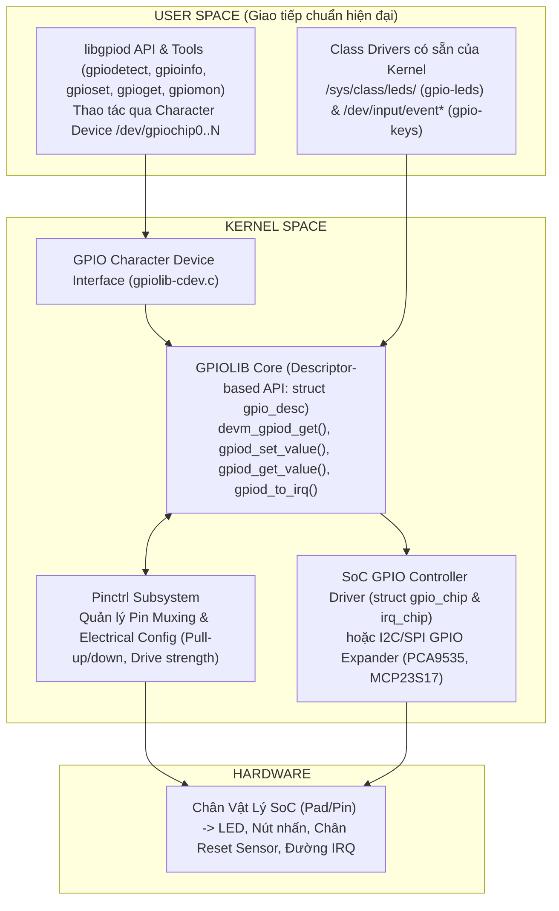

---

## 8.2. Ba Phương Pháp Điều Khiển GPIO & Sự Chuyển Dịch Kiến Trúc

### 1. Giao diện trong Kernel Space: Legacy Integer GPIO vs. Modern Descriptor (`gpiod_*`)
- **Legacy API (`<linux/gpio.h>` — Đã lỗi thời / Deprecated):** Dùng một số nguyên toàn cục (ví dụ `gpio_request(55, ...)`), lập trình viên phải tự tính công thức `(bank - 1) * 32 + pin` và phải tự nhớ chân đó là kích mức cao (`1`) hay kích mức thấp (`0`).
- **Modern Descriptor-based API (`<linux/gpio/consumer.h>` — Chuẩn bắt buộc hiện nay):**
  - Thao tác qua con trỏ trừu tượng **`struct gpio_desc *`** lấy trực tiếp từ thuộc tính Device Tree (ví dụ khai báo `reset-gpios = <&gpio1 5 GPIO_ACTIVE_LOW>;` trong DTB thì trong driver gọi `devm_gpiod_get(dev, "reset", GPIOD_OUT_LOW)`).
  - **Điểm ưu việt nhất:** `gpiod_set_value(desc, 1)` mang ý nghĩa là **"Kích hoạt (Assert / Bật) chức năng đó"**, bất kể mạch phần cứng thiết kế kích mức cao hay kích mức thấp! Nếu Device Tree khai báo `GPIO_ACTIVE_LOW`, khi gọi `gpiod_set_value(desc, 1)` (Bật Reset), Kernel sẽ tự động xuất mức điện áp **`0V` (Low)** ra chân vật lý. Nếu phần cứng đổi mạch ở phiên bản PCB sau, chỉ cần sửa cờ trong Device Tree, **không phải sửa một dòng code C nào trong Driver**.

### 2. Giao diện trên User Space: Tại sao `/sys/class/gpio` bị loại bỏ và thay bằng `libgpiod`?
- **Legacy Sysfs (`/sys/class/gpio/export` — Đã bị gỡ bỏ trên Kernel mới):**
  - Không gắn với tiến trình: Nếu một ứng dụng export `gpio55` rồi bị crash, chân GPIO vẫn bị giữ trạng thái lơ lửng không ai dọn dẹp.
  - Không thể đọc/ghi đồng thời nhiều chân GPIO cùng lúc; tốc độ chậm và không có cơ chế bắt sự kiện ngắt kèm nhãn thời gian (timestamp) chuẩn xác.
- **Modern Character Device (`/dev/gpiochipX` + `libgpiod`):**
  - Quản lý theo đúng chuẩn File Descriptor của Linux: Khi tiến trình đóng hoặc bị crash, Kernel tự động thu hồi và giải phóng chân GPIO.
  - Cho phép điều khiển nguyên tử (atomic) một nhóm nhiều chân GPIO cùng lúc, cấu hình Pull-up/Pull-down, Open-drain và lắng nghe sự kiện ngắt sườn lên/sườn xuống (`gpiomon`) với độ chính xác cao.

### 3. Tận dụng Driver có sẵn của Kernel (`gpio-leds` & `gpio-keys`)
> **Quy tắc thực chiến:** Nếu chân GPIO trên board chỉ dùng để điều khiển **Đèn LED** hoặc đọc **Nút nhấn**, kỹ sư Embedded Linux chuyên nghiệp **không bao giờ tự viết lại driver từ đầu**, mà chỉ cần khai báo node dùng sẵn driver chuẩn **`gpio-leds`** (hỗ trợ sẵn nháy theo nhịp heartbeat, timer, trigger) và **`gpio-keys`** (hỗ trợ sẵn chống dội phím phần mềm *debounce* và đẩy thẳng mã phím chuẩn lên Linux Input Subsystem `/dev/input/eventX`).

---

## 8.3. Ngắt GPIO (`gpiod_to_irq`) & Lưu Ý Context (`cansleep`)

- **Biến chân GPIO thành nguồn ngắt:** Thay vì dùng vòng lặp đọc trạng thái chân GPIO liên tục gây tốn CPU (*Polling*), ta chuyển descriptor của chân GPIO sang số hiệu ngắt Linux bằng hàm **`int irq = gpiod_to_irq(desc);`** rồi đăng ký hàm xử lý ngắt với `devm_request_threaded_irq()`.
- **Phân biệt `gpiod_set_value()` vs. `gpiod_set_value_cansleep()`:**
  - Nếu chân GPIO nằm trực tiếp trên SoC (Memory-mapped register), việc bật/tắt chỉ mất 1 lệnh ghi thanh ghi, không bao giờ ngủ → dùng được `gpiod_set_value()` ngay cả trong **Hard IRQ (Top Half)**.
  - Nếu chân GPIO nằm trên một chip **GPIO Expander nối qua bus I2C hoặc SPI** (như PCA9535), để đổi mức chân GPIO thì CPU phải truyền một khung tin I2C/SPI (quá trình này phải chờ bus nên **bắt buộc phải ngủ — sleep**). Với các chân này, bắt buộc chỉ được gọi **`gpiod_set_value_cansleep()`** bên trong **Process Context (Workqueue hoặc Threaded IRQ)**.

---

## 8.4. 🎯 Câu Hỏi Phỏng Vấn Thực Tế: GPIO Subsystem

> **Câu 1: Trong Device Tree khai báo `reset-gpios = <&gpio1 18 GPIO_ACTIVE_LOW>;`. Khi trong Driver gọi `gpiod_set_value(reset_gpio, 1);` thì điện áp đo được bằng đồng hồ ở chân vật lý số 18 là mức Cao (3.3V) hay mức Thấp (0V)?**
> - **Trả lời:** Điện áp đo được ở chân vật lý sẽ là **mức Thấp (0V)**. Vì API `gpiod_*` làm việc với **Mức Logic Chức Năng (Logical State: `1` = Active/Đang kích hoạt, `0` = Inactive/Ngừng kích hoạt)** chứ không phải mức điện áp vật lý. Do trong Device Tree chân này được đánh dấu là `GPIO_ACTIVE_LOW` (kích hoạt ở mức thấp), nên khi truyền `1` (Active), `gpiolib` tự động đảo mức điện áp xuất ra chân cứng thành `0V`.

> **Câu 2: Làm sao xử lý hiện tượng dội phím (Switch Bouncing) khi nối một nút nhấn cơ học vào chân ngắt GPIO trên Embedded Linux?**
> - **Trả lời:** Khi nhấn nút cơ học, tiếp điểm kim loại dao động đóng/ngắt hàng chục lần trong vài mili-giây đầu tiên, làm kích hoạt ngắt liên tục. Có 3 cách xử lý:
>   1. **Dùng driver chuẩn `gpio-keys` trong Device Tree:** Chỉ cần khai báo thuộc tính `debounce-interval = <20>;` (20ms), driver có sẵn của Linux sẽ tự xử lý toàn bộ.
>   2. **Nếu SoC GPIO Controller hỗ trợ Debounce phần cứng:** Gọi `gpiod_set_debounce(desc, 20000);` (tính bằng micro-giây).
>   3. **Nếu tự viết trong Driver riêng:** Khi ngắt GPIO (Top Half) xảy ra, tạm thời mask ngắt hoặc khởi động lại một **Kernel Timer (`struct timer_list`) / Delayed Workqueue (`schedule_delayed_work`)** trễ 20ms. Chỉ khi hết 20ms mà chân GPIO vẫn giữ nguyên trạng thái ổn định thì mới xác nhận sự kiện nhấn nút.

> **Câu 3: Tại sao giao diện `/sys/class/gpio` bị cộng đồng Linux Kernel loại bỏ (deprecated) và thay thế bằng `/dev/gpiochipX` (`libgpiod`)?**
> - **Trả lời:** Vì `/sys/class/gpio` vi phạm mô hình quản lý tài nguyên của Linux: (1) Trạng thái chân GPIO không gắn với vòng đời tiến trình (app crash không tự giải phóng chân); (2) Không có tính nguyên tử khi cần bật/tắt nhiều chân cùng lúc (phải mở và `echo` vào từng file rời rạc); (3) Tốn nhiều thao tác chuỗi ký tự chậm chạp và thiếu các tính năng điều khiển điện học hiện đại (open-drain, pull-up/down, đọc hàng loạt sự kiện ngắt kèm timestamp phần cứng) mà `/dev/gpiochipX` cung cấp qua `ioctl`.

---

# Phần 9: Device Tree (Mô Tả Phần Cứng Chuẩn Hóa)

## 9.1. Bản Chất & Kiến Trúc Biên Dịch Device Tree

**Device Tree** là một cấu trúc dữ liệu dạng cây mô tả toàn bộ **phần cứng không thể tự dò tìm (non-discoverable hardware)** trên board mạch (khác với USB hay PCIe có thể tự nhận diện thiết bị khi cắm vào, CPU không thể tự biết ở địa chỉ I2C `0x68` có gắn cảm biến gì hay chân GPIO nào nối với đèn LED nếu không được mô tả trước).

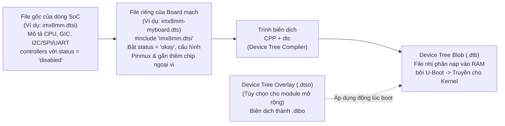

**Nguyên tắc kế thừa `.dtsi` và `.dts`:**
- **`.dtsi` (Device Tree Source Include):** Do hãng sản xuất chip (NXP, TI, ST) viết, khai báo tất cả các khối IP bên trong SoC. Hầu hết các ngoại vi (I2C, SPI, CAN, PWM) trong `.dtsi` đều được đặt mặc định là **`status = "disabled";`**.
- **`.dts` (Device Tree Source):** Do kỹ sư phát triển board viết cho sản phẩm thực tế. Nó `#include` file `.dtsi` rồi dùng cú pháp tham chiếu nhãn (`&i2c1 { status = "okay"; ... }`) để ghi đè/mở rộng thuộc tính và khai báo các chip gắn bên ngoài.

---

## 9.2. Giải Phẫu Các Thuộc Tính Cốt Lõi trong Device Tree

| Thuộc tính | Ý nghĩa & Cơ chế hoạt động | Ví dụ minh họa |
| :--- | :--- | :--- |
| **`compatible`** | **Thuộc tính quan trọng số 1:** Chuỗi định danh `"<hãng>,<mã-thiết-bị>"` dùng để Kernel so khớp với bảng `of_match_table` của Driver nhằm gọi hàm `probe()` | `compatible = "microchip,mcp2515";` |
| **`reg`** | Địa chỉ cơ sở và kích thước vùng thanh ghi (với thiết bị trên Memory Bus), hoặc địa chỉ Slave (trên I2C), hoặc số chân Chip Select (trên SPI) | `reg = <0x30a20000 0x10000>;` (MMIO)<br/>`reg = <0x68>;` (I2C addr) |
| **`#address-cells` & `#size-cells`** | Quy định ở **node Cha** xem thuộc tính `reg` của các **node Con** cần bao nhiêu ô số 32-bit (cell) để ghi Địa chỉ và bao nhiêu ô để ghi Kích thước | Bus I2C/SPI luôn có:<br/>`#address-cells = <1>;`<br/>`#size-cells = <0>;` |
| **`status`** | Trạng thái kích hoạt của khối phần cứng (`"okay"` để Kernel khởi tạo driver; `"disabled"` để bỏ qua hoàn toàn) | `status = "okay";` |
| **`interrupt-parent` & `interrupts`** | Chỉ định bộ điều khiển ngắt cha (GIC hoặc GPIO bank) và số hiệu đường ngắt kèm kiểu kích hoạt (Sườn lên, Sườn xuống, Mức cao, Mức thấp) | `interrupt-parent = <&gpio4>;`<br/>`interrupts = <12 IRQ_TYPE_EDGE_FALLING>;` |
| **`pinctrl-names` & `pinctrl-0`** | Tham chiếu tới cấu hình **Pin Multiplexing** sẽ được Kernel tự động áp dụng cho các chân chip ngay trước khi chạy hàm `probe()` của driver | `pinctrl-names = "default";`<br/>`pinctrl-0 = <&pinctrl_i2c1>;` |
| **`phandle` (`&label`)** | Con trỏ tham chiếu tới một node khác trong cây (dùng để nối Clock, Regulator cấp nguồn, GPIO, DMA channel) | `clocks = <&clk_can_osc>;`<br/>`vdd-supply = <&reg_3v3>;` |

### Khung logic đặc trưng kết nối `pinctrl` và Ngoại vi trong `.dts`
```dts
/* 1. Khai báo cấu hình chân (Pinmux & điện học) trong khối iomuxc / pinctrl */
&iomuxc {
    pinctrl_i2c2: i2c2grp {
        fsl,pins = <
            MX8MM_IOMUXC_I2C2_SCL_I2C2_SCL   0x400001c3  /* Open-drain, Pull-up */
            MX8MM_IOMUXC_I2C2_SDA_I2C2_SDA   0x400001c3
        >;
    };
};

/* 2. Tham chiếu & kích hoạt bộ điều khiển I2C2 có sẵn trong .dtsi */
&i2c2 {
    clock-frequency = <400000>;      /* Tốc độ Fast-mode 400kHz */
    pinctrl-names = "default";
    pinctrl-0 = <&pinctrl_i2c2>;     /* Tự động mux chân SCL/SDA khi probe */
    status = "okay";                 /* Ghi đè status = "disabled" của .dtsi */

    /* 3. Khai báo chip ngoại vi (Slave) gắn trên bus I2C2 */
    rtc_chip: ds1307@68 {
        compatible = "dallas,ds1307";
        reg = <0x68>;
    };
};
```

---

## 9.3. Cơ Chế Khớp Thiết Bị & Các API Đọc Device Tree trong Driver (`of_*`)

Khi Kernel khởi động, nó giải nén file `.dtb`, tự động tạo các đối tượng thiết bị (`platform_device`, `i2c_client`, `spi_device`) cho mọi node có `status = "okay"`, rồi đối chiếu chuỗi **`compatible`** của node với mảng **`of_match_table`** của các driver đã đăng ký:

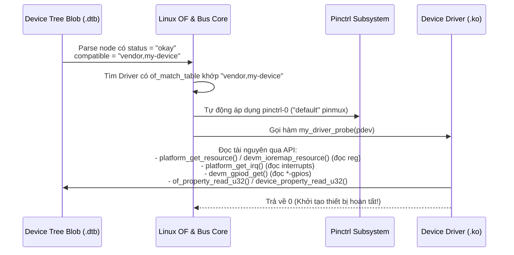

---

## 9.4. 🎯 Câu Hỏi Phỏng Vấn Thực Tế: Device Tree

> **Câu 1: Bạn đã viết xong một Kernel Driver và nạp module bằng `insmod` thành công (không báo lỗi gì), nhưng hàm `probe()` của driver hoàn toàn không được gọi. Những nguyên nhân nào có thể xảy ra và cách kiểm tra?**
> - **Trả lời:** Trong mô hình Linux Device Model, `module_init()` chỉ mới đăng ký driver vào Bus, còn hàm `probe()` chỉ chạy khi Bus tìm thấy một **Device khớp với Driver**. Nếu `probe()` không chạy, kiểm tra 4 điểm sau:
>   1. **Chuỗi `compatible` bị lệch (sai chính tả dù chỉ 1 ký tự)** giữa file `.dts` và mảng `of_match_table` trong code C.
>   2. **Quên bật `status = "okay";`** ở node thiết bị hoặc ở **node Bus cha** (ví dụ khai báo sensor trong `&i2c1` nhưng bản thân `&i2c1` vẫn đang `status = "disabled"`).
>   3. **Board đang boot nhầm file `.dtb` cũ** (quên copy file `.dtb` mới vào phân vùng boot hoặc U-Boot nạp nhầm tên file). **Cách kiểm tra trực tiếp trên board đang chạy:** Gõ `ls /proc/device-tree/` (hoặc `/sys/firmware/devicetree/base/`) để xem cây Device Tree thực tế mà Kernel đã nạp vào RAM có chứa node của mình và `status` có phải là `"okay"` hay không!
>   4. **Thiếu khai báo `.of_match_table = ...`** bên trong cấu trúc `.driver` của `platform_driver` / `i2c_driver` / `spi_driver`.

> **Câu 2: Lỗi `EPROBE_DEFER` (`-517`) trong hàm `probe()` của Driver là gì và Kernel xử lý nó như thế nào?**
> - **Trả lời:** Trong hệ thống có nhiều thiết bị phụ thuộc chéo nhau qua Device Tree (ví dụ: Driver Camera `probe()` cần xin một chân GPIO từ chip I2C GPIO Expander, hoặc cần một nguồn điện từ chip PMIC, nhưng tại thời điểm đó Driver của I2C Expander/PMIC **chưa được `probe()` xong**). Khi ấy, hàm `devm_gpiod_get()` hoặc `devm_regulator_get()` sẽ trả về mã **`-EPROBE_DEFER`**. Khi hàm `probe()` của Driver Camera return `-EPROBE_DEFER`, Kernel hiểu đây không phải lỗi hỏng thiết bị mà sẽ đưa thiết bị này vào **Deferred Probe List** (danh sách chờ), đợi các driver khác khởi tạo xong rồi tự động gọi lại `probe()` của Camera ở lượt tiếp theo. (Có thể kiểm tra các thiết bị bị kẹt chưa đủ phụ thuộc tại `/sys/kernel/debug/devices_deferred`).

> **Câu 3: Device Tree Overlay (`.dtbo`) là gì và khi nào dùng nó?**
> - **Trả lời:** Là một mảnh Device Tree bổ sung có thể được nạp ghép đè (patch) lên trên file `.dtb` gốc (bởi U-Boot lúc khởi động hoặc từ User Space qua `configfs`) mà không cần biên dịch lại file `.dtb` chính của board. Rất hữu ích khi một board mạch chủ có thể gắn nhiều loại bo mạch mở rộng khác nhau (như các HAT trên Raspberry Pi, Cape trên BeagleBone, hoặc các tùy chọn màn hình/camera khác nhau theo từng phiên bản xe).

---

# Phần 10: I2C Device Driver (Giao Tiếp Ngoại Vi I2C)

## 10.1. Nguyên Lý Vật Lý & Giao Thức I2C

**I2C (Inter-Integrated Circuit)** là chuẩn giao tiếp nối tiếp **đồng bộ, bán song công (Half-Duplex), đa chủ – đa tớ (Multi-Master, Multi-Slave)** chỉ sử dụng **2 dây tín hiệu** kết nối nhiều IC trên cùng một board mạch (Camera Sensor, Audio Codec, PMIC, EEPROM, IMU, RTC, Touch Controller):
- **`SDA` (Serial Data):** Đường truyền dữ liệu hai chiều.
- **`SCL` (Serial Clock):** Đường xung nhịp đồng bộ do Master phát ra (tốc độ phổ biến: *Standard* 100kHz, *Fast* 400kHz, *Fast-Plus* 1MHz).
- **Cấu trúc cực thu hở (Open-Drain / Open-Collector) & Điện trở kéo lên (Pull-up Resistor):** Các chip trên bus I2C chỉ có khả năng **kéo đường dây xuống mức `0` (GND)** chứ không tự đẩy lên mức `1` được. Do đó, cả hai dây `SDA` và `SCL` **bắt buộc phải có điện trở kéo lên nguồn `VCC`** (thường từ $2.2\,\text{k}\Omega$ đến $4.7\,\text{k}\Omega$). Nhờ thiết kế này, không bao giờ xảy ra chập cháy nguồn khi nhiều thiết bị cùng phát tín hiệu.

### Khung truyền I2C chuẩn & Thao tác Đọc Thanh Ghi (Repeated Start)

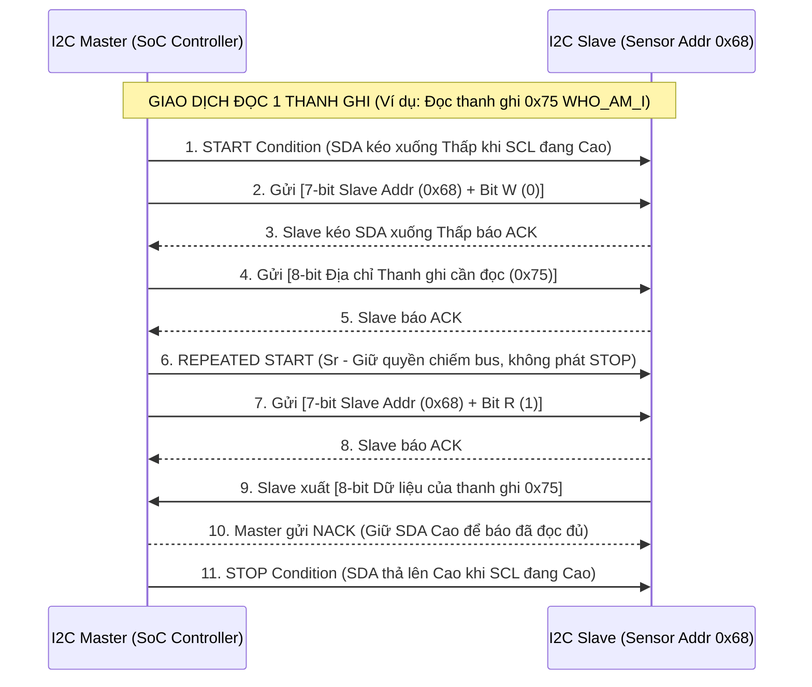

---

## 10.2. Kiến Trúc Linux I2C Subsystem

Linux Kernel chia I2C Subsystem thành **3 tầng tách biệt** để Driver của cảm biến (như MPU6050, IMX219) hoàn toàn độc lập với phần cứng bộ điều khiển I2C của từng dòng SoC:

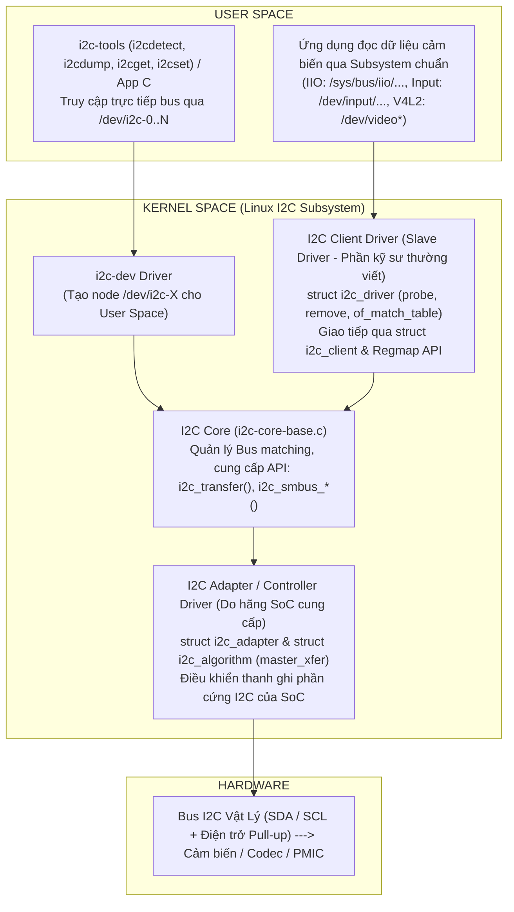

**Giải thích các cấu trúc dữ liệu trọng tâm:**
- **`struct i2c_adapter`:** Đại diện cho một **bộ điều khiển phần cứng I2C Master** trên SoC (ví dụ khối `I2C1` tạo ra `/dev/i2c-0`). Chứa con trỏ `struct i2c_algorithm` cài đặt hàm `.master_xfer()` để phát xung thực tế ra chân chip.
- **`struct i2c_client`:** Đại diện cho một **chip ngoại vi Slave** gắn trên bus (được Kernel tự động sinh ra khi đọc node con bên trong `&i2c1` của Device Tree, chứa địa chỉ `client->addr = 0x68` và con trỏ tới `client->adapter`).
- **`struct i2c_driver`:** Đại diện cho phần mềm điều khiển chip Slave đó. Khi `compatible` của `i2c_client` khớp với `of_match_table` của `i2c_driver`, hàm `probe(struct i2c_client *client)` được kích hoạt.

---

## 10.3. Các API Giao Tiếp I2C trong Kernel & Regmap Framework

1. **API SMBus tiện lợi (`i2c_smbus_*`):** Dùng cho các chip có thanh ghi 8-bit tiêu chuẩn:
   - `val = i2c_smbus_read_byte_data(client, reg_addr);`
   - `ret = i2c_smbus_write_byte_data(client, reg_addr, value);`
2. **API Giao dịch tổng quát (`i2c_transfer`):** Tạo một mảng gồm nhiều `struct i2c_msg` để thực hiện chuỗi *Write địa chỉ thanh ghi + Repeated Start + Read dữ liệu* (hoặc thanh ghi 16-bit của Camera Sensor) trong **một giao dịch nguyên tử duy nhất**:
   ```c
   uint8_t reg = 0x75, buf = 0;
   struct i2c_msg msgs[2] = {
       { .addr = client->addr, .flags = 0,        .len = 1, .buf = &reg }, /* Ghi địa chỉ reg */
       { .addr = client->addr, .flags = I2C_M_RD, .len = 1, .buf = &buf }, /* Repeated Start & Đọc */
   };
   i2c_transfer(client->adapter, msgs, 2); /* Trả về số lượng msg thành công (== 2) */
   ```
3. **Modern Regmap API (`<linux/regmap.h>` — Chuẩn công nghiệp cho Driver hiện đại):**
   - Nhiều chip cảm biến/codec hỗ trợ **cả 2 chuẩn giao tiếp I2C và SPI** trên cùng một bộ thanh ghi. Thay vì gọi cứng `i2c_transfer`, Linux cung cấp lớp trừu tượng **`struct regmap`**.
   - Khởi tạo 1 dòng trong `probe()`: `regmap = devm_regmap_init_i2c(client, &my_regmap_config);`.
   - Sau đó toàn bộ driver chỉ dùng `regmap_read(regmap, reg, &val)`, `regmap_write()`, và đặc biệt là **`regmap_update_bits(regmap, reg, mask, val)`** (tự động thực hiện *Read-Modify-Write* có khóa bảo vệ và hỗ trợ cache thanh ghi).

---

## 10.4. 🎯 Câu Hỏi Phỏng Vấn Thực Tế: I2C Device Driver

> **Câu 1: Khi dùng lệnh `i2cdetect -y 1` để quét bus I2C số 1, bạn thấy một số địa chỉ hiển thị số Hex (ví dụ `68`), một số địa chỉ hiển thị chữ `UU`, và trường hợp toàn bộ bảng hiện kín tất cả địa chỉ từ `03` đến `77`. Hãy giải thích ý nghĩa của từng hiện tượng?**
> - **Trả lời:**
>   1. **Hiện số Hex (ví dụ `68`):** Có một thiết bị phần cứng tại địa chỉ `0x68` đã phản hồi xung **ACK**, và hiện tại **chưa có Kernel Driver nào** gắn (bind) với thiết bị này.
>   2. **Hiện chữ `UU`:** Địa chỉ đó **đang được một Kernel Driver quản lý (In-use)**. `i2cdetect` không quét đè vào để tránh làm sai lệch trạng thái của driver đang chạy.
>   3. **Hiện kín toàn bộ các địa chỉ (`03`..`77` đều có mặt):** Đường dây **`SDA` đang bị chập xuống GND (Stuck Low)**! Khi `SDA` luôn ở mức `0`, sau mỗi khung địa chỉ Master thả `SDA` ra để đọc bit thứ 9 thì vẫn thấy mức `0` nên hiểu nhầm là mọi địa chỉ trên bus đều trả lời **ACK**. (Ngược lại, nếu quét quá chậm và không thấy bất kỳ thiết bị nào kèm log timeout thì thường do **thiếu điện trở Pull-up** hoặc `SCL` bị kéo xuống GND).

> **Câu 2: Hiện tượng I2C Bus Lockup (Treo bus do `SDA` bị Slave giữ ở mức thấp) xảy ra khi nào và xử lý ra sao trong Embedded Linux?**
> - **Trả lời:** Xảy ra khi SoC (Master) bị Warm Reset đột ngột đúng vào lúc Slave đang phát một bit `0` trên đường `SDA`. Khi SoC khởi động lại, Slave (không có chân Reset riêng) vẫn đang đứng chờ xung `SCL` tiếp theo nên tiếp tục kéo chặt `SDA = 0`, khiến Master tưởng bus đang bận (`Bus Busy`) và tê liệt toàn bộ bus I2C đó.
> - **Giải pháp chuẩn (I2C Bus Recovery trong Kernel):** Cấu hình trong Device Tree để I2C Controller Driver tạm thời chuyển chân `SCL` sang chế độ **GPIO Output**, chủ động phát **9 xung Clock giả** trên `SCL` cho đến khi Slave đẩy hết byte đang kẹt ra và nhả `SDA` lên cao, sau đó Master phát một tín hiệu `STOP` để reset trạng thái mọi Slave trên bus.

> **Câu 3: Có được phép gọi hàm `i2c_transfer()` hoặc `i2c_smbus_read_byte_data()` trực tiếp bên trong hàm xử lý ngắt cứng (Top Half ISR / Hard IRQ) không?**
> - **Trả lời:** **Tuyệt đối KHÔNG!** Giao tiếp I2C rất chậm (tính bằng hàng chục đến hàng trăm micro-giây); bên trong `i2c_transfer()` sử dụng `mutex_lock` để khóa bus và dùng `wait_for_completion()` đưa tiến trình vào trạng thái **ngủ (sleep)** chờ ngắt hoàn tất từ I2C Controller. Gọi hàm có thể ngủ trong Hard IRQ Context sẽ gây lỗi **`BUG: scheduling while atomic` (Kernel Panic)**. Bắt buộc phải dùng **Threaded IRQ (`devm_request_threaded_irq`)** hoặc đẩy việc đọc I2C xuống **Workqueue**.

---

# Phần 11: SPI Subsystem (Serial Peripheral Interface)

## 11.1. Nguyên Lý Vật Lý & 4 Chế Độ SPI Modes (`CPOL` & `CPHA`)

**SPI (Serial Peripheral Interface)** là chuẩn giao tiếp nối tiếp **đồng bộ, song công toàn phần (Full-Duplex — vừa gửi vừa nhận đồng thời trên 2 dây riêng), mô hình 1 Master – nhiều Slave** với tốc độ rất cao (từ vài MHz đến **50–100MHz+**, dùng cho CAN Controller MCP2515, NOR Flash, màn hình LCD nhỏ, ADC tốc độ cao, LoRa/RF module).

### 1. Bốn đường tín hiệu chuẩn của SPI
- **`SCLK` (Serial Clock):** Xung nhịp đồng bộ do Master phát ra.
- **`MOSI` (Master Out Slave In / COPI):** Dữ liệu truyền từ Master sang Slave.
- **`MISO` (Master In Slave Out / CIPO):** Dữ liệu truyền từ Slave về Master.
- **`CS` / `SS` (Chip Select / Slave Select):** Đường chọn chip (thường **kích hoạt mức thấp — Active Low**). Mỗi Slave cần 1 dây `CS` riêng biệt từ Master.

```mermaid
flowchart LR
    subgraph M["SPI MASTER (SoC)"]
        SR1["Shift Register 8-bit"]
    end
    subgraph S["SPI SLAVE (Ví dụ: MCP2515)"]
        SR2["Shift Register 8-bit"]
    end

    M -->|"SCLK (Xung nhịp)"| S
    SR1 -->|"MOSI (Đẩy bit MSB ra)"| SR2
    SR2 -->|"MISO (Đẩy bit MSB về)"| SR1
    M -->|"CS_n (Kéo xuống 0V để chọn chip)"| S
```
> **Bản chất Thanh ghi dịch vòng (Shift Register Ring):** Trong SPI, **không có khái niệm "Chỉ Đọc" hay "Chỉ Ghi" tách rời ở tầng vật lý**. Để đọc 1 byte từ Slave, Master bắt buộc phải đẩy ra 1 byte giả (*Dummy Byte*, ví dụ `0x00`) trên dây `MOSI` để tạo 8 xung `SCLK`, đồng thời 8 bit dữ liệu từ Slave sẽ dịch sang Master trên dây `MISO`.

### 2. Bốn Chế độ Hoạt động của SPI (SPI Mode 0, 1, 2, 3)
Master và Slave bắt buộc phải thống nhất 2 thông số cấu hình xung nhịp:
- **`CPOL` (Clock Polarity — Cực tính xung nhịp khi nghỉ):**
  - `CPOL = 0`: Khi không truyền (Idle), chân `SCLK` nằm ở mức **Thấp (`0V`)**.
  - `CPOL = 1`: Khi không truyền (Idle), chân `SCLK` nằm ở mức **Cao (`VCC`)**.
- **`CPHA` (Clock Phase — Pha lấy mẫu dữ liệu):**
  - `CPHA = 0`: Lấy mẫu (Sample/Đọc) dữ liệu ở **Cạnh xung đầu tiên (Leading Edge)** và dịch dữ liệu ở cạnh xung thứ hai.
  - `CPHA = 1`: Dịch dữ liệu ở cạnh xung đầu tiên và lấy mẫu (Sample/Đọc) dữ liệu ở **Cạnh xung thứ hai (Trailing Edge)**.

| SPI Mode | `CPOL` | `CPHA` | Mức `SCLK` khi nghỉ (Idle) | Cạnh xung Lấy mẫu (Sample) | Cờ cấu hình trong Device Tree |
| :---: | :---: | :---: | :---: | :---: | :--- |
| **Mode 0** *(Phổ biến nhất)* | `0` | `0` | Mức Thấp (`0`) | Cạnh Lên (Rising Edge) | *(Mặc định — không cần thêm cờ)* |
| **Mode 1** | `0` | `1` | Mức Thấp (`0`) | Cạnh Xuống (Falling Edge) | `spi-cpha;` |
| **Mode 2** | `1` | `0` | Mức Cao (`1`) | Cạnh Xuống (Falling Edge) | `spi-cpol;` |
| **Mode 3** *(Rất phổ biến)* | `1` | `1` | Mức Cao (`1`) | Cạnh Lên (Rising Edge) | `spi-cpol;` và `spi-cpha;` |

---

## 11.2. Kiến Trúc Linux SPI Subsystem & Cấu Trúc Giao Dịch

Tương tự I2C, Linux SPI Subsystem cũng tách biệt hoàn toàn giữa **SPI Controller Driver** (quản lý phần cứng SPI của SoC) và **SPI Protocol/Client Driver** (điều khiển chip ngoại vi):

```mermaid
flowchart TB
    subgraph US["USER SPACE"]
        SPIDEV["Ứng dụng C / spidev_test<br/>Giao tiếp trực tiếp qua /dev/spidevX.Y (ioctl SPI_IOC_MESSAGE)"]
        SUB["Các Subsystem chuẩn của Linux<br/>(SocketCAN: can0 cho MCP2515, MTD: /dev/mtd* cho SPI Flash, IIO cho ADC)"]
    end

    subgraph KS["KERNEL SPACE (Linux SPI Subsystem)"]
        UDEV["spidev.c (Generic User-space SPI Driver)"]
        PDRV["SPI Protocol Driver (struct spi_driver)<br/>Hàm probe(struct spi_device *spi)<br/>Đóng gói giao dịch: spi_transfer -> spi_message -> spi_sync() / spi_async()"]
        CORE["SPI Core (spi.c)<br/>Hàng đợi tin nhắn (Message Queue), quản lý Chip Select & DMA Mapping"]
        CTRL["SPI Controller Driver (struct spi_controller / spi_master)<br/>Phát xung SCLK, điều khiển FIFO & DMA phần cứng của SoC"]
    end

    SPIDEV --> UDEV --> CORE
    SUB --> PDRV --> CORE
    CORE --> CTRL --> HW["Bus SPI Vật Lý (SCLK, MOSI, MISO, CS0..N)"]
```

### Cấu trúc dữ liệu giao dịch: `spi_transfer` & `spi_message`
1. **`struct spi_transfer`:** Mô tả **1 phân đoạn truyền/nhận** gồm con trỏ buffer phát (`tx_buf`), con trỏ buffer thu (`rx_buf`), số byte (`len`), và tùy chọn giữ chân `CS` (`cs_change`).
2. **`struct spi_message`:** Gom **1 hoặc nhiều `spi_transfer`** thành một giao dịch nguyên tử (ví dụ: Transfer 1 gửi 2 byte lệnh Command + Địa chỉ; Transfer 2 nhận 16 byte dữ liệu trả về, trong suốt cả 2 transfer đó chân `CS` vẫn được giữ ở mức thấp liên tục).
3. **Thực thi:**
   - `spi_sync(spi, &msg)`: Gửi đồng bộ (ngủ chờ đến khi DMA/Interrupt truyền xong toàn bộ message).
   - `spi_async(spi, &msg)`: Gửi bất đồng bộ (trả về ngay, khi xong sẽ gọi hàm `msg.complete` callback — dùng được cả trong ngữ cảnh không được phép ngủ).
   - `spi_write_then_read(spi, txbuf, n_tx, rxbuf, n_rx)`: Hàm tiện ích gói sẵn 1 lệnh ghi tiếp nối bởi 1 lệnh đọc cho dữ liệu nhỏ.

### Khung logic đặc trưng giao tiếp SPI trong Kernel Driver
```c
uint8_t cmd[2] = { CMD_READ_REG, reg_addr };
uint8_t rx_val = 0;
struct spi_transfer xfers[2] = {
    { .tx_buf = cmd,    .len = 2 }, /* Phân đoạn 1: Gửi mã lệnh + địa chỉ thanh ghi */
    { .rx_buf = &rx_val, .len = 1 }, /* Phân đoạn 2: Đọc giá trị trả về (CS vẫn giữ thấp) */
};
struct spi_message msg;

spi_message_init(&msg);
spi_message_add_tail(&xfers[0], &msg);
spi_message_add_tail(&xfers[1], &msg);
int ret = spi_sync(spi, &msg);       /* Hoặc dùng ngắn gọn: spi_write_then_read(spi, cmd, 2, &rx_val, 1) */
```

---

## 11.3. Bảng So Sánh Tổng Hợp: I2C vs. SPI vs. UART vs. CAN

| Đặc điểm | I2C | SPI | UART | CAN / CAN FD |
| :--- | :--- | :--- | :--- | :--- |
| **Số dây tín hiệu** | **2 dây** (`SDA`, `SCL`) | **4 dây** (`SCLK`, `MOSI`, `MISO`, `CS`) | **2 dây** (`TX`, `RX`) | **2 dây vi sai** (`CAN_H`, `CAN_L`) |
| **Đồng bộ xung nhịp** | Đồng bộ (Master cấp `SCL`) | Đồng bộ (Master cấp `SCLK`) | **Bất đồng bộ** (Phải khớp Baudrate) | Bất đồng bộ (Đồng bộ theo bit frame) |
| **Chế độ truyền** | Half-Duplex (Bán song công) | **Full-Duplex (Song công toàn phần)** | Full-Duplex | Half-Duplex (Broadcast) |
| **Mô hình kết nối** | Multi-Master, Multi-Slave (Định danh bằng **Địa chỉ 7-bit**) | 1 Master, Multi-Slave (Chọn bằng **Dây `CS` riêng**) | Điểm – Điểm (1–1) | **Multi-Master ngang hàng** (Định danh & ưu tiên theo **Frame ID**) |
| **Tốc độ điển hình** | 100 kbps – 1 Mbps | **10 Mbps – 100+ Mbps** | 9600 bps – 3 Mbps | 500 kbps – 1 Mbps (CAN FD: **5–8 Mbps**) |
| **Khoảng cách truyền** | Ngắn (Trên cùng PCB, < 0.5m) | Ngắn (Trên cùng PCB, < 0.3m) | Ngắn (~1m; RS485 được xa) | **Rất xa & Chống nhiễu cao** (40m @ 1Mbps trên khung xe ô tô) |
| **Xác nhận gói tin phần cứng** | ✅ Có bit **ACK/NACK** | ❌ **Không có ACK** (Master không tự biết Slave có sống hay không) | ❌ Không có ACK | ✅ Có **ACK slot + 15-bit CRC** cực mạnh |

---

## 11.4. 🎯 Câu Hỏi Phỏng Vấn Thực Tế: SPI Subsystem

> **Câu 1: Làm thế nào để Master trên bus SPI biết được chip Slave có đang gắn trên mạch và phản hồi hay không, trong khi giao thức SPI hoàn toàn không có bit ACK như I2C?**
> - **Trả lời:** Vì giao thức SPI chỉ là việc dịch bit ra chân `MOSI` và thu bit từ chân `MISO` theo xung `SCLK`, ngay cả khi tháo hẳn chip Slave ra khỏi mạch thì hàm `spi_sync()` trong Linux **vẫn trả về `0` (thành công)** và đọc về toàn bit `1` (`0xFF` — nếu MISO kéo lên) hoặc toàn bit `0` (`0x00` — nếu MISO kéo xuống)! Do đó, trong hàm `probe()` của mọi SPI Driver chuẩn, kỹ sư **bắt buộc phải thực hiện bước đọc một thanh ghi định danh có giá trị cố định của chip (Hardware ID / `WHO_AM_I` / `CHIP_ID`)** rồi so sánh với giá trị trong Datasheet. Nếu đọc về `0x00` hoặc `0xFF` khác với mã chip dự kiến thì mới kết luận lỗi giao tiếp và return `-ENODEV`.

> **Câu 2: Tại sao khi truyền các gói dữ liệu nhỏ trên SPI, CPU dùng cơ chế PIO (Programmed I/O / Interrupt), còn khi truyền gói lớn lại chuyển sang DMA? Và bộ nhớ truyền cho `spi_transfer.tx_buf` khi dùng DMA có yêu cầu gì đặc biệt?**
> - **Trả lời:** Với gói tin rất nhỏ (vài byte đọc thanh ghi), chi phí thiết lập DMA Descriptor và flush/invalidate Cache còn tốn thời gian hơn cả việc CPU ghi thẳng vài byte đó vào thanh ghi FIFO của SPI Controller. Ngược lại, khi truyền khối lớn (đọc Flash, đẩy frame ra màn hình SPI), DMA giúp giải phóng hoàn toàn CPU.
> - **Lưu ý sống còn về bộ nhớ DMA trong SPI:** Các buffer truyền cho `spi_transfer` (`tx_buf`, `rx_buf`) **bắt buộc phải là bộ nhớ DMA-safe (cấp phát bằng `kmalloc`/`kzalloc`)**, **tuyệt đối không được dùng biến cục bộ nằm trên Stack hoặc vùng nhớ cấp phát bằng `vmalloc`** — vì vùng nhớ Stack/vmalloc không đảm bảo căn chỉnh Cache-line và tính liên tục vật lý cho bộ điều khiển DMA, sẽ gây lỗi hỏng dữ liệu hoặc Kernel Warning/Oops!

---

# Phần 12: CAN Bus & SocketCAN (Giao Thức Mạng Ô Tô)

## 12.1. Kiến Trúc Vật Lý CAN Bus, Khung Tin & Cơ Chế Phân Xử (Arbitration)

**CAN (Controller Area Network)** là mạng giao tiếp xương sống kết nối các ECU trên ô tô (Động cơ, Phanh ABS, Hộp số, Cụm đồng hồ Digital Cluster, ADAS) và máy móc công nghiệp nhờ hai đặc tính: **tín hiệu vi sai chống nhiễu điện từ cực tốt** và **phân xử ưu tiên thời gian thực không làm hỏng dữ liệu**.

### 1. Tín hiệu Vi sai (`CAN_H` & `CAN_L`) và Điện trở kết thúc $120\,\Omega$
- Bus sử dụng 2 dây xoắn đôi **`CAN_H`** và **`CAN_L`**, ở **hai đầu tận cùng của đường trục bus bắt buộc phải gắn 2 điện trở kết thúc $120\,\Omega$** (tổng trở song song đo giữa 2 dây khi tắt nguồn là **$60\,\Omega$**) để triệt tiêu sóng phản xạ tín hiệu ở tần số cao.
- **Bit `0` (Dominant — Trội / Áp đảo):** `CAN_H` $\approx 3.5\text{V}$, `CAN_L` $\approx 1.5\text{V}$ ($\Delta V \approx 2\text{V}$).
- **Bit `1` (Recessive — Lặn / Nhường):** `CAN_H` $\approx 2.5\text{V}$, `CAN_L` $\approx 2.5\text{V}$ ($\Delta V \approx 0\text{V}$).
- **Quy luật vật lý quyết định:** Nếu Node A phát bit **`0` (Dominant)** cùng lúc Node B phát bit **`1` (Recessive)**, trạng thái trên đường dây vật lý sẽ luôn là **`0` (Dominant thắng)**.

### 2. Cấu trúc Khung tin CAN & So sánh CAN 2.0 vs. CAN FD

```mermaid
flowchart LR
    SOF["SOF<br/>(1 bit 0)"] --> ID["Arbitration Field<br/>11-bit ID (CAN 2.0A) hoặc 29-bit ID (2.0B)<br/>+ RTR bit (hoặc RRS trong CAN FD)"]
    ID --> CTRL["Control Field<br/>IDE, FDF, BRS (Bit Rate Switch),<br/>DLC (4 bits)"]
    CTRL --> DATA["Data Payload<br/>CAN 2.0: 0..8 Bytes<br/>CAN FD: 0..64 Bytes"]
    DATA --> CRC["CRC Field<br/>15-bit (hoặc 17/21-bit FD)<br/>+ CRC Delimiter"]
    CRC --> ACK["ACK Slot (1 bit)<br/>Mọi node nhận tốt đều<br/>kéo xuống 0 để xác nhận"]
    ACK --> EOF["EOF (7 bits 1)<br/>+ IFS (3 bits)"]
```

- **Điểm đột phá của CAN FD (Flexible Data-Rate):**
  1. Tăng kích thước Payload từ **8 bytes lên tới 64 bytes** trong 1 khung tin.
  2. Hỗ trợ **2 tốc độ xung nhịp trong cùng 1 khung tin (nhờ bit `BRS` — Bit Rate Switch)**: Ở pha phân xử (`ID`), bus vẫn chạy ở tốc độ chuẩn (ví dụ **500 kbps** hoặc **1 Mbps**) để đảm bảo các node ở xa kịp phân xử va chạm; ngay khi phân xử xong, ở pha truyền `Data` + `CRC` (chỉ còn 1 node phát độc quyền), tốc độ được tăng tốc vọt lên **2 Mbps, 5 Mbps hoặc 8 Mbps**!

### 3. Cơ chế Phân xử Không Phá Hủy (Non-Destructive Bitwise Arbitration)
Khi nhiều ECU cùng bắt đầu phát tin nhắn tại cùng một thời điểm:
- Mỗi ECU vừa phát từng bit của trường **`ID`** (từ bit MSB cao nhất xuống LSB) vừa **đọc ngược lại trạng thái thực tế trên dây bus**.
- Nếu một ECU phát ra bit `1` (Recessive) nhưng lại đọc thấy trên bus là bit `0` (do một ECU khác có mã ID nhỏ hơn đang phát bit `0` Dominant), nó biết ngay mình đã **thua cuộc phân xử** → **lập tức ngừng phát và chuyển sang chế độ lắng nghe** mà không làm hỏng một bit nào của ECU thắng cuộc!
- **Kết luận sống còn:** **Mã `CAN ID` càng nhỏ (càng nhiều bit `0` ở đầu) thì mức độ ưu tiên càng cao** (ví dụ: thông điệp Phanh/Túi khí đặt ID `0x010` sẽ luôn thắng thông điệp Nhiệt độ điều hòa `0x520`).

---

## 12.2. Quản Lý Lỗi Tự Động (Error Handling & Bus-Off State Machine)

CAN có 5 cơ chế kiểm tra lỗi phần cứng ở từng khung tin (*Bit Error, Bit-Stuffing Error — sau 5 bit giống nhau liên tiếp phải chèn 1 bit đảo, CRC Error, Form Error, ACK Error*). Mỗi CAN Controller duy trì 2 thanh ghi đếm lỗi nội bộ là **`TEC` (Transmit Error Counter)** và **`REC` (Receive Error Counter)** để tự cô lập node bị hỏng, không cho phép 1 ECU lỗi làm tê liệt toàn mạng xe:

```mermaid
stateDiagram-v2
    [*] --> ErrorActive: Khởi động (TEC <= 127 & REC <= 127)
    ErrorActive --> ErrorPassive: TEC > 127 hoặc REC > 127
    ErrorPassive --> ErrorActive: Giao tiếp tốt -> TEC <= 127 & REC <= 127
    ErrorPassive --> BusOff: TEC > 255 (Lỗi phát nghiêm trọng liên tiếp)
    BusOff --> ErrorActive: Phục hồi sau 128x11 bit nghỉ<br/>(khi cấu hình restart-ms trong SocketCAN)
```

---

## 12.3. Kiến Trúc SocketCAN trong Linux Kernel

Thay vì coi bộ điều khiển CAN là một Character Device `/dev/can0` với các lệnh `ioctl` độc quyền không tương thích giữa các hãng như các hệ điều hành cũ, Linux tích hợp CAN trực tiếp vào **Linux Networking Stack** dưới tên gọi **SocketCAN**.

```mermaid
flowchart TB
    subgraph US["USER SPACE"]
        UTILS["Bộ công cụ can-utils (candump, cansend, cangen, cansniffer)<br/>& Công cụ cấu hình mạng iproute2 (ip link set can0...)"]
        APP["Ứng dụng Automotive C/C++<br/>Dùng chuẩn BSD Socket API: socket(PF_CAN, SOCK_RAW, CAN_RAW)"]
    end

    subgraph KS["KERNEL SPACE (Linux Networking & SocketCAN)"]
        PROTO["SocketCAN Protocol Family (AF_CAN)<br/>- CAN_RAW (Gửi/nhận trực tiếp + Bộ lọc can_filter)<br/>- CAN_BCM (Broadcast Manager: Gửi chu kỳ, lọc thay đổi nội dung)<br/>- CAN_ISOTP (ISO 15765-2: Phân mảnh gói lớn > 8/64B cho UDS Chẩn đoán)"]
        NET["Linux Network Device Layer (struct net_device & sk_buff)<br/>Giao diện mạng: can0, can1, vcan0 (Virtual CAN)"]
        DRV["CAN Controller Drivers (drivers/net/can/)<br/>- SoC tích hợp: flexcan (NXP), m_can (Bosch), rcar_canfd<br/>- Qua bus SPI: mcp251xfd, mcp251x<br/>- Qua USB: gs_usb, peak_usb"]
    end

    subgraph HW["HARDWARE"]
        PHY["CAN Controller <==(CAN_TX / CAN_RX)==> CAN Transceiver (TJA1050 / MCP2551) <==(CAN_H / CAN_L)==> CAN Bus"]
    end

    UTILS --> PROTO
    APP --> PROTO
    PROTO --> NET --> DRV --> PHY
```

### Khung logic đặc trưng lập trình C với SocketCAN (Nhận có Bộ lọc ID & Gửi Frame)
```c
int s = socket(PF_CAN, SOCK_RAW, CAN_RAW);          /* 1. Mở Raw CAN Socket */

struct ifreq ifr;
strcpy(ifr.ifr_name, "can0");
ioctl(s, SIOCGIFINDEX, &ifr);                       /* 2. Lấy chỉ số ifindex của giao diện can0 */

struct sockaddr_can addr = { .can_family = AF_CAN, .can_ifindex = ifr.ifr_ifindex };
bind(s, (struct sockaddr *)&addr, sizeof(addr));    /* 3. Gắn socket vào can0 */

/* 4. Thiết lập Bộ lọc trong Kernel (chỉ nhận các frame có ID từ 0x100 đến 0x10F) */
struct can_filter rfilter = { .can_id = 0x100, .can_mask = 0x7F0 };
setsockopt(s, SOL_CAN_RAW, CAN_RAW_FILTER, &rfilter, sizeof(rfilter));

/* 5. Đọc và Gửi khung tin CAN chuẩn */
struct can_frame frame;
read(s, &frame, sizeof(frame));                     /* Nhận 1 frame (8 bytes) */
write(s, &tx_frame, sizeof(tx_frame));              /* Phát 1 frame ra bus */
```

---

## 12.4. 🎯 Câu Hỏi Phỏng Vấn Thực Tế: CAN Bus & SocketCAN

> **Câu 1: Trên bàn lab, bạn chỉ có duy nhất 1 board Embedded Linux (đã gắn CAN Transceiver). Khi bạn gõ lệnh `cansend can0 123#11223344`, chuyện gì sẽ xảy ra trên bus và trạng thái của `can0` thay đổi như thế nào?**
> - **Trả lời:** Gói tin sẽ **KHÔNG gửi thành công** và bộ đếm lỗi phát (`TEC`) của `can0` sẽ tăng vọt lên tới `128` (**trạng thái `ERROR-PASSIVE`**), đồng thời khung tin đó bị phần cứng CAN Controller tự động phát đi phát lại liên tục trên dây bus!
> - **Lý do bản chất:** Theo chuẩn CAN, node phát để trống bit **ACK Slot** ở mức `1` (Recessive) và yêu cầu **phải có ít nhất 1 node thứ hai trên bus đang hoạt động cùng tốc độ bitrate kéo bit ACK đó xuống `0` (Dominant)**. Khi chỉ có 1 board đơn độc trên bus (hoặc chưa nối dây ra bus, hoặc node kia đặt sai bitrate), không có ai kéo bit ACK xuống `0` → sinh lỗi **ACK Error** → CAN Controller tự động re-transmit và cộng `+8` vào `TEC` cho đến khi chạm ngưỡng `128` (Error-Passive; chú ý: riêng lỗi ACK Error không làm `TEC` vượt qua 128 để vào Bus-Off).
> - **Mẹo test khi chỉ có 1 board:** Bật chế độ **Loopback** của phần cứng (`ip link set can0 type can bitrate 500000 loopback on`) để bộ điều khiển tự ACK chính nó, hoặc dùng giao diện ảo **`vcan0`**.

> **Câu 2: Hai ECU trên xe cùng bắt đầu truyền tin nhắn tại đúng một micro-giây: ECU A gửi `ID = 0x120` và ECU B gửi `ID = 0x108`. ECU nào sẽ thắng quyền truyền và gói tin của ECU thua có bị hỏng không?**
> - **Trả lời:** Viết dạng nhị phân 11-bit của 2 mã ID (so sánh từ bit cao nhất MSB):
>   - `0x120` = `001 0010 0000`
>   - `0x108` = `001 0000 1000`
>   - 5 bit đầu tiên (`00100`) của cả hai giống hệt nhau. Đến bit thứ 6 (tính từ trái sang), ECU A phát bit **`1` (Recessive)** trong khi ECU B phát bit **`0` (Dominant)**. Đường dây vật lý mang mức `0`. ECU A đọc lại thấy khác với bit mình phát nên lập tức ngừng phát, nhường toàn bộ bus cho **ECU B (`0x108`) thắng cuộc**. Gói tin của ECU B tiếp tục truyền đi hoàn toàn nguyên vẹn; còn ECU A tự động chờ ngay khi gói của B kết thúc sẽ tự phát lại gói `0x120` ở mức phần cứng mà phần mềm ứng dụng không hề bị mất dữ liệu.

> **Câu 3: Khi một node CAN trên Linux rơi vào trạng thái `BUS-OFF` (do chập dây `CAN_H` và `CAN_L` tạm thời), làm sao để nó tự động phục hồi khi dây hết chập mà không cần người dùng gõ lệnh khởi động lại?**
> - **Trả lời:** Khi cấu hình giao diện `can0`, bắt buộc phải đặt tham số **`restart-ms <thời-gian-ms>`** (ví dụ: `ip link set can0 type can bitrate 500000 restart-ms 100`). Nếu để mặc định `restart-ms 0`, khi chạm ngưỡng `TEC > 255` (Bus-Off), driver sẽ ngắt vĩnh viễn cho đến khi ứng dụng gọi lệnh restart bằng tay. Khi đặt `restart-ms 100`, sau khi vào Bus-Off 100ms, Kernel sẽ tự động reset bộ điều khiển CAN và chờ đủ 128 chuỗi 11 bit nghỉ liên tiếp để đưa node quay trở lại trạng thái `ERROR-ACTIVE`.

---

# Phần 13: Hướng Dẫn Thực Chiến Step-by-Step Bring-Up Ngoại Vi (SPI & CAN)

> **Tình huống thực tế kinh điển trong dự án Embedded Linux:** Bo mạch phần cứng mới (Custom Board) vừa về tới phòng Lab. Trên board có gắn một **chip CAN Controller MCP2515 (hoặc MCP2518FD) giao tiếp với SoC thông qua bus SPI**, kèm theo một cổng **Native CAN (`flexcan`)** và một thiết bị **SPI (`spidev`)**. Bạn được giao nhiệm vụ **Bring-up (đánh thức và kích hoạt)** cả SPI và CAN từ con số 0 cho đến khi gửi/nhận dữ liệu thành công trên User Space.

Dưới đây là **Quy trình Chuẩn 6 Bước (Step-by-Step)** có thể áp dụng trực tiếp cho mọi dòng SoC (NXP i.MX, TI Sitara, STM32MP1, Raspberry Pi, Rockchip, Renesas):

```mermaid
flowchart TD
    B1["BƯỚC 1: Kiểm Tra Phần Cứng & Schematic<br/>- Nguồn VCC (3.3V/5V), GND, Thạch anh (Crystal 8MHz/16MHz/20MHz)<br/>- Tra bảng Pinout: SCLK, MOSI, MISO, CS0, chân ngắt GPIO_INT<br/>- Kiểm tra CAN Transceiver & Điện trở đầu cuối 120 Ohm"]

    B2["BƯỚC 2: Cấu Hình Pinmux (pinctrl) trong Device Tree (.dts)<br/>- Đưa các chân vật lý về đúng chức năng SPI / CAN / GPIO Interrupt<br/>- Đảm bảo KHÔNG có ngoại vi khác đang chiếm giữ trùng các chân này!"]

    B3["BƯỚC 3: Khai Báo Node Thiết Bị trong Device Tree (.dts)<br/>- Khai báo clock cố định của thạch anh ngoại vi (fixed-clock)<br/>- Bật status = 'okay' cho SPI/CAN Controller & khai báo node con (mcp2515 / spidev)"]

    B4["BƯỚC 4: Bật Cấu Hình Kernel Config (make menuconfig / .cfg)<br/>- Bật SPI Master Driver, SPIDEV, SocketCAN Core (CONFIG_CAN)<br/>- Bật Driver của chip CAN (CONFIG_CAN_MCP251X / CONFIG_CAN_FLEXCAN)"]

    B5["BƯỚC 5: Biên Dịch, Nạp & Kiểm Tra Kernel Probe (dmesg & /sys)<br/>- Kiểm tra dmesg | grep -iE 'spi|can|mcp'<br/>- Kiểm tra /proc/interrupts, /dev/spidev*, và ip -d link show can0"]

    B6["BƯỚC 6: Kiểm Thử Thực Tế trên User Space & Xử Lý Lỗi<br/>- Test SPI: Nối tắt MOSI-MISO chạy spidev_test<br/>- Test CAN: Bật ip link set can0 up -> candump & cansend"]

    B1 --> B2 --> B3 --> B4 --> B5 --> B6
```

---

## Bước 1: Kiểm Tra Phần Cứng & Đọc Schematic (Hardware Checklist)

Trước khi đụng vào bất kỳ dòng code nào, hãy mở sơ đồ nguyên lý (Schematic) và dùng đồng hồ VOM kiểm tra:
1. **Nguồn cấp & Mức logic:** Chip ngoại vi đã có đủ nguồn `3.3V` (cho khối logic giao tiếp SPI với SoC) và `5V` (cấp cho chip **CAN Transceiver** như TJA1050/MCP2551 để tạo mức áp vi sai trên dây `CAN_H`/`CAN_L`) chưa?
2. **Tần số Thạch anh (External Crystal Oscillator):** Nếu dùng chip SPI-to-CAN như MCP2515, nhìn lên thân linh kiện thạch anh gắn cạnh nó xem là **`8MHz`, `16MHz` hay `20MHz`**? *(Ghi nhớ con số này: Nếu trên mạch gắn thạch anh 8MHz mà trong Device Tree khai báo 16MHz, tốc độ Baudrate CAN xuất ra sẽ bị lệch đúng một nửa và không bao giờ giao tiếp được với các ECU khác!).*
3. **Sơ đồ đấu nối chân (Pin Mapping):** Ghi ra giấy chính xác:
   - Cụm chân SPI nối vào bộ SPI thứ mấy của SoC (ví dụ `ECSPI2`: `SCLK`, `MOSI`, `MISO`, `SS0`)?
   - Chân ngắt **`INT` (Active Low)** của chip MCP2515 nối vào chân GPIO nào của SoC (ví dụ `GPIO4_IO12`)?
   - Nếu là Native CAN của SoC (`FLEXCAN1`): Chân `CAN_TX` và `CAN_RX` nối vào pad nào? Chân `STB` (Standby) của chip CAN Transceiver có cần một chân GPIO kéo xuống `LOW` để bật chế độ Normal Mode hay không?
4. **Trở đầu cuối Bus CAN:** Đo điện trở giữa `CAN_H` và `CAN_L` khi tắt nguồn: đã có trở $120\,\Omega$ (hoặc $60\,\Omega$ nếu đã nối với 1 thiết bị đầu cuối khác) chưa?

---

## Bước 2 & Bước 3: Cấu Hình Pinmux & Khai Báo Node trong Device Tree (`.dts`)

Mở file `.dts` của board (ví dụ `arch/arm64/boot/dts/freescale/imx8mm-myboard.dts`) và thực hiện 3 khai báo logic sau:

```dts
/ {
    /* 1. Khai báo tần số Thạch anh gắn ngoài cấp cho chip MCP2515 (Ví dụ: 16MHz) */
    clocks {
        clk_mcp2515_osc: mcp2515-osc {
            compatible = "fixed-clock";
            #clock-cells = <0>;
            clock-frequency = <16000000>; /* PHẢI KHỚP VỚI THẠCH ANH TRÊN MẠCH! */
        };
    };
};

/* 2. Cấu hình Pin Multiplexing (Pinmux) cho các chân SPI2, chân Ngắt GPIO & chân Native CAN */
&iomuxc {
    pinctrl_ecspi2: ecspi2grp {
        fsl,pins = <
            MX8MM_IOMUXC_ECSPI2_SCLK_ECSPI2_SCLK    0x82
            MX8MM_IOMUXC_ECSPI2_MOSI_ECSPI2_MOSI    0x82
            MX8MM_IOMUXC_ECSPI2_MISO_ECSPI2_MISO    0x82
            MX8MM_IOMUXC_ECSPI2_SS0_GPIO5_IO13      0x40000 /* Dùng GPIO làm chân CS0 */
        >;
    };

    pinctrl_can_int: canintgrp {
        fsl,pins = <
            MX8MM_IOMUXC_SAI1_TXFS_GPIO4_IO12       0x1c0   /* Chân GPIO Input kéo Pull-up cho INT */
        >;
    };
};

/* 3. Kích hoạt bộ điều khiển SPI2 và khai báo thiết bị con gắn trên nó */
&ecspi2 {
    pinctrl-names = "default";
    pinctrl-0 = <&pinctrl_ecspi2>;
    cs-gpios = <&gpio5 13 GPIO_ACTIVE_LOW>;
    status = "okay";

    /* KỊCH BẢN A: Khai báo chip SPI-to-CAN MCP2515 ở chân CS0 (reg = <0>) */
    can0: mcp2515@0 {
        compatible = "microchip,mcp2515";
        reg = <0>;                                          /* Chip Select 0 */
        pinctrl-names = "default";
        pinctrl-0 = <&pinctrl_can_int>;
        clocks = <&clk_mcp2515_osc>;                        /* Liên kết tới thạch anh 16MHz ở trên */
        interrupt-parent = <&gpio4>;
        interrupts = <12 IRQ_TYPE_EDGE_FALLING>;            /* Ngắt sườn xuống tại GPIO4_IO12 */
        spi-max-frequency = <10000000>;                     /* Tốc độ SPI tối đa 10MHz */
        status = "okay";
    };

    /* KỊCH BẢN B: Hoặc nếu muốn xuất thẳng bus SPI (CS1) lên User-space thành /dev/spidev1.1 để test */
    spidev@1 {
        compatible = "rohm,dh2228fv";                       /* Compatible hợp lệ được đăng ký trong spidev.c */
        reg = <1>;                                          /* Chip Select 1 */
        spi-max-frequency = <10000000>;
    };
};

/* KỊCH BẢN C: Nếu dùng bộ điều khiển CAN tích hợp sẵn trong SoC (Native FlexCAN) */
&flexcan1 {
    pinctrl-names = "default";
    pinctrl-0 = <&pinctrl_flexcan1>;
    xceiver-supply = <&reg_can_3v3>;                        /* Nguồn cấp cho CAN Transceiver (nếu có) */
    status = "okay";
};
```

> [!WARNING]
> **Lỗi kinh điển cần tránh khi viết Device Tree:**
> 1. **Trùng chân (Pin Conflict):** Luôn tìm kiếm trong toàn bộ file `.dts` xem các chân vừa khai báo trong `pinctrl_ecspi2` / `pinctrl_can_int` có đang bị một node ngoại vi khác (ví dụ `uart3` hoặc `sai1`) chiếm dụng với `status = "okay"` hay không. Nếu trùng, hàm `probe()` sẽ báo lỗi `pin already requested`!
> 2. **Lưu ý với `spidev`:** Trên các bản Linux Kernel mới, nếu bạn viết `compatible = "spidev"` trực tiếp trong Device Tree, Kernel sẽ cảnh báo `BUG/WARN: spidev listed directly in DT`! Thay vào đó, hãy dùng một chuỗi `compatible` nằm trong bảng `spidev_dt_ids[]` của file `drivers/spi/spidev.c` (như `"rohm,dh2228fv"` hoặc `"lineartechnology,ltc2488"`).

---

## Bước 4: Bật Cấu Hình Kernel Config & Công Cụ User-Space

Mở giao diện cấu hình Kernel (`make menuconfig` hoặc `bitbake virtual/kernel -c menuconfig` trong Yocto) và đảm bảo các tùy chọn sau đã được bật (`=y` hoặc `=m`):

```ini
# 1. Bật hỗ trợ SPI Subsystem & User-space spidev
CONFIG_SPI=y
CONFIG_SPI_MASTER=y
CONFIG_SPI_IMX=y                  # (Hoặc driver SPI tương ứng của hãng SoC: CONFIG_SPI_OMAP24XX...)
CONFIG_SPI_SPIDEV=y               # Tạo node /dev/spidevX.Y

# 2. Bật hỗ trợ SocketCAN & Driver phần cứng CAN
CONFIG_NET=y
CONFIG_CAN=y                      # SocketCAN Core
CONFIG_CAN_RAW=y                  # Raw CAN Socket
CONFIG_CAN_BCM=y                  # Broadcast Manager
CONFIG_CAN_DEV=y                  # CAN Device Drivers
CONFIG_CAN_CALC_BITTIMING=y       # Tự động tính toán Bit-timing theo Bitrate
CONFIG_CAN_MCP251X=m              # Driver cho chip SPI MCP2515 (hoặc CONFIG_CAN_MCP251XFD cho MCP2518FD)
CONFIG_CAN_FLEXCAN=m              # Driver cho Native CAN trên SoC NXP (hoặc CONFIG_CAN_M_CAN)
CONFIG_CAN_VCAN=m                 # Virtual CAN để test phần mềm
```
- Đồng thời trong Yocto (`local.conf` hoặc Image Recipe), thêm các gói công cụ kiểm thử vào RootFS:
  `IMAGE_INSTALL:append = " can-utils iproute2 spidev-test"`

---

## Bước 5: Biên Dịch, Nạp Lên Board & Kiểm Tra Quá Trình `probe()`

Biên dịch lại file `.dtb` (`make dtbs`) và Kernel/Modules, cập nhật lên board và khởi động lại. Ngay khi đăng nhập vào terminal trên board, kiểm tra tuần tự từ tầng Kernel lên:

```bash
# 1. Kiểm tra xem Kernel đã nhận đúng node trong Device Tree mới chưa
ls /proc/device-tree/soc@0/bus@30800000/spi@30830000/

# 2. Kiểm tra log khởi tạo của Driver SPI và CAN trong dmesg
dmesg | grep -iE "spi|mcp251|can"
# -> Kết quả mong đợi khi thành công:
#    mcp251x spi1.0 can0: MCP2515 successfully initialized.

# 3. Nếu là spidev: Kiểm tra xem node /dev/spidev* đã xuất hiện chưa
ls -l /dev/spidev*

# 4. Nếu là CAN: Kiểm tra xem giao diện mạng can0 và đường ngắt GPIO đã đăng ký chưa
ip -details link show can0
cat /proc/interrupts | grep mcp251x
```

> **Cách xử lý nhanh nếu `dmesg` báo `MCP251x didn't enter in conf mode after reset` (Probe thất bại):**
> Nghĩa là SoC gửi lệnh Reset qua SPI nhưng không đọc về được thanh ghi trạng thái của MCP2515. Nguyên nhân 99% nằm ở: (1) Chân `MISO`/`MOSI`/`SCLK`/`CS` cấu hình sai Pinmux; (2) Thạch anh gắn cạnh MCP2515 chưa dao động hoặc chip thiếu nguồn 3.3V; hoặc (3) Chân `RESET` của MCP2515 đang bị kéo xuống GND.

---

## Bước 6: Kiểm Thử Thực Tế (Verification) trên User Space

### 1. Test ngoại vi SPI bằng kỹ thuật Loopback (`spidev_test`)
- Dùng một sợi dây jumper nối tắt trực tiếp chân **`MOSI` vào chân `MISO`** trên header của board, sau đó chạy công cụ `spidev_test` chuẩn của Kernel:
  ```bash
  spidev_test -D /dev/spidev1.1 -s 1000000 -v -p "HELLO_SPI_LINUX"
  # -> Nếu dòng RX nhận về đúng chuỗi "HELLO_SPI_LINUX" (48 45 4C 4C 4F ...):
  #    Xác nhận 100% SPI Controller, Clock, Pinmux và DMA đã hoạt động hoàn hảo!
  ```

### 2. Test ngoại vi CAN bằng `iproute2` và `can-utils`
- **Bật giao diện `can0` ở tốc độ 500 kbps (kèm tự phục hồi Bus-Off sau 100ms):**
  ```bash
  ip link set can0 down
  ip link set can0 type can bitrate 500000 sample-point 0.875 restart-ms 100
  ip link set can0 up
  ```
- **Kiểm tra trạng thái chi tiết & bộ đếm lỗi:**
  ```bash
  ip -details -statistics link show can0
  # -> Đảm bảo state là ERROR-ACTIVE (berr-counter tx 0 rx 0)
  ```
- **Gửi và Nhận thử nghiệm:**
  - Nếu **chưa nối với thiết bị CAN thứ 2**: Bật thêm `loopback on` khi cấu hình `ip link`, mở 1 terminal chạy `candump can0`, terminal kia chạy `cansend can0 123#DEADBEEF`. Nếu `candump` in ra ngay khung `can0 123 [4] DE AD BE EF` và bộ đếm ngắt trong `cat /proc/interrupts` tăng lên tương ứng → **Toàn bộ chuỗi SoC ↔ SPI ↔ MCP2515 ↔ Interrupt đã hoạt động chuẩn xác!**
  - Nếu **đã nối dây `CAN_H`/`CAN_L` (có trở $120\,\Omega$) sang USB-CAN Analyzer (như PCAN / Vector CANoe) hoặc board thứ 2**: Tắt `loopback` (`loopback off`), đặt cùng tốc độ `500000` ở cả 2 đầu và bắn gói tin qua lại để nghiệm thu tầng vật lý Transceiver!

---

# Phần 14: V4L2 Framework (Video4Linux2 & Camera Pipeline)

## 14.1. Kiến Trúc Tổng Thể V4L2 & Media Controller Framework

**V4L2 (Video for Linux 2)** là subsystem chuẩn của Linux Kernel chịu trách nhiệm quản lý toàn bộ các thiết bị thu/phát và xử lý video phần cứng: Cảm biến Camera (MIPI CSI-2, Parallel, USB UVC), bộ giải tuần tự Automotive (**FPD-Link III / GMSL Deserializer**), khối xử lý tín hiệu hình ảnh (**ISP — Image Signal Processor**), và các bộ nén/giải nén video phần cứng (**V4L2 M2M Codec H.264/H.265**).

Trên các SoC nhúng hiện đại, một luồng hình ảnh từ Camera vào đến RAM đi qua một chuỗi nhiều khối IP phần cứng nối tiếp nhau. Để cấu hình linh hoạt từng mắt xích này, V4L2 kết hợp với **Media Controller Framework**:

```mermaid
flowchart TB
    subgraph US["USER SPACE"]
        APP["Camera App / GStreamer (v4l2src)<br/>Điều khiển luồng buffer video qua /dev/video0"]
        MCTL["media-ctl & v4l2-ctl<br/>Cấu hình đồ thị liên kết qua /dev/media0<br/>& định dạng từng khối qua /dev/v4l-subdev0..N"]
    end

    subgraph KS["KERNEL SPACE (V4L2 & Media Controller Subsystem)"]
        MC["Media Controller Core (struct media_device)<br/>Quản lý đồ thị: Entities (Khối), Pads (Cổng vào/ra), Links (Đường nối)"]
        VDEV["V4L2 Video Node (struct video_device -> /dev/video0)<br/>Xử lý ioctl: QUERYCAP, S_FMT, REQBUFS, QBUF, DQBUF, STREAMON"]
        VB2["Videobuf2 (vb2) Core<br/>Quản lý hàng đợi Incoming/Outgoing Queue & Cấp phát bộ nhớ CMA / DMA-BUF"]
        SD1["v4l2_subdev 1: Camera Sensor Driver (I2C)<br/>(IMX219 / OV5640: Exposure, Gain, Frame Rate)"]
        SD2["v4l2_subdev 2: Deserializer & MIPI CSI-2 RX<br/>(Thu nhận luồng cao tần từ cáp đồng trục / MIPI Lanes)"]
        SD3["v4l2_subdev 3: Hardware ISP / ISI<br/>(Debayer RAW -> YUV/NV12, Auto White Balance, Scale/Crop)"]
    end

    subgraph HW["HARDWARE PIPELINE"]
        CAM["Camera Sensor"] -->|"MIPI CSI-2 / FPD-Link"| CSI["CSI-2 Receiver"] --> ISP["ISP / Bridge"] --> DMA["DMA Engine ---> DRAM (CMA)"]
    end

    APP <-->|"ioctl() & mmap/dmabuf"| VDEV
    MCTL <-->|"Cấu hình Pads & Links"| MC
    VDEV <--> VB2
    MC --- SD1
    MC --- SD2
    MC --- SD3
    SD1 --> CAM
    SD2 --> CSI
    SD3 --> ISP
    VB2 <--> DMA
```

**Bốn cấu trúc trụ cột trong V4L2 Kernel Space:**
1. **`struct v4l2_device`:** Thực thể gốc đại diện cho toàn bộ một tổ hợp thiết bị video.
2. **`struct v4l2_subdev`:** Đại diện cho từng khối phần cứng thành phần trên đường truyền (Sensor I2C, CSI-2 Bridge, ISP). Khi bật `CONFIG_VIDEO_V4L2_SUBDEV_API`, mỗi subdev xuất ra một node **`/dev/v4l-subdevX`** cho phép User Space cấu hình độ phân giải/pixel format riêng tại từng cổng (`pad`).
3. **`struct video_device`:** Đại diện cho cổng DMA cuối cùng ghi hình ảnh vào RAM (hoặc đọc từ RAM), hiển thị thành **`/dev/videoX`**.
4. **`videobuf2 (vb2)`:** Bộ máy quản lý bộ nhớ trung tâm của V4L2 — kết nối trực tiếp với bộ cấp phát **CMA (Contiguous Memory Allocator)** và **DMA-BUF** để vận hành cơ chế trao đổi khung hình không sao chép.

---

## 14.2. Ba Chế Độ Quản Lý Bộ Nhớ Buffer trong V4L2 (`MMAP`, `USERPTR`, `DMABUF`)

Hiệu năng của một hệ thống Camera (độ trễ và % tải CPU) phụ thuộc quyết định vào cách chọn chế độ bộ nhớ khi gọi `VIDIOC_REQBUFS`:

| Chế độ Bộ nhớ | Chủ thể cấp phát RAM | Cơ chế hoạt động | Đánh giá Ưu / Nhược điểm & Trường hợp sử dụng |
| :--- | :--- | :--- | :--- |
| **`V4L2_MEMORY_MMAP`** | **V4L2 Kernel Driver** (thường lấy từ vùng nhớ liên tục vật lý **CMA**) | Ứng dụng gọi `mmap()` để ánh xạ trực tiếp buffer của Kernel vào không gian địa chỉ ảo User Space | **Ưu:** Phổ biến nhất, mọi driver đều hỗ trợ, không tốn copy từ Kernel lên User.<br/>**Nhược:** Nếu chuyển tiếp sang GPU/Display bằng con trỏ ảo có thể phát sinh copy.<br/>**Dùng khi:** Ứng dụng xử lý ảnh trên CPU, test camera. |
| **`V4L2_MEMORY_USERPTR`** | **User Space App** (`malloc` / `posix_memalign`) | Ứng dụng tự cấp phát vùng nhớ rồi truyền con trỏ ảo xuống cho V4L2 Driver | **Ưu:** Ứng dụng chủ động quản lý memory pool.<br/>**Nhược:** Bộ nhớ User thường bị phân mảnh vật lý, đòi hỏi phần cứng Camera DMA phải hỗ trợ *Scatter-Gather* (nhiều SoC nhúng không hỗ trợ). |
| **`V4L2_MEMORY_DMABUF`** | **Một Driver Exporter** (V4L2, GPU, hoặc Display DRM) | Các subsystem trao đổi trực tiếp **File Descriptor (`dmabuf_fd`)** đại diện cho vùng RAM vật lý chung | **Ưu:** **ZERO-COPY TUYỆT ĐỐI** xuyên suốt `Camera → ISP → GPU → Hardware Encoder → Display`; tải CPU $\approx 0\%$.<br/>**Dùng khi:** **Bắt buộc trong Automotive (Camera lùi / 360°)** và hệ thống video thời gian thực độ phân giải cao. |

```mermaid
flowchart LR
    CAM["1. V4L2 Camera DMA"] -->|"Ghi thẳng frame NV12"| CMA["Vùng Nhớ Vật Lý Chung (DRAM / CMA)<br/>Không bao giờ bị CPU copy!"]
    CMA -->|"Đọc thẳng qua DMA"| GPU["2. GPU / V4L2 H.264 Encoder"]
    CMA -->|"Quét thẳng ra màn hình"| DRM["3. Display Controller (DRM/KMS)"]
    APP["User Space / GStreamer<br/>Chỉ chuyển tiếp số nguyên dmabuf_fd"] -.->|"VIDIOC_EXPBUF / QBUF(dmabuf_fd)"| CAM
    APP -.->|"Import dmabuf_fd"| GPU
    APP -.->|"Import dmabuf_fd"| DRM
```

---

## 14.3. Vòng Đời Capture Video Chuẩn trong V4L2 (`ioctl` Workflow)

Quá trình thu nhận khung hình từ `/dev/video0` vận hành như một băng chuyền **Producer – Consumer** giữa **Camera DMA (Producer)** và **Ứng dụng User Space (Consumer)** thông qua 2 hàng đợi trong `videobuf2`: **Incoming Queue** (chứa các buffer rỗng chờ DMA đổ ảnh vào) và **Outgoing Queue** (chứa các buffer đã có ảnh hoàn chỉnh chờ ứng dụng lấy ra).

```mermaid
sequenceDiagram
    participant App as User Application
    participant V4L2 as V4L2 Driver & videobuf2
    participant HW as Camera Sensor & DMA

    App->>V4L2: 1. open("/dev/video0") & ioctl(VIDIOC_QUERYCAP)
    App->>V4L2: 2. ioctl(VIDIOC_S_FMT) -> Chọn 1920x1080, Pixel Format NV12 / YUYV
    App->>V4L2: 3. ioctl(VIDIOC_REQBUFS, count=4, V4L2_MEMORY_MMAP)
    Note over V4L2: Kernel cấp phát 4 vùng nhớ khung hình trong CMA

    loop Với mỗi buffer i = 0..3
        App->>V4L2: 4. ioctl(VIDIOC_QUERYBUF, i) + mmap() (hoặc VIDIOC_EXPBUF lấy dmabuf_fd)
        App->>V4L2: 5. ioctl(VIDIOC_QBUF, i) -> Đẩy cả 4 buffer rỗng vào Incoming Queue
    end

    App->>V4L2: 6. ioctl(VIDIOC_STREAMON)
    V4L2->>HW: Bật nguồn/xung Sensor (s_stream=1) & Kích hoạt DMA

    loop Vòng lặp Streaming thời gian thực (30 / 60 fps)
        HW->>V4L2: DMA ghi xong 1 frame vào buffer[i] -> Phát ngắt IRQ<br/>Chuyển buffer[i] sang Outgoing Queue & đánh thức poll()
        App->>V4L2: 7. poll() + ioctl(VIDIOC_DQBUF) (Lấy buffer[i] đã có ảnh ra)
        Note right of App: Hiển thị / Đẩy vào GPU / Encode frame
        App->>V4L2: 8. ioctl(VIDIOC_QBUF, i) (Trả lại buffer[i] rỗng vào Incoming Queue)
    end

    App->>V4L2: 9. ioctl(VIDIOC_STREAMOFF) -> munmap() -> close()
```

### Khung logic đặc trưng của các lệnh kiểm tra & cấu hình V4L2 trên Board
```bash
# 1. Liệt kê các thiết bị video và kiểm tra đầy đủ năng lực (Format, Resolution, FPS)
v4l2-ctl --list-devices
v4l2-ctl -d /dev/video0 --all
v4l2-ctl -d /dev/video0 --list-formats-ext

# 2. Với SoC có Media Controller (ISP/CSI-2): Xem và cấu hình định dạng tại từng Pad trong pipeline
media-ctl -d /dev/media0 -p
media-ctl -d /dev/media0 -V "'imx219 1-0010':0 [fmt:SRGGB10_1X10/1920x1080]"

# 3. Thu thử 1 khung hình thô bằng MMAP để kiểm chứng phần cứng và Driver hoạt động
v4l2-ctl -d /dev/video0 --set-fmt-video=width=1920,height=1080,pixelformat=NV12 \
         --stream-mmap=4 --stream-count=1 --stream-to=test_frame.nv12
```

---

## 14.4. 🎯 Câu Hỏi Phỏng Vấn Thực Tế: V4L2 Framework

> **Câu 1: Trên một SoC phức tạp có sử dụng Media Controller (Sensor → MIPI CSI-2 Receiver → ISP → `/dev/video0`), khi bạn gọi lệnh `v4l2-ctl` hoặc chạy GStreamer trên `/dev/video0` thì báo lỗi `Broken pipe (-EPIPE)` tại bước `VIDIOC_STREAMON`. Nguyên nhân là gì và cách khắc phục?**
> - **Trả lời:** Lỗi **`-EPIPE` (Broken pipe)** khi gọi `VIDIOC_STREAMON` là lỗi kinh điển nhất của hệ thống V4L2 Media Controller. Nguyên nhân là **định dạng (Resolution, Pixel Format / Media Bus Code) hoặc đường liên kết (Link) giữa các `pad` của các `v4l2_subdev` trong chuỗi phần cứng chưa khớp nhau** (ví dụ: Sensor đang xuất ra `1920x1080 SRGGB10`, nhưng cổng vào của MIPI CSI-2 hoặc ISP lại đang cấu hình mặc định là `1280x720 UYVY`, hoặc Link giữa CSI-2 và ISP đang ở trạng thái `DISABLED`).
> - **Cách khắc phục:** Chạy `media-ctl -p` để in toàn bộ đồ thị pipeline, kiểm tra từng cặp `Source Pad → Sink Pad` nối với nhau, dùng `media-ctl -l` để bật Link (`[ENABLED]`) và dùng `media-ctl -V` để đồng bộ cùng một độ phân giải và mã định dạng từ Sensor qua CSI-2 đến ISP và `/dev/video0`.

> **Câu 2: Tại sao khi cấp phát buffer trong V4L2 (`VIDIOC_REQBUFS`), người ta thường yêu cầu từ 3 đến 4 buffer mà không dùng 1 hoặc 2 buffer, cũng không dùng tới 20 buffer?**
> - **Trả lời:**
>   - **Nếu chỉ dùng 1 buffer:** Không thể vừa thu vừa hiển thị song song (khi ứng dụng lấy buffer ra bằng `DQBUF`, phần cứng DMA không còn buffer nào trong Incoming Queue để ghi frame tiếp theo → mất một nửa số frame hoặc gây xé hình *tearing*).
>   - **Nếu dùng 2 buffer (Ping-Pong):** Trong lúc DMA ghi vào Buffer 1 thì App xử lý Buffer 0; tuy nhiên chỉ cần hệ điều hành hơi trễ nhịp lập lịch một chút khiến App chưa kịp trả (`QBUF`) Buffer 0 trước khi tín hiệu VSYNC của frame mới tới, DMA sẽ bị rớt frame ngay lập tức.
>   - **Nếu dùng quá nhiều (ví dụ 20 buffer):** Tốn hàng chục MB bộ nhớ CMA quý giá và nếu App xử lý chậm hơn tốc độ camera, hàng đợi sẽ tích tụ tới 20 frame cũ làm **độ trễ hình ảnh (Latency) tăng vọt lên gần 1 giây** (cực kỳ nguy hiểm cho Camera lùi ô tô).
>   - **Do đó, 3–4 buffer** là điểm cân bằng tối ưu nhất giữa tính mượt mà (chống rớt frame do jitter ngắn hạn) và độ trễ cực thấp (Low Latency) cùng tiết kiệm RAM.

> **Câu 3: Sự khác biệt giữa `V4L2_CAP_VIDEO_CAPTURE` (Single-planar) và `V4L2_CAP_VIDEO_CAPTURE_MPLANE` (Multi-planar) là gì?**
> - **Trả lời:** Với định dạng đóng gói chung như `YUYV`, toàn bộ điểm ảnh của 1 frame nằm trên **1 vùng nhớ liên tục duy nhất (1 Plane)** → dùng Single-planar API. Nhưng với các định dạng như **`NV12`** (1 mặt phẳng độ sáng `Y` và 1 mặt phẳng màu `UV`) hoặc **`YUV420 / I420`** (3 mặt phẳng `Y`, `U`, `V`), nhiều bộ điều khiển phần cứng ISP/Encoder yêu cầu mỗi mặt phẳng màu có thể nằm ở **các vùng địa chỉ vật lý độc lập nhau** (tối đa 8 planes trong `struct v4l2_plane`). Vì vậy, các SoC hiện đại (như NXP i.MX8, Qualcomm, Rockchip) hầu hết đều cài đặt driver theo chuẩn **Multi-planar (`_MPLANE`)**.

---

# Phần 15: GStreamer Framework (Kiến Trúc Multimedia Pipeline)

## 15.1. Kiến Trúc Cốt Lõi của GStreamer Pipeline

**GStreamer** là framework đa phương tiện chuẩn công nghiệp trên Embedded Linux, cho phép xây dựng mọi luồng xử lý Video/Audio (Capture, Convert, Scale, Hardware Encode/Decode, Mux/Demux, Network Streaming, Display Rendering) bằng cách nối các khối chức năng độc lập (**Elements**) thành một đường ống (**Pipeline**).

```mermaid
flowchart LR
    subgraph PIPE["GSTREAMER PIPELINE (Quản lý Global Clock & Message Bus)"]
        direction LR
        SRC["Source Element<br/>(v4l2src)<br/>Chỉ có SRC pad"]
        CAPS["Caps Filter<br/>video/x-raw,<br/>format=NV12,1080p"]
        Q1["Queue<br/>(Tách Thread mới)"]
        ENC["Filter / HW Codec<br/>(v4l2h264enc / glupload)<br/>Có SINK & SRC pad"]
        SINK["Sink Element<br/>(waylandsink / udpsink)<br/>Chỉ có SINK pad"]

        SRC -->|"GstBuffer + Caps"| CAPS --> Q1 --> ENC --> SINK
    end

    BUS["GstBus (Hàng đợi sự kiện bất đồng bộ:<br/>ERROR, EOS, STATE_CHANGED, QOS)"]
    APP["Main Application<br/>(GMainLoop / Callback)"]

    PIPE -.->|"Post GstMessage"| BUS -.->|"Thông báo Thread-safe"| APP
```

### Giải thích 6 thành phần kiến trúc nền tảng:
1. **Element:** Đơn vị xử lý cơ bản nhất, gồm 3 nhóm:
   - **Source Element (Nguồn phát):** Chỉ có cổng ra (`src` pad) — đọc dữ liệu từ phần cứng, file hoặc mạng (`v4l2src`, `alsasrc`, `filesrc`, `udpsrc`, `rtspsrc`, `appsrc`).
   - **Filter / Codec / Muxer / Demuxer (Khối biến đổi):** Có cả cổng vào (`sink` pad) và cổng ra (`src` pad) (`videoconvert`, `videoscale`, `v4l2h264enc`, `h264parse`, `mp4mux`, `qtdemux`, `tee`, `compositor`).
   - **Sink Element (Điểm đích):** Chỉ có cổng vào (`sink` pad) — tiêu thụ dữ liệu ra màn hình, loa, file hoặc mạng (`waylandsink`, `kmssink`, `glimagesink`, `alsasink`, `filesink`, `udpsink`, `appsink`).
2. **Pad (Cổng giao tiếp) & 3 kiểu khởi tạo Pad:**
   - **Always (Static) Pad:** Luôn tồn tại sẵn (như pad của `v4l2src`, `videoconvert`) → có thể nối ngay bằng hàm `gst_element_link()`.
   - **Sometimes (Dynamic) Pad:** Chỉ được tạo ra động trong lúc chạy khi element phân tích xong luồng dữ liệu đầu vào (ví dụ: `qtdemux` hoặc `decodebin` phải đọc header của file `.mp4` rồi mới tạo động `video_0` pad và `audio_0` pad). Trong code C, bắt buộc phải bắt tín hiệu **`"pad-added"`** để nối pad động này.
   - **Request Pad:** Chỉ được tạo ra khi ứng dụng chủ động yêu cầu (ví dụ: mỗi khi cần chia thêm 1 nhánh ở `tee` hoặc ghép thêm 1 camera vào `compositor`).
3. **Caps (Capabilities) & Thương lượng định dạng (Caps Negotiation):**
   - Mỗi Pad đi kèm một tập mô tả định dạng mà nó hỗ trợ (loại dữ liệu, màu sắc `NV12`/`YUYV`, độ phân giải, tốc độ khung hình, kiểu bộ nhớ `memory:DMABuf`).
   - Trước khi dữ liệu chảy, hai element nối với nhau tự động trao đổi truy vấn để chốt một định dạng chung tối ưu nhất. Nếu 2 element không có định dạng chung (ví dụ Camera chỉ xuất `YUYV` mà Encoder chỉ nhận `NV12` nhưng ở giữa không có khối chuyển đổi) → Pipeline dừng ngay với lỗi **`not-negotiated (-4)`**.
4. **GstBuffer & GstMemory:** `GstBuffer` là gói tin chảy giữa các Pad, chứa nhãn thời gian (**PTS / DTS**), metadata và con trỏ tới vùng nhớ thực tế (`GstMemory` hoặc **`GstDmaBufMemory`**).
5. **Bin & Pipeline:** `Bin` gom nhiều element thành một khối logic hợp nhất. `Pipeline` là Bin cấp cao nhất điều phối trạng thái, cấp **Clock đồng bộ** và quản lý **Bus**.
6. **Bus (`GstBus`):** Vì GStreamer tự tạo nhiều luồng (Streaming Threads) chạy ngầm bên dưới, ứng dụng không xử lý lỗi trực tiếp trên các luồng đó mà lắng nghe thông điệp (`ERROR`, `EOS`, `QOS`, `STATE_CHANGED`) tập trung qua `GstBus` trên luồng chính.

---

## 15.2. Máy Trạng Thái (State Machine), Prerolling & Cơ Chế Đa Luồng (`queue` / `tee`)

### 1. Bốn Trạng Thái Tuần Tự của GStreamer Pipeline

```mermaid
stateDiagram-v2
    [*] --> NULL: Khởi tạo Element (Chưa chiếm tài nguyên)
    NULL --> READY: Mở thiết bị (/dev/video0), cấp phát bộ nhớ tĩnh
    READY --> PAUSED: Kích hoạt Pads, tạo Streaming Threads & PREROLLING
    PAUSED --> PLAYING: Clock chạy -> Render đúng theo nhãn thời gian PTS
    PLAYING --> PAUSED: Tạm dừng Clock (Giữ nguyên frame hiện tại)
    PAUSED --> READY: Dừng các Streaming Threads, giải phóng Buffers
    READY --> NULL: Đóng thiết bị phần cứng, thu hồi toàn bộ RAM
```

- **Bản chất của Prerolling (tại trạng thái `PAUSED`):** Khi chuyển từ `READY → PAUSED`, các luồng bắt đầu đẩy dữ liệu đi cho đến khi khung hình đầu tiên chạm tới `Sink`. Tại đó, `Sink` chặn luồng lại (pipeline đã được "bơm đầy" dữ liệu — *prerolled*), sẵn sàng để ngay khoảnh khắc chuyển sang `PLAYING` là xuất hình ảnh tức thì không có độ trễ khởi động. *(Lưu ý: Với các **Live Source** như Camera `v4l2src` hoặc luồng mạng trực tiếp `udpsrc`, chúng không phát dữ liệu ở trạng thái `PAUSED` để tránh積 trữ ảnh cũ, mà chỉ phát dữ liệu khi bước vào `PLAYING`).*

### 2. Cơ chế Đa luồng (Multithreading) & Vai trò quyết định của `queue` và `tee`
Mặc định, các element nối trực tiếp với nhau (`A ! B ! C`) chạy tuần tự trên **cùng một Streaming Thread duy nhất** (khi `A` xử lý xong buffer, nó gọi thẳng hàm `chain()` của `B` trên chính luồng đó).
- **Vấn đề:** Nếu `C` bị chậm (ví dụ chờ mạng hoặc chờ GPU), nó làm treo luôn cả `B` và `A`, khiến `v4l2src` không kịp lấy buffer từ driver và làm rớt frame!
- **Giải pháp với `queue`:** Mỗi phần tử `queue` đóng vai trò là **ranh giới tách Thread**:
  - Một luồng phía trước đẩy dữ liệu vào FIFO của `queue`.
  - `queue` tự sinh ra **một Streaming Thread hoàn toàn mới** ở đầu ra để đẩy dữ liệu cho các phần tử phía sau, giúp các giai đoạn chạy song song thực sự trên nhiều nhân CPU (Multi-core Parallelism).
- **Quy tắc bắt buộc khi chia nhánh bằng `tee`:** Ngay sau mỗi nhánh của `tee` **bắt buộc phải đặt một `queue`** (`tee name=t  t. ! queue ! nhánh_1  t. ! queue ! nhánh_2`). Nếu thiếu `queue`, luồng của `tee` khi đẩy frame đầu tiên vào `nhánh_1` sẽ bị hàm Preroll ở Sink của `nhánh_1` chặn đứng lại, làm nó không bao giờ quay về để đẩy frame sang `nhánh_2` được → **toàn bộ Pipeline bị Deadlock ngay ở trạng thái `PAUSED`!**

---

## 15.3. Thiết Kế Pipeline Thực Chiến: Zero-Copy & Hệ Thống Camera Automotive

Trên các SoC nhúng (i.MX8, R-Car H3, TCC8030, Jetson), quy tắc thiết kế quan trọng nhất là: **Không dùng CPU để chạm vào dữ liệu Pixel** (tránh dùng `videoconvert`, `videoscale`, `x264enc` bằng phần mềm), mà luôn kết hợp **`io-mode=dmabuf` + Hardware ISP/GPU/VPU + `queue leaky=downstream`**.

```mermaid
flowchart TD
    subgraph HW["TẦNG PHẦN CỨNG & KERNEL V4L2"]
        CAM["4x Camera (Rear / Front / Left / Right)<br/>MIPI CSI-2 -> ISP -> /dev/video0..3 (NV12)"]
    end

    subgraph GST["GSTREAMER ZERO-COPY AUTOMOTIVE PIPELINE"]
        VSRC["v4l2src device=/dev/video0 io-mode=dmabuf<br/>(Xuất trực tiếp DMA-BUF fd, 0% CPU copy)"]
        Q["queue max-size-buffers=2 leaky=downstream<br/>(Nếu phía sau bận, vứt ngay frame cũ, luôn giữ frame mới nhất)"]
        TEE["tee name=t (Phân nhánh luồng video)"]
        
        subgraph B1["Nhánh 1: Hiển Thị Thời Gian Thực (< 50ms Latency)"]
            Q1["queue leaky=downstream"]
            GPU["GPU Dewarp & Render<br/>(glupload -> glcolorconvert / waylandsink)"]
        end

        subgraph B2["Nhánh 2: Ghi Hình Hộp Đen / Stream H.264"]
            Q2["queue leaky=downstream"]
            ENC["Hardware Encoder (v4l2h264enc)<br/>-> h264parse -> mp4mux / rtph264pay"]
        end

        subgraph B3["Nhánh 3: Xử Lý AI / ADAS (Cầu nối App)"]
            Q3["queue max-size-buffers=1 leaky=downstream"]
            ASINK["appsink (Đưa frame sang NPU / OpenCV)"]
        end
    end

    CAM --> VSRC --> Q --> TEE
    TEE --> Q1 --> GPU
    TEE --> Q2 --> ENC
    TEE --> Q3 --> ASINK
```

### Ba mẫu Pipeline đặc trưng cần thuộc lòng

```bash
# 1. Pipeline hiển thị Camera Zero-Copy độ trễ cực thấp (Chuẩn Camera lùi Automotive)
gst-launch-1.0 \
  v4l2src device=/dev/video0 io-mode=dmabuf ! \
  video/x-raw,format=NV12,width=1920,height=1080,framerate=60/1 ! \
  queue max-size-buffers=2 leaky=downstream ! \
  waylandsink sync=false

# 2. Pipeline chia 2 nhánh bằng 'tee': Vừa hiển thị màn hình, vừa nén H.264 phần cứng phát qua mạng RTP/UDP
gst-launch-1.0 \
  v4l2src device=/dev/video0 io-mode=dmabuf ! \
  video/x-raw,format=NV12,width=1280,height=720,framerate=30/1 ! \
  tee name=t \
  t. ! queue max-size-buffers=2 leaky=downstream ! waylandsink \
  t. ! queue max-size-buffers=2 leaky=downstream ! v4l2h264enc ! h264parse ! rtph264pay config-interval=1 pt=96 ! udpsink host=192.168.1.10 port=5000

# 3. Pipeline Failover (Chuyển đổi mượt sang Camera dự phòng khi Camera chính mất tín hiệu)
gst-launch-1.0 \
  input-selector name=sel ! waylandsink \
  v4l2src device=/dev/video0 ! queue leaky=downstream ! sel.sink_0 \
  v4l2src device=/dev/video1 ! queue leaky=downstream ! sel.sink_1
```

---

## 15.4. 🎯 Câu Hỏi Phỏng Vấn Thực Tế: GStreamer Framework

> **Câu 1: Trong thiết kế GStreamer Pipeline cho Camera thời gian thực (như Camera lùi hoặc ADAS), tại sao người ta luôn cấu hình `queue max-size-buffers=2 leaky=downstream`? Sự khác biệt giữa `leaky=downstream` và `leaky=upstream` là gì?**
> - **Trả lời:** Mặc định, `queue` có thể chứa tới 200 buffers. Nếu khối xử lý phía sau (ví dụ GPU hoặc AI) bị chậm tạm thời, `queue` sẽ tích trữ hàng chục khung hình cũ, làm hình ảnh trên màn hình bị **trễ (lag) tới vài giây** so với thực tế bên ngoài xe, hoặc khi đầy sẽ chặn đứng luôn `v4l2src`.
> - Khi đặt `max-size-buffers=2` kèm thuộc tính `leaky`:
>   - **`leaky=downstream` (Xả ở đầu ra / Vứt bỏ frame CŨ NHẤT):** Khi queue đã có 2 frame mà camera đẩy frame thứ 3 mới tinh vào, queue sẽ **vứt bỏ frame cũ nhất đang nằm ở đầu hàng đợi** để nhận frame mới nhất. Nhờ đó, màn hình luôn hiển thị trạng thái thời gian thực mới nhất!
>   - **`leaky=upstream` (Xả ở đầu vào / Vứt bỏ frame MỚI NHẤT):** Khi queue đầy, nó từ chối và vứt bỏ frame mới vừa tới, cố giữ lại các frame cũ trong hàng đợi.

> **Câu 2: Khi xây dựng một GStreamer Pipeline phức tạp mà bị lỗi không chạy (ví dụ báo `Internal data stream error` / `not-negotiated`) hoặc bị giật hình (độ trễ cao), quy trình và công cụ debug thực tế của bạn là gì?**
> - **Trả lời:** Áp dụng quy trình 4 bước chẩn đoán chuẩn:
>   1. **Kiểm tra Caps của từng Element bằng `gst-inspect-1.0 <element>`:** Xem `Pad Templates` của phần tử phát và phần tử nhận có giao nhau về `format` (`NV12`/`YUYV`/`RGB`) hay không.
>   2. **Bật Log có chọn lọc với `GST_DEBUG`:** Chạy `GST_DEBUG=3` để nhìn lỗi tổng quát, sau đó bật sâu riêng phần thương lượng Caps: `GST_DEBUG=GST_CAPS:5,v4l2src:5` để thấy chính xác tại pad nào hai bên không khớp định dạng.
>   3. **Xuất sơ đồ trực quan của Pipeline (`.dot` graph):** Chạy với biến môi trường `GST_DEBUG_DUMP_DOT_DIR=/tmp`, sau đó dùng Graphviz (`dot -Tpng file.dot -o pipe.png`) để nhìn tận mắt từng khối, trạng thái của từng pad và định dạng Caps thực tế đã thương lượng trên mỗi đường nối.
>   4. **Đo độ trễ từng mắt xích (Latency Profiling):** Bật bộ đo vết tích hợp sẵn của GStreamer: `GST_TRACER="latency(flags=pipeline+element)" GST_DEBUG=GST_TRACER:7` để in ra số mili-giây tiêu tốn tại từng element riêng biệt, từ đó tìm ra chính xác element nào đang làm nghẽn cổ chai (ví dụ phát hiện `videoconvert` bằng CPU ngốn 70ms/frame để thay bằng khối phần cứng `glcolorconvert` hoặc `v4l2convert`).

> **Câu 3: Làm thế nào để kết nối một thuật toán xử lý ảnh/AI viết bằng C++ (OpenCV / TensorFlow Lite / NPU SDK) vào giữa một GStreamer Pipeline đang chạy?**
> - **Trả lời:** Có 2 cách tiếp cận chuẩn tùy theo yêu cầu hiệu năng:
>   1. **Cách nhanh & linh hoạt nhất — Dùng cặp `appsink` và `appsrc`:** Pipeline 1 thu hình từ camera đẩy vào `appsink` (`emit-signals=true`, callback `new-sample` lấy `GstBuffer` ra cho code C++/AI xử lý). Sau khi xử lý hoặc vẽ bounding box xong, đẩy buffer đó vào `appsrc` của Pipeline 2 để hiển thị ra `waylandsink` hoặc nén H.264 phát qua mạng. (Nếu map buffer qua `dmabuf_fd`, cách này vẫn đạt hiệu năng rất cao).
>   2. **Cách chuyên nghiệp nhất cho Production — Viết một Custom GStreamer Filter Plugin kế thừa lớp `GstBaseTransform` (hoặc `GstVideoFilter`):** Cài đặt hàm `.transform_ip()` (*In-place transform*: sửa trực tiếp trên chính buffer đang chảy qua pipeline mà không tạo buffer mới), đóng gói thành file `.so` đặt vào `/usr/lib/gstreamer-1.0/` để dùng trực tiếp trong mọi pipeline như một element chuẩn.

---

# 🏁 Phụ Lục: Bảng Tra Cứu Nhanh Lệnh Debug Theo Từng Chủ Đề

| Chủ đề | Bộ lệnh kiểm tra & Debug cốt lõi trên Embedded Linux |
| :--- | :--- |
| **1. Linux File System** | `df -h`, `mount`, `lsof`, `ls -li` (xem số Inode), `stat <file>`, `sync` |
| **2. Linux Process** | `ps -ef`, `top` / `htop`, `cat /proc/<pid>/maps`, `cat /proc/<pid>/status`, `strace -p <pid>` |
| **3. Linux Thread** | `ps -T -p <pid>` (xem toàn bộ TID trong process), `top -H -p <pid>`, `gdb` (`info threads`), `valgrind --tool=helgrind` (bắt Race Condition/Deadlock) |
| **4. IPC** | `ipcs -a` & `ipcrm` (System V), `ls -l /dev/shm/` (POSIX SHM/Sem), `ls -l /dev/mqueue/`, `ss -xlp` (Unix Domain Sockets), `kill -l` (Danh sách Signals) |
| **5. U-Boot** | `printenv`, `setenv`, `saveenv`, `bdinfo`, `mmc list`, `fatload` / `ext4load`, `fdt addr` / `fdt print`, `booti` / `bootz` / `bootm` |
| **6. Yocto Project** | `bitbake <target>`, `bitbake -e <recipe>` (xem biến môi trường), `bitbake -c menuconfig virtual/kernel`, `bitbake-layers show-layers`, `devtool modify <recipe>` |
| **7. Character Driver** | `insmod`, `rmmod`, `modprobe`, `lsmod`, `modinfo`, `dmesg -w`, `cat /proc/devices` (xem Major number), `addr2line -e drv.ko <offset>` |
| **8. GPIO** | `gpiodetect`, `gpioinfo`, `gpioget`, `gpioset`, `gpiomon` (bộ `libgpiod`), `cat /sys/kernel/debug/gpio`, `cat /sys/kernel/debug/pinctrl/...` |
| **9. Device Tree** | `dtc -I dtb -O dts -o out.dts board.dtb` (dịch ngược DTB ra DTS), `ls /proc/device-tree/`, `cat /sys/kernel/debug/devices_deferred` |
| **10. I2C Driver** | `i2cdetect -l`, `i2cdetect -y <bus>`, `i2cdump -y <bus> <addr>`, `i2cget -y <bus> <addr> <reg>`, `i2cset -y <bus> <addr> <reg> <val>` |
| **11. SPI** | `ls -l /dev/spidev*`, `spidev_test -D /dev/spidevX.Y -s 1000000 -v -p "TEST"`, `ls /sys/bus/spi/devices/` |
| **12 & 13. CAN & Bring-up** | `ip link set can0 type can bitrate 500000 restart-ms 100`, `ip -d -s link show can0`, `candump -td -e can0`, `cansend can0 123#11223344`, `cangen can0` |
| **14. V4L2** | `v4l2-ctl --list-devices`, `v4l2-ctl -d /dev/video0 --all`, `v4l2-ctl --list-formats-ext`, `media-ctl -p`, `media-ctl -V` |
| **15. GStreamer** | `gst-inspect-1.0 <plugin>`, `gst-launch-1.0`, `GST_DEBUG=3`, `GST_DEBUG_DUMP_DOT_DIR=/tmp`, `GST_TRACER="latency(flags=pipeline+element)"` |

---
*Tài liệu được biên soạn và tổng hợp toàn diện cho kỹ sư Embedded Linux.*
