# 📘 Sổ Tay Phỏng Vấn Embedded Linux & Automotive

*Bản đầy đủ — Lý thuyết + Thực hành + Kinh nghiệm dự án*
_Cập nhật: 2026‑11‑14_

> [!TIP]
> **Cách sử dụng tài liệu này:** Mỗi câu hỏi gồm 4 phần — **Keywords** (từ khóa cần nhắc đến), **Lý thuyết nền** (hiểu sâu bản chất), **Câu trả lời mẫu** (cách diễn đạt khi phỏng vấn), và **Kinh nghiệm dự án thực tế** (câu chuyện thật để kể). Hãy đọc lý thuyết trước, sau đó luyện nói theo câu trả lời mẫu.

---

# PHẦN 1: LINUX KERNEL ARCHITECTURE & BUILD (LO1, LO2)

---

## Câu 1: Kernel Space vs. User Space & System Call

### 🔑 Keywords
`kernel space`, `user space`, `privilege level`, `ring 0 / ring 3`, `MMU (Memory Management Unit)`, `virtual memory`, `system call`, `context switch`, `trap`, `svc/syscall instruction`, `sys_call_table`, `glibc wrapper`, `copy_from_user / copy_to_user`

### 📚 Lý thuyết nền

**Tại sao phải chia tách?**

Linux chia không gian bộ nhớ thành 2 vùng riêng biệt để đảm bảo **tính ổn định** và **bảo mật** của hệ thống:

- **Kernel Space (Không gian nhân):** Chạy ở mức đặc quyền cao nhất (ring 0 trên x86, EL1 trên ARM64). Tại đây, code có quyền truy cập **trực tiếp** vào phần cứng — đọc/ghi thanh ghi, quản lý bộ nhớ vật lý, xử lý ngắt (interrupt). Nếu code kernel bị lỗi → **toàn bộ hệ thống crash** (kernel panic).

- **User Space (Không gian người dùng):** Chạy ở mức đặc quyền thấp (ring 3 trên x86, EL0 trên ARM64). Mỗi process có **không gian bộ nhớ ảo riêng** nhờ MMU. Nếu một app crash → chỉ process đó chết, hệ thống vẫn chạy bình thường. User space **không thể** truy cập trực tiếp phần cứng hay bộ nhớ kernel.

**Cơ chế bảo vệ — MMU:**

MMU (Memory Management Unit) là phần cứng nằm trong CPU, dịch **địa chỉ ảo → địa chỉ vật lý** thông qua **page table**. Kernel cấu hình page table sao cho:
- Trang nhớ kernel được đánh dấu `supervisor-only` → user process truy cập sẽ gây **page fault** (segfault).
- Mỗi process có page table riêng → process A không đọc được bộ nhớ process B.

**System Call — Cầu nối duy nhất:**

Khi ứng dụng cần dịch vụ từ kernel (đọc file, gửi mạng, cấp bộ nhớ), nó phải đi qua **system call** — đây là cửa ngõ **duy nhất** hợp lệ từ user space vào kernel space.

### 📝 Câu trả lời mẫu (khi phỏng vấn)

> "Linux chia bộ nhớ thành kernel space và user space để cách ly và bảo vệ hệ thống. Kernel chạy ở privilege level cao nhất, có toàn quyền truy cập hardware. User space chạy ở level thấp, mỗi process bị giới hạn trong vùng nhớ ảo riêng nhờ MMU.
>
> Khi ứng dụng cần dịch vụ kernel, nó gọi system call. Ví dụ `read()`:
> 1. App gọi `read()` → thực chất gọi vào glibc wrapper
> 2. Wrapper đặt **syscall number** vào thanh ghi (ví dụ `eax` trên x86, `x8` trên ARM64) và các tham số vào các thanh ghi khác
> 3. Thực thi lệnh đặc biệt: `syscall` (x86_64), `svc #0` (ARM64) → CPU chuyển sang **kernel mode**
> 4. CPU nhảy đến **entry point** cố định trong kernel, lưu trạng thái user (thanh ghi, stack pointer)
> 5. Kernel tra bảng `sys_call_table` theo syscall number → gọi hàm `sys_read()`
> 6. `sys_read()` xử lý xong, kết quả trả về thanh ghi, kernel khôi phục trạng thái user → CPU quay lại user mode"

### 🔄 Flow chi tiết

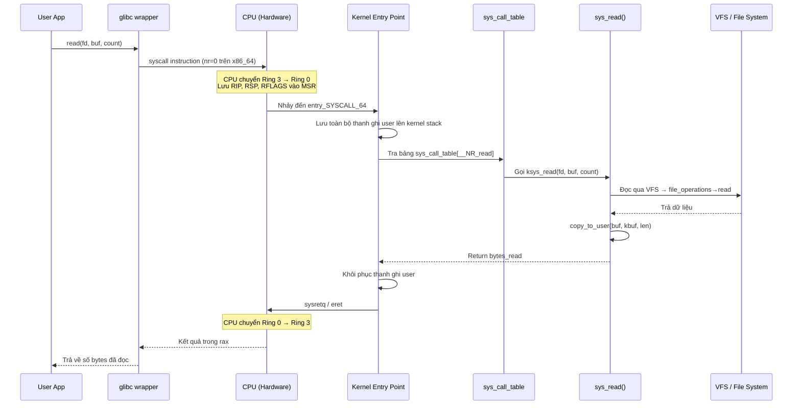

> [!IMPORTANT]
> **`copy_to_user()` / `copy_from_user()`** là hàm BẮT BUỘC khi truyền dữ liệu giữa kernel và user space. Nếu kernel đọc/ghi trực tiếp con trỏ user → **lỗ hổng bảo mật** hoặc **kernel panic** (con trỏ user có thể không hợp lệ trong kernel context).

### 🏭 Kinh nghiệm dự án

> *"Trong dự án ADAS trên i.MX8, tôi viết driver camera ISP. Ban đầu dùng `memcpy` trực tiếp từ kernel buffer sang user pointer → module hoạt động trên dev board nhưng crash ngẫu nhiên khi chạy thực tế vì user buffer bị swap ra disk. Sau khi chuyển sang `copy_to_user()` + kiểm tra `access_ok()`, lỗi biến mất hoàn toàn."*

---

## Câu 2: Cross-compile Kernel cho Board Đích

### 🔑 Keywords
`cross-compiler`, `toolchain`, `CROSS_COMPILE`, `ARCH`, `defconfig`, `menuconfig`, `Kconfig`, `Device Tree Source (.dts)`, `Device Tree Blob (.dtb)`, `zImage / Image`, `modules`, `CONFIG_PREEMPT_RT`, `CONFIG_CAN`, `out-of-tree build`

### 📚 Lý thuyết nền

**Cross-compilation là gì?**

Là quá trình biên dịch code trên máy **host** (ví dụ x86_64 PC) để tạo binary chạy trên máy **target** (ví dụ ARM Cortex-A53). Cần thiết vì:
- Target thường yếu, biên dịch trực tiếp quá chậm (board ARM biên dịch kernel mất hàng giờ vs vài phút trên PC).
- Target có thể chưa có OS để chạy compiler.

**Toolchain bao gồm:**
- **Cross-compiler** (`arm-linux-gnueabihf-gcc`): biên dịch code C/C++ thành mã máy ARM.
- **Binutils** (`arm-linux-gnueabihf-ld`, `objdump`): linker, assembler.
- **C library** (glibc, musl, uclibc): thư viện C chuẩn cho target.
- **GDB** (tùy chọn): debugger cho target.

**Hệ thống cấu hình kernel — Kconfig:**

Kernel Linux có hàng nghìn tùy chọn, được quản lý bởi hệ thống **Kconfig**. Mỗi tùy chọn có 3 trạng thái:
- `y` (built-in): biên dịch trực tiếp vào kernel image
- `m` (module): biên dịch thành file `.ko`, load khi cần
- `n` (disabled): không biên dịch

File `.config` chứa toàn bộ cấu hình. `defconfig` là phiên bản rút gọn chỉ chứa giá trị khác mặc định.

### 📝 Câu trả lời mẫu

> "Quy trình cross-compile kernel cho board đích gồm 6 bước chính:"

| Bước | Hành động | Lệnh | Giải thích |
|------|-----------|------|------------|
| **1** | Cài đặt toolchain | `sudo apt install gcc-arm-linux-gnueabihf` | Hoặc dùng toolchain từ vendor (NXP, TI, Renesas). Trong automotive, toolchain phải là phiên bản đã được **qualification** theo ISO‑26262 |
| **2** | Thiết lập biến môi trường | `export ARCH=arm`<br>`export CROSS_COMPILE=arm-linux-gnueabihf-` | Nói cho build system biết kiến trúc đích và prefix của compiler |
| **3** | Tạo cấu hình cơ sở | `make imx8_defconfig` | Dùng defconfig từ vendor BSP làm baseline — đã bật sẵn driver cho board |
| **4** | Tùy chỉnh cấu hình | `make menuconfig` | Giao diện ncurses để bật/tắt tùy chọn |
| **5** | Biên dịch | `make -j$(nproc) zImage dtbs modules` | `-j` để build song song. Kết quả: `zImage` (kernel), `*.dtb` (Device Tree), `*.ko` (modules) |
| **6** | Đóng gói | `make modules_install INSTALL_MOD_PATH=./rootfs` | Cài modules vào thư mục rootfs để đưa lên board |

**Các CONFIG quan trọng cho Automotive:**

| Config | Bật/Tắt | Lý do |
|--------|---------|-------|
| `CONFIG_PREEMPT_RT` | ✅ Bật | Biến kernel thành **real-time** — giảm worst-case latency xuống ~100µs. Bắt buộc cho ADAS khi cần xử lý frame camera < 33ms |
| `CONFIG_CAN` + `CONFIG_CAN_RAW` | ✅ Bật | Hỗ trợ giao thức CAN bus — giao tiếp với ECU trên xe |
| `CONFIG_HIGH_RES_TIMERS` | ✅ Bật | Timer chính xác ns-level cho scheduling real-time |
| `CONFIG_NO_HZ_FULL` | ✅ Bật | Giảm tick interrupt trên core chạy real-time task → giảm jitter |
| `CONFIG_DEBUG_INFO` | ❌ Tắt (production) | Giảm kích thước image từ ~200MB xuống ~20MB. Chỉ bật cho debug build |
| `CONFIG_KALLSYMS` | ❌ Tắt (production) | Bảng symbol chỉ cần khi debug oops/panic |
| `CONFIG_IKCONFIG` | ❌ Tắt | Tiết kiệm ~50KB trong kernel image |

### 🔄 Flow biên dịch

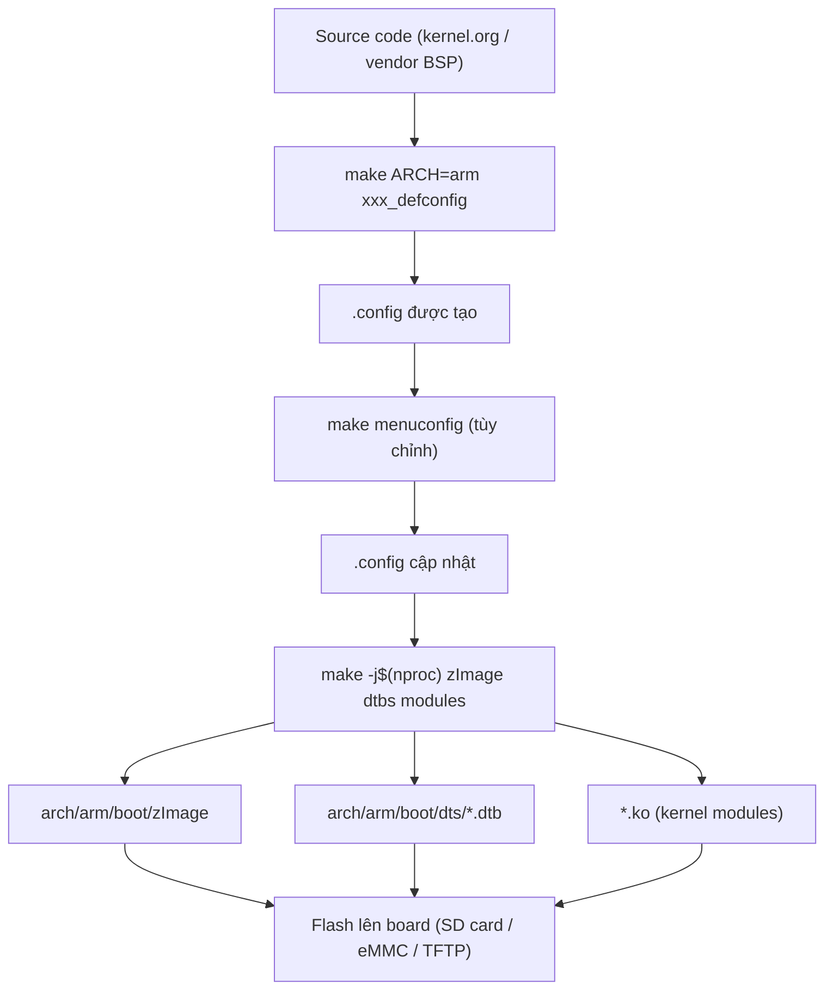

### 🏭 Kinh nghiệm dự án

> *"Trong dự án IVI (In-Vehicle Infotainment) trên R-Car H3 của Renesas, tôi cần bật `CONFIG_PREEMPT_RT` để đảm bảo audio playback không bị giật. Tuy nhiên, bật RT patch làm throughput network giảm ~15% do lock contention. Giải pháp: isolate 2 core cho RT task (`isolcpus=2,3`), 2 core còn lại chạy non-RT workload. Kết quả: audio latency < 5ms, network throughput không bị ảnh hưởng."*

---

## Câu 3: Kernel Build Xong Nhưng Không Chạy Trên Board

### 🔑 Keywords
`bootargs`, `console=`, `root=`, `Device Tree mismatch`, `earlyprintk / earlycon`, `kernel panic`, `VFS: Cannot open root device`, `wrong architecture`, `endianness`, `kernel version mismatch`

### 📚 Lý thuyết nền

Kernel không chạy được trên board có nhiều nguyên nhân, chia thành 3 nhóm chính:

**Nhóm 1 — Sai cấu hình bootloader:**
- `bootargs` thiếu `console=ttyS0,115200` → có log nhưng không thấy vì UART sai.
- `root=` trỏ sai partition → kernel boot OK nhưng panic khi mount rootfs ("VFS: Cannot open root device").

**Nhóm 2 — Mismatch giữa kernel và phần cứng:**
- DTB (Device Tree Blob) không khớp với board thực tế → kernel cố truy cập peripheral không tồn tại → hang hoặc crash.
- Kernel build cho ARMv7 nhưng board là ARMv8 (hoặc ngược lại).
- Kernel cần driver mà chưa được bật trong `.config`.

**Nhóm 3 — Lỗi image bị hỏng:**
- File zImage bị corrupt khi flash (copy thiếu bytes, lỗi NAND).
- Modules build từ kernel version khác → `insmod` báo "version magic mismatch".

### 📝 Câu trả lời mẫu — Checklist debug theo thứ tự ưu tiên

```
1. Có log gì từ serial console không?
   ├── KHÔNG có log gì cả
   │   ├── Kiểm tra dây UART (TX/RX đấu ngược?)
   │   ├── Kiểm tra baud rate (115200 8N1?)
   │   └── Bật earlycon trong bootargs: earlycon=uart8250,mmio32,0x...
   │
   ├── Có log U-Boot nhưng dừng ở "Starting kernel..."
   │   ├── DTB sai → xem Câu 5 bên dưới
   │   ├── Kernel image corrupt → so sánh checksum (md5sum)
   │   └── Kernel build sai ARCH → kiểm tra `file zImage`
   │
   └── Có log kernel nhưng panic
       ├── "VFS: Cannot open root device" → bootargs root= sai
       ├── "Unable to mount root fs" → rootfs type không được build trong kernel
       ├── "Kernel panic - not syncing" → đọc dòng trên để biết nguyên nhân
       └── Oops + call trace → đọc function name, dùng addr2line để tìm dòng code
```

### 🏭 Kinh nghiệm dự án

> *"Có lần board chạy kernel mới bị treo ngay sau 'Starting kernel...'. Sau 2 giờ debug, phát hiện DTB khai báo RAM size 2GB nhưng board thực chỉ có 1GB. Kernel cố truy cập vùng nhớ không tồn tại ngay khi khởi tạo page table → treo cứng. Sửa DTB `memory@80000000 { reg = <0x0 0x80000000 0x0 0x40000000>; }` (1GB thay vì 2GB) → boot thành công."*

---

# PHẦN 2: BOOT PROCESS & SYSTEM DEBUGGING (LO3)

---

## Câu 4: Chuỗi Boot — Bootloader → Kernel → Init → Userspace

### 🔑 Keywords
`Boot ROM`, `SPL (Secondary Program Loader)`, `U-Boot`, `Device Tree`, `zImage / Image decompression`, `initramfs / initrd`, `init (PID 1)`, `systemd`, `SysVinit`, `BusyBox init`, `mount rootfs`, `kernel command line`

### 📚 Lý thuyết nền

Quá trình boot của một embedded Linux system trải qua **4 giai đoạn chính**, mỗi giai đoạn có nhiệm vụ riêng và ràng buộc riêng:

**Giai đoạn 1 — Boot ROM (trong chip SoC):**
- Code **cố định trong silicon**, không thể sửa (factory-programmed).
- Nhiệm vụ: khởi tạo tối thiểu (CPU clock cơ bản), đọc **boot device** (eMMC, SD, NOR flash, USB) theo thứ tự ưu tiên do fuse hoặc pin bootstrap quyết định.
- Load First-Stage Bootloader (SPL) vào **internal SRAM** (OCRAM) — vì DRAM chưa được khởi tạo.
- Kích thước SRAM rất nhỏ (64KB–256KB) → SPL phải nhỏ gọn.

**Giai đoạn 2 — SPL + U-Boot (Bootloader):**
- **SPL (Secondary Program Loader):** khởi tạo **DRAM controller**, cấu hình clock tree, rồi load U-Boot đầy đủ vào DRAM.
- **U-Boot:** bootloader chính, cung cấp:
  - Shell tương tác (qua serial console)
  - Biến môi trường (`bootargs`, `bootcmd`, `bootdelay`)
  - Hỗ trợ nhiều giao thức: TFTP, NFS, USB, MMC
  - Load kernel image + DTB vào RAM tại địa chỉ xác định
  - Truyền `bootargs` (kernel command line) cho kernel

**Giai đoạn 3 — Linux Kernel:**
- Giải nén (nếu là zImage/Image.gz).
- Nhận DTB từ bootloader → parse để biết cấu hình phần cứng.
- Khởi tạo subsystem: **memory management**, **scheduler**, **interrupt controller**, **drivers** (theo thứ tự dependency).
- Mount **root filesystem** (từ `root=` trong bootargs).
- Chạy chương trình đầu tiên: thường là `/sbin/init` → trở thành **PID 1**.

**Giai đoạn 4 — Init → User Space:**
- **PID 1** là process cha của mọi process. Nếu PID 1 chết → kernel panic.
- Các init system phổ biến:
  - **SysVinit:** đọc `/etc/inittab`, chạy script tuần tự (`/etc/rc.d/`). Đơn giản nhưng chậm.
  - **systemd:** khởi tạo song song, quản lý dependency, cgroups, journal. Dùng cho hệ thống phức tạp.
  - **BusyBox init:** siêu nhẹ, phù hợp embedded. Đọc `/etc/inittab` đơn giản.

### 🔄 Flow chi tiết

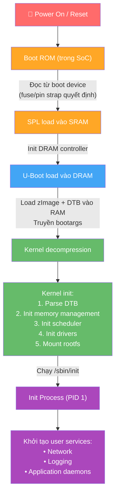

**Thời gian boot điển hình (embedded ARM):**

| Giai đoạn | Thời gian | Ghi chú |
|-----------|-----------|---------|
| Boot ROM | ~10ms | Cố định |
| SPL | ~100ms | Phụ thuộc DRAM init |
| U-Boot | ~1-3s | Có thể giảm bằng `bootdelay=0`, `silent` |
| Kernel | ~2-5s | Phụ thuộc số driver, có thể giảm bằng deferred probe |
| Init → ready | ~3-10s | Phụ thuộc số service, dùng systemd-analyze để tối ưu |
| **Tổng** | **~6-20s** | Automotive yêu cầu rear-view camera < 2s |

> [!WARNING]
> **Yêu cầu Automotive:** Tiêu chuẩn automotive yêu cầu camera lùi hiển thị trong **< 2 giây** sau khi bật nguồn. Để đạt được, cần: (1) skip hoặc rút gọn U-Boot, (2) dùng kernel XIP hoặc không nén, (3) chạy camera driver trước init, (4) dùng initramfs thay vì mount rootfs từ storage.

---

## Câu 5: Board Dừng Ở "Starting kernel..." — Phân Tích & Debug

### 🔑 Keywords
`earlycon`, `earlyprintk`, `CONFIG_DEBUG_LL`, `DTB mismatch`, `memory node`, `kernel decompression`, `wrong load address`, `MMU setup failure`, `JTAG debugger`

### 📚 Lý thuyết nền

Dòng `"Starting kernel ..."` là log **cuối cùng** do U-Boot in ra trước khi nhảy vào kernel. Sau đó, kernel phải tự thiết lập console output. Nếu không có log tiếp theo, có nghĩa kernel **đã nhận quyền điều khiển** nhưng **chết trước khi kịp cấu hình UART driver**.

**Nguyên nhân phổ biến (xếp theo tần suất gặp):**

1. **DTB sai — nguyên nhân #1 (60% trường hợp):**
   - Node `memory` khai báo sai kích thước hoặc địa chỉ RAM → kernel cố truy cập vùng nhớ không tồn tại khi setup page table → treo ngay lập tức.
   - Node `chosen` thiếu `stdout-path` → kernel không biết dùng UART nào → có thể vẫn chạy nhưng ta không thấy log.

2. **Kernel load ở địa chỉ sai (20%):**
   - U-Boot load zImage vào địa chỉ RAM mà kernel không expect → decompressor ghi đè lên chính nó → crash.
   - Ví dụ: kernel expect `0x80008000` nhưng U-Boot load vào `0x82000000`.

3. **Kernel build cho sai architecture (10%):**
   - Build cho ARMv7 (`ARCH=arm`) nhưng board là ARMv8 chạy AArch64 → CPU không hiểu instruction.

4. **Image bị corrupt (5%):**
   - CRC check pass trong U-Boot nhưng bị lỗi bit → kernel decompressor crash.

5. **Thiếu driver cho interrupt controller (5%):**
   - Kernel không thể đăng ký IRQ → treo khi cố init subsystem đầu tiên.

### 📝 Quy trình debug từng bước

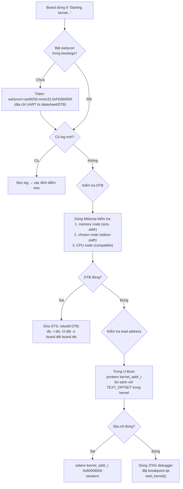

### 🏭 Kinh nghiệm dự án

> *"Trên board custom dùng i.MX6ULL, kernel dừng cứng sau 'Starting kernel...'. Thêm `earlycon` vẫn không có log. Dùng JTAG (J-Link) đặt breakpoint tại `start_kernel()` → không bao giờ đến. Lùi lại đặt tại `__hyp_stub_install` → CPU trap vào undefined instruction. Hóa ra, defconfig bật `CONFIG_ARM_LPAE` (Large Physical Address Extension) nhưng i.MX6ULL không hỗ trợ LPAE. Tắt config này → boot thành công."*

---

## Câu 6: Dùng Serial Console và U-Boot Để Xác Định Lỗi Boot

### 🔑 Keywords
`minicom`, `picocom`, `screen`, `115200 8N1`, `U-Boot shell`, `printenv`, `setenv`, `saveenv`, `bootcmd`, `bootargs`, `tftp`, `fatload`, `md` (memory display), `mw` (memory write), `crc32`

### 📚 Lý thuyết nền

**Serial Console — Tại sao không thể thiếu:**

Trong embedded, serial console (UART) là công cụ debug **cơ bản nhất** và **đáng tin cậy nhất**:
- Hoạt động từ rất sớm (trước khi có network, trước khi có display).
- Không cần driver phức tạp — chỉ cần 3 dây (TX, RX, GND).
- Hầu hết SoC đều có UART0 được chỉ định làm debug console.

**U-Boot Shell — Công cụ mạnh:**

U-Boot không chỉ là bootloader, nó là một **mini OS** với shell tương tác. Các lệnh debug quan trọng:

| Lệnh | Công dụng | Ví dụ |
|-------|-----------|-------|
| `printenv` | Xem toàn bộ biến môi trường | `printenv bootargs` |
| `setenv` | Đặt biến | `setenv bootargs console=ttyS0,115200 root=/dev/mmcblk0p2` |
| `saveenv` | Lưu env vào flash | (cẩn thận, ghi sai có thể brick board) |
| `md` | Đọc bộ nhớ (memory display) | `md.b 0x80000000 100` — đọc 256 bytes tại địa chỉ kernel |
| `mw` | Ghi bộ nhớ (memory write) | `mw.l 0x80000000 0xDEADBEEF` — test DRAM |
| `crc32` | Tính CRC của vùng nhớ | `crc32 0x80000000 0x500000` — verify kernel image |
| `fatload` | Load file từ FAT partition | `fatload mmc 0:1 0x80000000 zImage` |
| `tftp` | Load file qua network | `tftp 0x80000000 zImage` |
| `bootm` / `bootz` | Boot kernel | `bootz $kernel_addr_r - $fdt_addr_r` |
| `iminfo` | Hiện thông tin kernel image | Kiểm tra type, arch, compression |

### 📝 Workflow debug thực tế

```
Step 1: Kết nối serial
$ picocom -b 115200 /dev/ttyUSB0
(hoặc: minicom -D /dev/ttyUSB0 -b 115200)
(Windows: PuTTY → Serial → COM3 → 115200)

Step 2: Vào U-Boot shell
→ Nhấn phím bất kỳ khi thấy "Hit any key to stop autoboot"

Step 3: Kiểm tra environment
=> printenv bootargs
   bootargs=console=ttyS0,115200 root=/dev/mmcblk0p2 rw rootwait

=> printenv bootcmd
   bootcmd=fatload mmc 0:1 0x82000000 zImage; fatload mmc 0:1 0x88000000 board.dtb; bootz 0x82000000 - 0x88000000

Step 4: Verify kernel image
=> fatload mmc 0:1 0x82000000 zImage
   5765432 bytes read in 234 ms (23.5 MiB/s)
=> crc32 0x82000000 0x580000
   CRC32 for 82000000 ... 827fffff ==> a1b2c3d4
   (So sánh với CRC từ host: crc32 zImage)

Step 5: Verify DTB
=> fatload mmc 0:1 0x88000000 board.dtb
=> fdt addr 0x88000000
=> fdt print /memory
   memory {
       reg = <0x80000000 0x40000000>;  // 1GB tại 0x80000000 — đúng?
   };

Step 6: Boot thủ công
=> bootz 0x82000000 - 0x88000000
   (Quan sát log kernel)
```

### 🏭 Kinh nghiệm dự án

> *"Khi mang board đi triển lãm CES, board không boot được tại booth vì SD card bị lỗi sector. Tôi dùng U-Boot TFTP để load kernel qua Ethernet từ laptop: `setenv serverip 192.168.1.1; tftp 0x82000000 zImage; tftp 0x88000000 board.dtb; bootz...`. Demo chạy thành công mà không cần thay SD card."*

---

# PHẦN 3: YOCTO PROJECT / BUILDROOT (LO4–LO7)

---

## Câu 7: Layer, Recipe và BitBake — Cách Image Được Build

### 🔑 Keywords
`layer (meta-*)`, `recipe (.bb)`, `append (.bbappend)`, `BitBake`, `OE-Core (openembedded-core)`, `DEPENDS`, `RDEPENDS`, `task (do_fetch, do_unpack, do_patch, do_configure, do_compile, do_install, do_package, do_rootfs)`, `MACHINE`, `DISTRO`, `IMAGE_INSTALL`, `sstate-cache`, `DL_DIR`

### 📚 Lý thuyết nền

**Yocto Project là gì?**

Yocto **không phải là một Linux distribution**. Nó là một **framework** để **tạo ra** Linux distribution tùy chỉnh cho embedded. Giống như một "nhà máy sản xuất OS" — bạn đưa vào nguyên liệu (source code, config) và nó output ra image hoàn chỉnh.

**3 khái niệm nền tảng:**

**1. Layer (Lớp):**
- Một thư mục chứa các recipe và config, có tiền tố `meta-`.
- Mục đích: **tách biệt mối quan tâm** (separation of concerns).
- Phân loại:
  - `meta` (OE-Core): layer cơ bản, chứa recipe cho toolchain, glibc, busybox, gcc...
  - `meta-poky`: reference distribution.
  - `meta-<vendor>` (ví dụ `meta-imx`, `meta-ti`): BSP layer chứa kernel, bootloader, driver cho board cụ thể.
  - `meta-<project>`: layer riêng cho dự án, chứa application recipes.
- Layer có **priority** — layer có priority cao sẽ override recipe trùng tên ở layer priority thấp.

**2. Recipe (.bb):**
- File mô tả cách build **một package** — giống "công thức nấu ăn" cho một phần mềm.
- Nội dung gồm: nguồn lấy ở đâu (`SRC_URI`), build thế nào (`do_compile`), cài đặt ở đâu (`do_install`), phụ thuộc gì (`DEPENDS`, `RDEPENDS`).
- `.bbappend`: file bổ sung/override recipe gốc mà không sửa trực tiếp (giữ layer gốc sạch).

**3. BitBake:**
- Build engine trung tâm, giống `make` nhưng mạnh hơn rất nhiều.
- Parse tất cả recipe → xây dựng **dependency graph** → thực thi task theo đúng thứ tự.
- Hỗ trợ **shared state cache** (`sstate-cache`): không rebuild thứ đã build rồi → tiết kiệm hàng giờ.

**Quy trình build một image:**

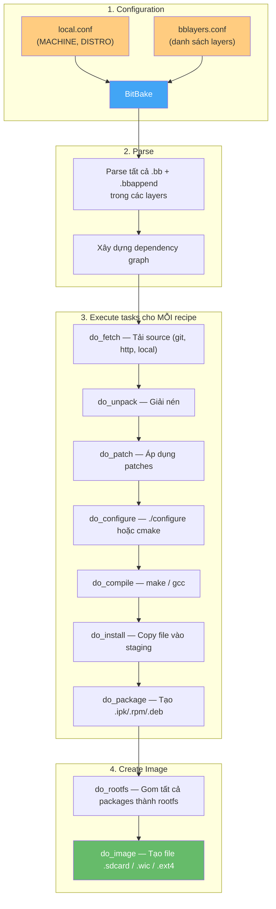

### 🏭 Kinh nghiệm dự án

> *"Trong dự án ADAS, cấu trúc layer gồm: `meta-poky` (base), `meta-renesas` (BSP cho R-Car), `meta-adas` (layer riêng chứa app nhận diện, camera pipeline, CAN handler). Tôi tạo `meta-adas` riêng để team app và team BSP có thể commit độc lập mà không conflict. Khi thêm board mới (từ R-Car H3 sang M3), chỉ cần đổi MACHINE trong local.conf mà không sửa gì trong meta-adas."*

---

## Câu 8: Viết Recipe Cơ Bản & Đưa Package Vào Image

### 🔑 Keywords
`SRC_URI`, `S`, `B`, `D`, `WORKDIR`, `do_compile`, `do_install`, `inherit`, `IMAGE_INSTALL:append`, `RDEPENDS`, `FILES`, `LICENSE`, `LIC_FILES_CHKSUM`

### 📚 Lý thuyết nền

**Các biến quan trọng trong recipe:**

| Biến | Ý nghĩa | Ví dụ |
|------|---------|-------|
| `SRC_URI` | Nơi lấy source code | `git://github.com/...;branch=main`, `file://myapp.c`, `http://...tar.gz` |
| `S` | Thư mục source sau khi unpack | `${WORKDIR}/git` (cho git), `${WORKDIR}` (cho file local) |
| `B` | Thư mục build (nếu khác S) | `${WORKDIR}/build` |
| `D` | Thư mục **destination** — staging area tạm | `do_install` cài vào `${D}`, BitBake sẽ package từ đây |
| `DEPENDS` | Build-time dependencies | `DEPENDS = "openssl zlib"` — cần header + lib khi compile |
| `RDEPENDS` | Runtime dependencies | `RDEPENDS:${PN} = "libssl"` — cần lib khi chạy trên target |
| `LICENSE` | License của package | `LICENSE = "MIT"`, `LICENSE = "GPLv2"` |
| `LIC_FILES_CHKSUM` | Checksum file license (bắt buộc) | `LIC_FILES_CHKSUM = "file://LICENSE;md5=..."` |

### 📝 Recipe hoàn chỉnh (ví dụ thực tế)

```bitbake
# can-monitor_1.0.bb — Ứng dụng giám sát CAN bus
SUMMARY = "CAN bus monitoring daemon for automotive"
DESCRIPTION = "Đọc và log CAN frames từ SocketCAN interface"
LICENSE = "MIT"
LIC_FILES_CHKSUM = "file://LICENSE;md5=abc123..."

# Nguồn từ git repository
SRC_URI = "git://github.com/myteam/can-monitor.git;branch=main;protocol=https"
SRCREV = "a1b2c3d4e5f6..."
S = "${WORKDIR}/git"

# Phụ thuộc build-time
DEPENDS = "libsocketcan"

# Phụ thuộc runtime
RDEPENDS:${PN} = "libsocketcan can-utils"

# Build
do_compile() {
    ${CC} ${CFLAGS} ${LDFLAGS} -lsocketcan \
        -o can-monitor ${S}/src/main.c ${S}/src/parser.c
}

# Cài đặt
do_install() {
    # Binary
    install -d ${D}${bindir}
    install -m 0755 can-monitor ${D}${bindir}

    # Config file
    install -d ${D}${sysconfdir}
    install -m 0644 ${S}/config/can-monitor.conf ${D}${sysconfdir}

    # Systemd service
    install -d ${D}${systemd_system_unitdir}
    install -m 0644 ${S}/systemd/can-monitor.service ${D}${systemd_system_unitdir}
}

# Khai báo service cho systemd
inherit systemd
SYSTEMD_SERVICE:${PN} = "can-monitor.service"

# Khai báo files thuộc package
FILES:${PN} += "${sysconfdir}/can-monitor.conf"
```

**Đưa vào image:**

Cách 1 — Thêm vào `local.conf`:
```
IMAGE_INSTALL:append = " can-monitor"
```

Cách 2 — Tạo custom image recipe:
```bitbake
# my-automotive-image.bb
require recipes-core/images/core-image-minimal.bb
IMAGE_INSTALL:append = " can-monitor v4l-utils gstreamer1.0"
```

---

## Câu 9: Tích Hợp BSP Layer Cho Board Mới

### 🔑 Keywords
`BSP (Board Support Package)`, `MACHINE`, `machine.conf`, `bblayers.conf`, `local.conf`, `PREFERRED_PROVIDER`, `PREFERRED_VERSION`, `kernel-devicetree`, `UBOOT_MACHINE`

### 📚 Lý thuyết nền

**BSP Layer là gì?**

BSP (Board Support Package) Layer chứa tất cả những gì **đặc thù cho phần cứng** của một board/SoC:
- Recipe cho kernel (với patches, defconfig riêng).
- Recipe cho U-Boot (với board config riêng).
- Device Tree Sources (`.dts`).
- Driver cho peripheral đặc biệt (GPU, ISP, VPU).
- Machine configuration file (`machine.conf`).

**`machine.conf` — File cốt lõi:**

File này nằm ở `meta-bsp/conf/machine/<machine-name>.conf` và định nghĩa:

```bitbake
# imx8mm-custom.conf
#@TYPE: Machine
#@NAME: Custom i.MX8M Mini Board

SOC_FAMILY = "imx8mm"
require conf/machine/include/imx-base.inc

# Kernel
PREFERRED_PROVIDER_virtual/kernel = "linux-imx"
PREFERRED_VERSION_linux-imx = "5.15%"
KERNEL_DEVICETREE = "freescale/imx8mm-custom.dtb"

# U-Boot
PREFERRED_PROVIDER_virtual/bootloader = "u-boot-imx"
UBOOT_CONFIG = "sd"
UBOOT_CONFIG[sd] = "imx8mm_custom_defconfig,sdcard"

# Serial console
SERIAL_CONSOLES = "115200;ttymxc1"

# Image type
IMAGE_FSTYPES = "wic.gz tar.bz2"

# Hardware features
MACHINE_FEATURES = "usbhost wifi bluetooth can"
```

### 📝 Các bước tích hợp BSP layer mới

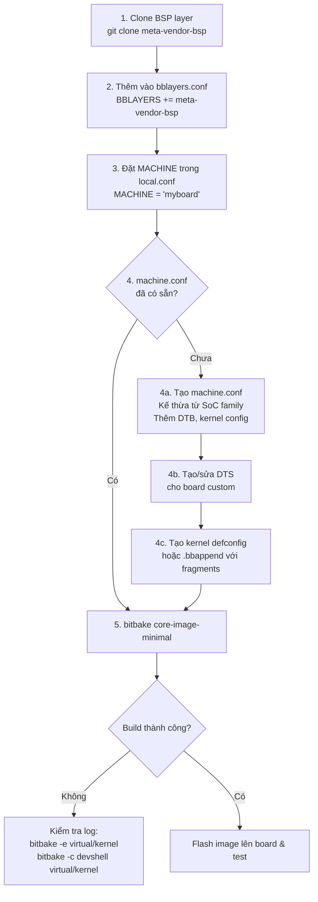

---

## Câu 10: Khi Nào Chọn Buildroot Thay Vì Yocto?

### 🔑 Keywords
`Buildroot`, `Yocto`, `Kconfig`, `rootfs`, `BusyBox`, `minimal footprint`, `build time`, `learning curve`, `reproducibility`, `sstate-cache`

### 📚 Lý thuyết nền — So sánh chi tiết

| Tiêu chí | **Yocto** | **Buildroot** |
|-----------|-----------|---------------|
| **Mô hình** | Framework tạo distribution | Tool tạo rootfs |
| **Cấu hình** | Recipe (.bb) + BitBake | Kconfig (giống kernel) |
| **Độ phức tạp** | Cao — cần hiểu layer, class, bbappend | Thấp — 1 Makefile, `make menuconfig` |
| **Build time lần đầu** | 1–4 giờ | 15–45 phút |
| **Rebuild (incremental)** | Nhanh nhờ `sstate-cache` | Phải build lại từ đầu (thường) |
| **Kích thước rootfs tối thiểu** | ~50MB (core-image-minimal) | ~5MB (BusyBox + musl libc) |
| **Package management** | Có (ipk/rpm/deb) — cập nhật OTA được | Không (image tĩnh) |
| **Cộng đồng & vendor support** | Rộng lớn, nhiều BSP chính thức | Nhỏ hơn, ít BSP chính thức |
| **Phù hợp cho** | Sản phẩm phức tạp, cần maintain lâu dài, nhiều team | Prototype, sản phẩm đơn giản, tài nguyên cực hạn chế |

**Chọn Buildroot khi:**
1. Board có **< 64MB RAM**, **< 32MB Flash** (ví dụ IoT sensor node).
2. Cần **boot time cực nhanh** (< 1 giây).
3. Chỉ chạy **1-2 ứng dụng** cố định.
4. Team nhỏ, cần **prototype nhanh**.

**Các bước tạo minimal rootfs với Buildroot:**

```bash
# 1. Clone
git clone https://github.com/buildroot/buildroot.git
cd buildroot

# 2. Chọn config cơ sở
make qemu_arm_versatile_defconfig   # hoặc board-specific config

# 3. Tùy chỉnh
make menuconfig
# Target options → Architecture: ARM
# Toolchain → C library: musl (nhỏ hơn glibc)
# System configuration → Init system: BusyBox
# Filesystem images → ext2/3/4 root filesystem

# 4. Build
make -j$(nproc)

# 5. Output
# output/images/rootfs.ext2   — root filesystem image
# output/images/zImage         — kernel (nếu build kernel)
# output/target/               — nội dung rootfs (có thể inspect)
```

---

# PHẦN 4: DEVICE DRIVER DEVELOPMENT (LO8–LO10)

---

## Câu 11: Character, Block, Network Device — So Sánh Chi Tiết

### 🔑 Keywords
`character device`, `block device`, `network device`, `major/minor number`, `file_operations`, `block_device_operations`, `net_device_ops`, `ioctl`, `sysfs`, `debugfs`, `mmap`, `netlink`, `/dev/`, `request queue`, `NAPI`, `socket buffer (skb)`

### 📚 Lý thuyết nền

**Triết lý "Everything is a file" trong Linux:**

Linux trừu tượng hóa phần cứng thành **file** trong `/dev/`. Ứng dụng user space tương tác với hardware bằng các system call quen thuộc: `open()`, `read()`, `write()`, `close()`, `ioctl()`. Driver đăng ký các hàm callback để xử lý các system call này.

| Loại | Đặc điểm | Ví dụ thiết bị | Interface chính | Truy cập |
|------|-----------|----------------|-----------------|----------|
| **Character Device** | Truy cập tuần tự, từng byte. Không có buffer cache. Đơn giản nhất. | UART (`/dev/ttyS0`), GPIO, I2C, SPI, sensor, LED | `struct file_operations` — `open, read, write, ioctl, release, poll, mmap` | `/dev/mydev` (major:minor) |
| **Block Device** | Truy cập ngẫu nhiên, theo block (thường 512B/4KB). Có **request queue** để tối ưu I/O (merge, reorder). | eMMC, SD card, SSD, RAM disk | `struct block_device_operations` — `open, release, ioctl`<br/>`struct gendisk`, `submit_bio()` | `/dev/mmcblk0`, `/dev/sda` |
| **Network Device** | Không có file trong `/dev/`. Giao tiếp qua **socket API**. Dùng **interrupt + NAPI polling** để nhận packet hiệu quả. | Ethernet, Wi-Fi, CAN | `struct net_device_ops` — `ndo_open, ndo_stop, ndo_start_xmit`<br/>`struct sk_buff` (socket buffer) | `eth0`, `can0`, `wlan0` |

**Cơ chế giao tiếp Kernel ↔ User Space:**

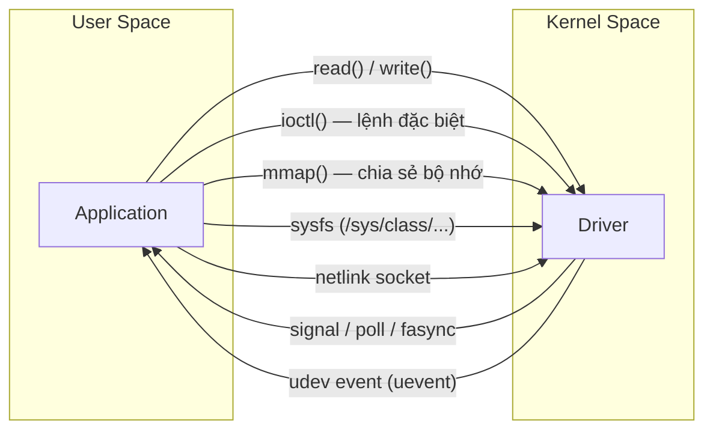

| Cơ chế | Khi nào dùng | Ưu điểm |
|--------|-------------|---------|
| `read()/write()` | Truyền dữ liệu đơn giản | Quen thuộc, dễ dùng |
| `ioctl()` | Lệnh điều khiển (set baudrate, get status) | Linh hoạt, truyền được struct phức tạp |
| `mmap()` | Chia sẻ buffer lớn (video frame, DMA buffer) | Zero-copy, hiệu suất cao |
| `sysfs` | Export thông tin/config đơn giản | Dễ dùng từ shell (`cat`, `echo`) |
| `debugfs` | Debug-only info | Không có trong production |
| `netlink` | Giao tiếp bất đồng bộ, multicast | Dùng cho network config, udev |
| `procfs` | Thông tin process/system | Legacy, nên dùng sysfs cho driver mới |

---

## Câu 12: Viết Kernel Module GPIO/I2C/SPI

### 🔑 Keywords
`module_init`, `module_exit`, `__init`, `__exit`, `platform_driver`, `of_match_table`, `probe`, `remove`, `devm_*` (managed resources), `gpio descriptor API (gpiod_*)`, `i2c_driver`, `spi_driver`, `Device Tree binding`

### 📚 Lý thuyết nền

**Kernel module lifecycle:**

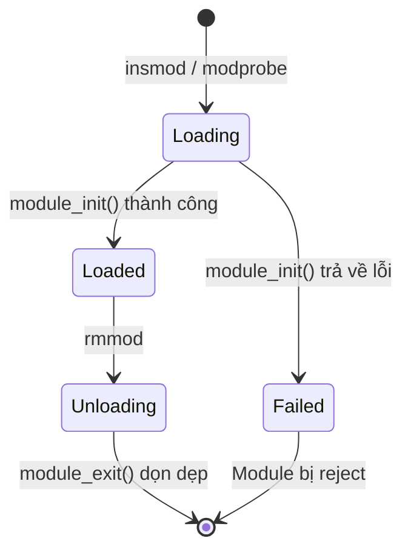

**Modern Driver Model — Platform Driver + Device Tree:**

Kernel hiện đại **không** hardcode thông tin phần cứng trong driver code. Thay vào đó:
1. **Device Tree** mô tả phần cứng (địa chỉ, interrupt, GPIO pin...).
2. **Driver** đăng ký một `compatible` string.
3. Khi kernel parse DTB và tìm thấy node có `compatible` khớp → gọi hàm `probe()` của driver.

Đây là nguyên tắc **separation of data and logic** — giúp cùng một driver chạy trên nhiều board khác nhau chỉ bằng cách thay DTB.

### 📝 Ví dụ: GPIO LED Driver (Modern Style)

**Device Tree node:**
```dts
/ {
    my-led {
        compatible = "myvendor,gpio-led";
        led-gpios = <&gpio1 23 GPIO_ACTIVE_HIGH>;
        status = "okay";
    };
};
```

**Driver code:**
```c
#include <linux/module.h>
#include <linux/platform_device.h>
#include <linux/of.h>
#include <linux/gpio/consumer.h>
#include <linux/fs.h>
#include <linux/miscdevice.h>
#include <linux/uaccess.h>

struct myled_data {
    struct gpio_desc *gpio;
    struct miscdevice misc;
};

static ssize_t myled_write(struct file *file, const char __user *buf,
                           size_t count, loff_t *ppos)
{
    struct myled_data *data = container_of(file->private_data,
                                           struct myled_data, misc);
    char val;
    if (copy_from_user(&val, buf, 1))
        return -EFAULT;
    gpiod_set_value(data->gpio, val == '1');
    return count;
}

static const struct file_operations myled_fops = {
    .owner = THIS_MODULE,
    .write = myled_write,
};

/* Hàm probe — được gọi khi kernel tìm thấy DT node khớp */
static int myled_probe(struct platform_device *pdev)
{
    struct myled_data *data;

    /* devm_kzalloc: bộ nhớ tự động free khi driver remove */
    data = devm_kzalloc(&pdev->dev, sizeof(*data), GFP_KERNEL);
    if (!data)
        return -ENOMEM;

    /* devm_gpiod_get: tự động release GPIO khi remove */
    data->gpio = devm_gpiod_get(&pdev->dev, "led", GPIOD_OUT_LOW);
    if (IS_ERR(data->gpio))
        return PTR_ERR(data->gpio);

    data->misc.minor = MISC_DYNAMIC_MINOR;
    data->misc.name = "myled";
    data->misc.fops = &myled_fops;

    platform_set_drvdata(pdev, data);
    return misc_register(&data->misc);
}

static int myled_remove(struct platform_device *pdev)
{
    struct myled_data *data = platform_get_drvdata(pdev);
    misc_deregister(&data->misc);
    /* Không cần free gpio hay kzalloc — devm tự dọn */
    return 0;
}

/* Bảng matching — liên kết driver với DT compatible string */
static const struct of_device_id myled_of_match[] = {
    { .compatible = "myvendor,gpio-led" },
    { /* sentinel */ }
};
MODULE_DEVICE_TABLE(of, myled_of_match);

static struct platform_driver myled_driver = {
    .probe  = myled_probe,
    .remove = myled_remove,
    .driver = {
        .name = "myled",
        .of_match_table = myled_of_match,
    },
};
module_platform_driver(myled_driver);

MODULE_LICENSE("GPL");
MODULE_AUTHOR("Your Name");
MODULE_DESCRIPTION("Simple GPIO LED driver with Device Tree");
```

> [!TIP]
> **`devm_*` (device-managed resources):** Luôn ưu tiên dùng `devm_kzalloc`, `devm_gpiod_get`, `devm_request_irq`... thay vì phiên bản không có `devm`. Resource sẽ **tự động giải phóng** khi `remove()` hoặc khi probe fail → tránh memory leak và use-after-free.

### 📝 Ví dụ I2C Sensor Driver (skeleton)

```c
static const struct of_device_id mysensor_of_match[] = {
    { .compatible = "myvendor,temp-sensor" },
    { }
};

static int mysensor_probe(struct i2c_client *client,
                           const struct i2c_device_id *id)
{
    int temp_raw;

    /* Đọc thanh ghi temperature từ I2C device */
    temp_raw = i2c_smbus_read_word_data(client, 0x00);
    if (temp_raw < 0)
        return temp_raw;

    dev_info(&client->dev, "Temperature: %d.%d°C\n",
             temp_raw >> 4, (temp_raw & 0xF) * 625 / 100);
    return 0;
}

static struct i2c_driver mysensor_driver = {
    .driver = {
        .name = "mysensor",
        .of_match_table = mysensor_of_match,
    },
    .probe = mysensor_probe,
};
module_i2c_driver(mysensor_driver);
```

---

## Câu 13: Debug Module Load Lỗi / Kernel Panic

### 🔑 Keywords
`dmesg`, `printk`, `pr_info/pr_err/pr_debug`, `ftrace`, `trace-cmd`, `kernel oops`, `kernel panic`, `call trace`, `addr2line`, `objdump`, `KASAN`, `lockdep`, `kprobes`, `dynamic debug`

### 📚 Lý thuyết nền

**Phân biệt Oops và Panic:**
- **Oops:** Kernel phát hiện lỗi nhưng **cố gắng tiếp tục** chạy. Process gây lỗi bị kill. Hệ thống có thể không ổn định.
- **Panic:** Lỗi **nghiêm trọng** không thể phục hồi → hệ thống dừng hoàn toàn. Xảy ra khi: Oops trong interrupt context, Oops trong PID 1, hoặc lỗi quan trọng (filesystem corruption, out of memory killer fail).

**Đọc hiểu một Oops message:**

```
[  123.456789] Unable to handle kernel NULL pointer dereference at virtual address 00000010
[  123.456790] pgd = 80004000
[  123.456791] [00000010] *pgd=00000000
[  123.456792] Internal error: Oops: 5 [#1] PREEMPT ARM
[  123.456793] Modules linked in: mydriver(O)          ← Module gây lỗi
[  123.456794] CPU: 0 PID: 1234 Comm: my_app
[  123.456795] PC is at mydriver_read+0x1c/0x40 [mydriver]  ← Hàm và offset
[  123.456796] LR is at vfs_read+0xb4/0x190
...
[  123.456800] Call trace:                              ← Stack trace
[  123.456801]  mydriver_read+0x1c/0x40 [mydriver]
[  123.456802]  vfs_read+0xb4/0x190
[  123.456803]  ksys_read+0x64/0xd0
[  123.456804]  sys_read+0x10/0x18
```

**Từ offset tìm ra dòng code lỗi:**
```bash
# Trên host, dùng addr2line hoặc objdump
arm-linux-gnueabihf-addr2line -e mydriver.ko -f 0x1c
# Output: mydriver_read tại file mydriver.c dòng 42

# Hoặc disassemble:
arm-linux-gnueabihf-objdump -dS mydriver.ko | less
# Tìm offset 0x1c trong hàm mydriver_read
```

### 📝 Bộ công cụ debug theo cấp độ

| Cấp độ | Công cụ | Cách dùng | Khi nào dùng |
|--------|---------|-----------|--------------|
| **1. Cơ bản** | `dmesg` | `dmesg -w` (theo dõi real-time) | Luôn luôn — xem log kernel |
| **1. Cơ bản** | `printk` | `pr_info("value = %d\n", val);` | Thêm vào code, rebuild module |
| **2. Trung bình** | `dynamic debug` | `echo 'file mydriver.c +p' > /sys/kernel/debug/dynamic_debug/control` | Bật log cho file cụ thể mà không cần rebuild |
| **2. Trung bình** | `ftrace` | `echo function_graph > current_tracer` | Xem call graph — ai gọi ai, mất bao lâu |
| **3. Nâng cao** | `trace-cmd` | `trace-cmd record -p function_graph -g mydriver_probe` | Record + visualize execution trace |
| **3. Nâng cao** | `KASAN` | Bật `CONFIG_KASAN` → rebuild kernel | Phát hiện use-after-free, buffer overflow |
| **3. Nâng cao** | `lockdep` | Bật `CONFIG_LOCKDEP` | Phát hiện deadlock tiềm ẩn |
| **4. Hardware** | JTAG | OpenOCD + GDB | Khi kernel crash quá sớm, không có log |

### 📝 Quy trình debug module load failure

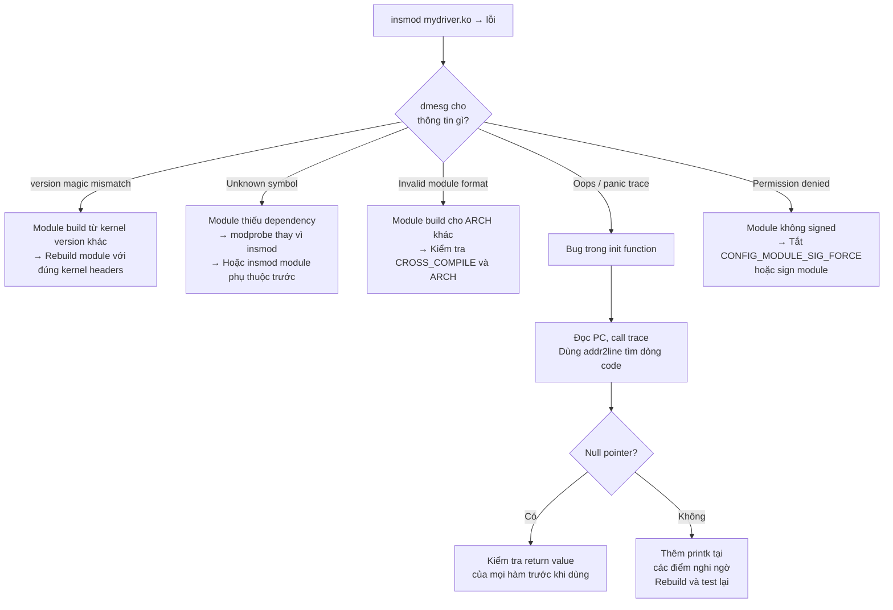

### 🏭 Kinh nghiệm dự án

> *"Driver CAN trên board gây kernel panic ngẫu nhiên ~ mỗi 2-3 giờ. `dmesg` chỉ hiện 'BUG: unable to handle kernel paging request'. Bật KASAN → phát hiện use-after-free trong interrupt handler: sau khi `kfree(skb)`, ISR cũ vẫn cố access skb do race condition giữa TX complete interrupt và timer callback. Fix bằng cách thêm `spin_lock_irqsave()` bảo vệ vùng critical. Sau đó chạy stress test 72 giờ không crash."*

---

# PHẦN 5: AUTOMOTIVE PROTOCOLS — CAN BUS (LO11, LO12)

---

## Câu 14: Cấu Trúc CAN Frame, Arbitration & Error Handling

### 🔑 Keywords
`CAN 2.0A (Standard)`, `CAN 2.0B (Extended)`, `CAN FD`, `SOF`, `Arbitration field`, `Control field`, `Data field`, `CRC field`, `ACK slot`, `EOF`, `dominant (0)`, `recessive (1)`, `bit-stuffing`, `TEC (Transmit Error Counter)`, `REC (Receive Error Counter)`, `Error Active`, `Error Passive`, `Bus-Off`

### 📚 Lý thuyết nền

**CAN Bus là gì?**

CAN (Controller Area Network) là giao thức truyền thông **serial, multi-master, broadcast** được thiết kế cho môi trường **nhiễu cao** (automotive, công nghiệp). Đặc điểm:
- **Không có master/slave** — mọi node đều bình đẳng.
- **Broadcast** — tất cả node nhận mọi frame, lọc theo ID.
- **Ưu tiên dựa trên ID** — ID thấp = ưu tiên cao.
- **Phát hiện lỗi mạnh** — 5 cơ chế phát hiện lỗi, tỷ lệ lỗi không phát hiện < 4.7 × 10⁻¹¹.

**Cấu trúc CAN Frame (Standard - CAN 2.0A):**

```
┌─────┬─────────────────┬─────────┬──────────┬──────────┬─────┬───┬─────┬───────┐
│ SOF │ Arbitration      │ Control │ Data     │ CRC      │ ACK │   │ EOF │ IFS   │
│ 1b  │ Field (12 bits) │ (6b)    │ (0-64b)  │ (16b)    │ (2b)│DEL│ (7b)│ (3b)  │
│     │ ┌────────┬─────┐│         │          │          │     │   │     │       │
│     │ │ ID     │ RTR ││ IDE│r│DLC│ Byte0..7 │ CRC│DEL  │ ACK │   │     │       │
│     │ │ 11-bit │ 1b  ││ 1b │1│4b │          │ 15b│1b   │ 2b  │   │     │       │
│     │ └────────┴─────┘│         │          │          │     │   │     │       │
└─────┴─────────────────┴─────────┴──────────┴──────────┴─────┴───┴─────┴───────┘
```

| Trường | Bits | Chức năng |
|--------|------|-----------|
| **SOF** (Start of Frame) | 1 | Dominant bit, đồng bộ hóa tất cả node |
| **ID** (Identifier) | 11 (Standard) / 29 (Extended) | Xác định nội dung frame VÀ mức ưu tiên |
| **RTR** (Remote Transmission Request) | 1 | 0 = Data frame, 1 = Remote frame (yêu cầu dữ liệu) |
| **IDE** (Identifier Extension) | 1 | 0 = Standard (11-bit ID), 1 = Extended (29-bit ID) |
| **DLC** (Data Length Code) | 4 | Số byte dữ liệu (0–8, CAN FD: 0–64) |
| **Data** | 0–64 bits | Payload thực tế |
| **CRC** | 15 + 1 delimiter | Checksum để phát hiện lỗi |
| **ACK** | 1 + 1 delimiter | Receiver ghi dominant để xác nhận đã nhận |
| **EOF** (End of Frame) | 7 | 7 recessive bits |

**Cơ chế Arbitration (Phân xử ưu tiên):**

Khi 2+ node gửi cùng lúc, CAN dùng **CSMA/CD+AMP** (Carrier Sense Multiple Access / Collision Detection + Arbitration on Message Priority):

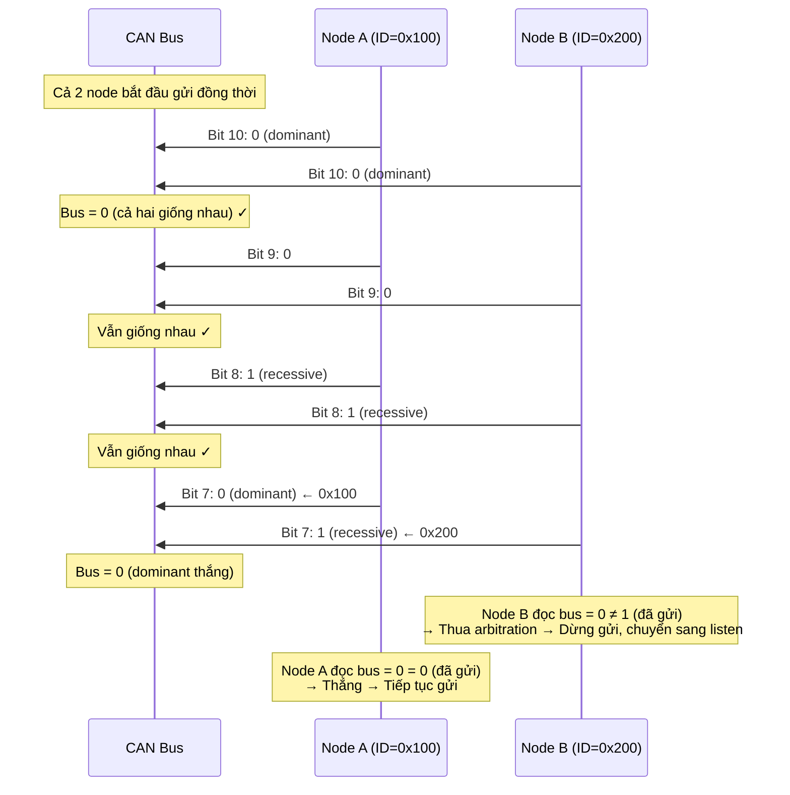

**Điểm mấu chốt:** ID nhỏ hơn → nhiều bit dominant hơn → **luôn thắng** arbitration. Vì vậy, message quan trọng nhất (phanh, lái) phải được gán ID thấp nhất.

**Error Handling — 5 cơ chế:**

| Cơ chế | Mô tả |
|--------|-------|
| **Bit Error** | Node gửi bit nhưng đọc lại từ bus thấy khác (ngoài arbitration field) |
| **Stuff Error** | Sau 5 bit liên tiếp giống nhau, bit thứ 6 phải khác (bit-stuffing rule) |
| **CRC Error** | CRC tính lại ≠ CRC nhận được |
| **Form Error** | Fixed-form field (EOF, delimiter) có giá trị sai |
| **ACK Error** | Transmitter không nhận được dominant bit trong ACK slot (không ai xác nhận) |

**Error State Machine:**

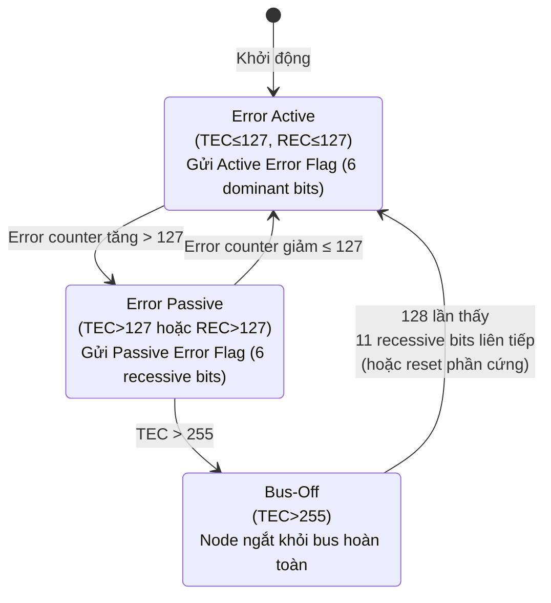

---

## Câu 15: Cấu Hình SocketCAN & Sử Dụng can-utils

### 🔑 Keywords
`SocketCAN`, `socket API`, `AF_CAN`, `can_raw`, `can_bcm`, `ip link`, `cansend`, `candump`, `cangen`, `canplayer`, `cansniffer`, `can_filter`, `loopback`

### 📚 Lý thuyết nền

**SocketCAN là gì?**

SocketCAN là subsystem trong Linux kernel cung cấp giao diện **socket chuẩn** cho CAN bus. Thay vì mỗi driver CAN có API riêng, SocketCAN trừu tượng hóa → ứng dụng dùng `socket()`, `bind()`, `read()`, `write()` giống như network programming.

**Kiến trúc:**

```
┌──────────────────────────────────────────────┐
│                 User Space                   │
│  ┌──────────┐  ┌──────────┐  ┌──────────┐   │
│  │ candump  │  │ cansend  │  │ Your App │   │
│  └────┬─────┘  └────┬─────┘  └────┬─────┘   │
│       │              │              │         │
│  ═════╪══════════════╪══════════════╪═══════  │
│       │     socket(AF_CAN, ...)     │         │
├───────┼──────────────┼──────────────┼─────────┤
│       │         Kernel Space        │         │
│  ┌────▼──────────────▼──────────────▼─────┐   │
│  │         SocketCAN Core                 │   │
│  │   ┌───────────┐  ┌───────────┐         │   │
│  │   │ CAN_RAW   │  │ CAN_BCM   │         │   │
│  │   │ (raw CAN) │  │(broadcast │         │   │
│  │   │           │  │ manager)  │         │   │
│  │   └─────┬─────┘  └─────┬─────┘         │   │
│  └─────────┼───────────────┼──────────────┘   │
│       ┌────▼───────────────▼────┐              │
│       │   CAN Network Device    │              │
│       │   (can0, can1, vcan0)   │              │
│       └────────────┬────────────┘              │
│                    │                           │
│       ┌────────────▼────────────┐              │
│       │   Hardware CAN Driver    │              │
│       │   (mcp251x, flexcan,     │              │
│       │    peak_usb, kvaser...)   │              │
│       └────────────┬────────────┘              │
└────────────────────┼─────────────────────────┘
                     │
              ┌──────▼──────┐
              │ CAN Hardware │
              │ (Transceiver)│
              └─────────────┘
```

### 📝 Cấu hình & Sử dụng từng bước

```bash
# ═══════════════════════════════════════════
# BƯỚC 1: Load kernel modules
# ═══════════════════════════════════════════
modprobe can         # CAN core
modprobe can_raw     # Raw CAN protocol
modprobe can_bcm     # Broadcast Manager (optional)
modprobe mcp251x     # Hardware driver (tùy board)
# Hoặc: modprobe flexcan (NXP i.MX), modprobe peak_usb (PEAK USB adapter)

# ═══════════════════════════════════════════
# BƯỚC 2: Cấu hình CAN interface
# ═══════════════════════════════════════════
# Set bitrate (phải khớp với các ECU khác trên bus)
ip link set can0 type can bitrate 500000

# Các tùy chọn nâng cao:
ip link set can0 type can \
    bitrate 500000 \
    sample-point 0.875 \       # Điểm lấy mẫu (87.5% — chuẩn automotive)
    restart-ms 100 \           # Tự restart sau bus-off (100ms)
    berr-reporting on \        # Bật báo cáo bit error
    listen-only off            # off = tham gia gửi, on = chỉ lắng nghe

# CAN FD (nếu hardware hỗ trợ):
ip link set can0 type can \
    bitrate 500000 \
    dbitrate 2000000 \         # Data bitrate cho CAN FD
    fd on

# Bật interface
ip link set can0 up

# Kiểm tra trạng thái
ip -details link show can0
# → Xem: state, bitrate, clock, error counters, restart count

# ═══════════════════════════════════════════
# BƯỚC 3: Gửi / Nhận CAN frames
# ═══════════════════════════════════════════
# Gửi frame: ID=0x123, data=11 22 33 44 55 66 77 88
cansend can0 123#1122334455667788

# Gửi Remote frame:
cansend can0 123#R

# Nhận (hiển thị tất cả frame):
candump can0

# Nhận có filter (chỉ ID 0x100-0x1FF):
candump can0,100:700

# Nhận và hiển thị timestamp + error frame:
candump -td -e can0

# ═══════════════════════════════════════════
# BƯỚC 4: Test & Debug nâng cao
# ═══════════════════════════════════════════
# Tạo virtual CAN (test không cần hardware):
modprobe vcan
ip link add dev vcan0 type vcan
ip link set vcan0 up

# Tạo traffic (stress test):
cangen can0 -g 1 -I i -D r -L 8
#   -g 1    : gap 1ms giữa các frame
#   -I i    : ID tăng dần
#   -D r    : data random
#   -L 8    : 8 bytes data

# Xem thống kê:
ip -statistics link show can0

# Monitor error counters:
cat /sys/class/net/can0/statistics/bus_error
```

### 📝 Ví dụ code C — SocketCAN Application

```c
#include <stdio.h>
#include <stdlib.h>
#include <string.h>
#include <unistd.h>
#include <net/if.h>
#include <sys/ioctl.h>
#include <sys/socket.h>
#include <linux/can.h>
#include <linux/can/raw.h>

int main(void)
{
    int s;
    struct sockaddr_can addr;
    struct ifreq ifr;
    struct can_frame frame;

    /* 1. Tạo socket CAN */
    s = socket(PF_CAN, SOCK_RAW, CAN_RAW);

    /* 2. Bind vào interface can0 */
    strcpy(ifr.ifr_name, "can0");
    ioctl(s, SIOCGIFINDEX, &ifr);
    addr.can_family = AF_CAN;
    addr.can_ifindex = ifr.ifr_ifindex;
    bind(s, (struct sockaddr *)&addr, sizeof(addr));

    /* 3. Set filter — chỉ nhận ID 0x123 */
    struct can_filter rfilter;
    rfilter.can_id   = 0x123;
    rfilter.can_mask = CAN_SFF_MASK;  /* Exact match */
    setsockopt(s, SOL_CAN_RAW, CAN_RAW_FILTER, &rfilter, sizeof(rfilter));

    /* 4. Nhận frame */
    while (1) {
        read(s, &frame, sizeof(frame));
        printf("ID: 0x%03X  DLC: %d  Data:", frame.can_id, frame.can_dlc);
        for (int i = 0; i < frame.can_dlc; i++)
            printf(" %02X", frame.data[i]);
        printf("\n");
    }

    close(s);
    return 0;
}
```

---

## Câu 16: Hai ECU Gửi Cùng Lúc / Bus Lỗi Nhiều

### 📚 Lý thuyết nền

**Tình huống 1 — Hai ECU gửi cùng lúc:**

Đây là **hoạt động bình thường** của CAN bus, không phải lỗi. Arbitration sẽ tự động giải quyết:
- ECU có ID thấp hơn thắng, tiếp tục gửi.
- ECU thua tự động dừng, **không gây corrupt dữ liệu** (non-destructive arbitration).
- ECU thua sẽ thử gửi lại ngay khi bus rảnh.

**Tình huống 2 — Bus báo lỗi nhiều:**

| Triệu chứng | Nguyên nhân có thể | Cách kiểm tra |
|-------------|--------------------|----|
| Nhiều error frame | Dây CAN_H / CAN_L bị đứt hoặc chập | Đo điện áp: CAN_H ≈ 3.5V, CAN_L ≈ 1.5V (khi dominant) |
| Một node liên tục bus-off | Bitrate không khớp giữa các node | `ip -d link show can0` → kiểm tra bitrate |
| Lỗi CRC intermittent | Nhiễu EMI, dây quá dài (> 40m ở 1Mbps) | Thêm termination resistor 120Ω ở 2 đầu bus |
| Lỗi ACK | Chỉ có 1 node trên bus (không ai ACK) | Thêm node hoặc bật loopback mode để test |
| Stuff error | Clock drift giữa các node | Kiểm tra oscillator accuracy (< 0.5% cho CAN) |

### 📝 Quy trình debug

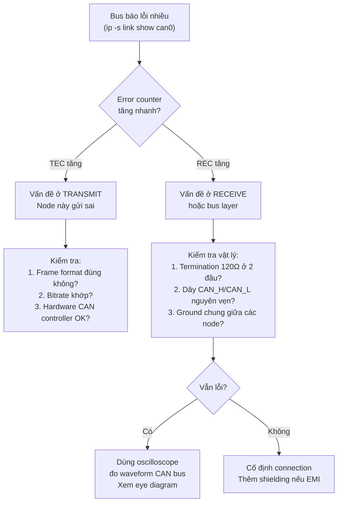

### 🏭 Kinh nghiệm dự án

> *"Trên xe test, CAN bus dashboard → ECU phanh mất kết nối ngẫu nhiên. `candump -e can0` cho thấy hàng loạt error frame. Đo bằng oscilloscope thấy tín hiệu CAN bị phản xạ (reflection) do thiếu điện trở kết thúc (termination resistor) ở đầu cuối bus. Sau khi hàn thêm 120Ω ở 2 đầu dây CAN, tín hiệu sạch và không còn error frame."*

---

# PHẦN 6: V4L2 / GSTREAMER (LO13–LO15)

---

## Câu 17: Kiểm Tra Camera & V4L2 Workflow

### 🔑 Keywords
`V4L2 (Video4Linux2)`, `/dev/video*`, `v4l2-ctl`, `VIDIOC_QUERYCAP`, `VIDIOC_ENUM_FMT`, `VIDIOC_S_FMT`, `VIDIOC_REQBUFS`, `VIDIOC_QBUF`, `VIDIOC_DQBUF`, `VIDIOC_STREAMON`, `buffer type (MMAP, USERPTR, DMABUF)`, `media-ctl`, `media pipeline`

### 📚 Lý thuyết nền

**V4L2 là gì?**

V4L2 (Video for Linux 2) là **framework** trong Linux kernel để quản lý các thiết bị video: camera, TV tuner, video encoder/decoder. Nó cung cấp API chuẩn để user space có thể capture, output, và xử lý video mà không cần biết chi tiết hardware.

**Buffer Management — Phần quan trọng nhất:**

V4L2 hỗ trợ 3 chế độ quản lý buffer:

| Chế độ | Mô tả | Ưu điểm | Nhược điểm | Khi nào dùng |
|--------|-------|---------|------------|--------------|
| **MMAP** | Kernel cấp phát buffer, user `mmap()` vào address space | Đơn giản, hiệu quả | User không kiểm soát vị trí buffer | Mặc định, phù hợp hầu hết trường hợp |
| **USERPTR** | User cấp phát buffer, truyền pointer cho kernel | User kiểm soát bộ nhớ | Phức tạp hơn, kernel phải pin pages | Khi cần buffer ở vị trí cụ thể |
| **DMABUF** | Buffer được chia sẻ qua DMA-BUF fd giữa các device | **Zero-copy** giữa camera → GPU → display | Cần hardware + driver hỗ trợ | **Automotive** — giảm latency |

### 🔄 V4L2 Capture Flow

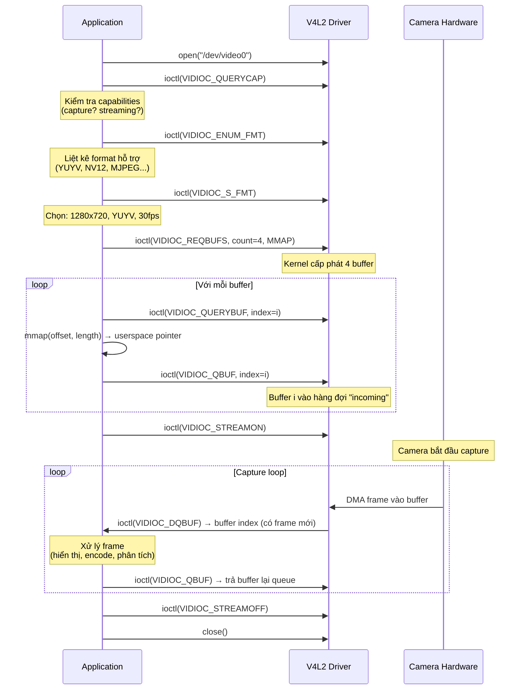

### 📝 Các lệnh kiểm tra thực tế

```bash
# ═══════════════════════════════════════
# Liệt kê video device
# ═══════════════════════════════════════
ls -la /dev/video*
# /dev/video0 → thường là capture device
# /dev/video1 → có thể là output hoặc metadata

# Chi tiết hơn: xem tên driver
v4l2-ctl --list-devices
# Camera (platform:fe.mipi-csi2):
#     /dev/video0
#     /dev/video1

# ═══════════════════════════════════════
# Kiểm tra capabilities
# ═══════════════════════════════════════
v4l2-ctl -d /dev/video0 --all
# Driver Info:
#     Driver name   : imx8-isi
#     Card type     : i.MX8 ISI
#     Capabilities  : 0x84201000
#         Video Capture Multiplanar
#         Streaming
# → Xác nhận device hỗ trợ capture + streaming

# ═══════════════════════════════════════
# Liệt kê format pixel hỗ trợ
# ═══════════════════════════════════════
v4l2-ctl -d /dev/video0 --list-formats
#     Type: Video Capture
#         [0]: 'YUYV' (YUYV 4:2:2)
#         [1]: 'NV12' (Y/CbCr 4:2:0)
#         [2]: 'MJPG' (Motion-JPEG)

# ═══════════════════════════════════════
# Liệt kê resolution + framerate
# ═══════════════════════════════════════
v4l2-ctl -d /dev/video0 --list-formats-ext
#     [0]: 'YUYV' (YUYV 4:2:2)
#         Size: 1920x1080 → Interval: 1/30 (30 fps)
#         Size: 1280x720  → Interval: 1/60 (60 fps)
#         Size: 640x480   → Interval: 1/120 (120 fps)

# ═══════════════════════════════════════
# Capture test (lưu 1 frame)
# ═══════════════════════════════════════
v4l2-ctl -d /dev/video0 \
    --set-fmt-video=width=1280,height=720,pixelformat=YUYV \
    --stream-mmap --stream-count=1 --stream-to=frame.raw

# ═══════════════════════════════════════
# Media pipeline (SoC phức tạp)
# ═══════════════════════════════════════
# Trên SoC có ISP (Image Signal Processor), pipeline phức tạp:
media-ctl -p    # In toàn bộ media graph
media-ctl -V "'imx8-mipi-csi2':1 [fmt:UYVY8_1X16/1920x1080]"
# → Cấu hình format trên pad của MIPI CSI-2 receiver
```

---

## Câu 18: GStreamer Pipeline — Capture, Xử Lý, Hiển Thị

### 🔑 Keywords
`GStreamer`, `pipeline`, `element`, `pad`, `caps`, `v4l2src`, `videoconvert`, `videoscale`, `autovideosink`, `x264enc / omxh264enc`, `rtph264pay`, `tee`, `queue`, `appsrc / appsink`, `gst-launch-1.0`, `gst-inspect-1.0`

### 📚 Lý thuyết nền

**GStreamer là gì?**

GStreamer là **multimedia framework** cho phép xây dựng **pipeline** xử lý media bằng cách ghép nối các **element** (khối xử lý). Giống như xây dựng từ LEGO — mỗi element làm một việc, ghép lại thành luồng xử lý hoàn chỉnh.

**Khái niệm cốt lõi:**

| Khái niệm | Giải thích | Ví dụ |
|-----------|-----------|-------|
| **Element** | Đơn vị xử lý nhỏ nhất | `v4l2src` (lấy frame), `videoconvert` (chuyển format) |
| **Pad** | Cổng vào/ra của element | `src` pad (output), `sink` pad (input) |
| **Caps** (Capabilities) | Mô tả format dữ liệu trên pad | `video/x-raw,format=NV12,width=1920,height=1080` |
| **Pipeline** | Chuỗi elements nối từ source → sink | `v4l2src ! videoconvert ! autovideosink` |
| **Bin** | Nhóm elements thành 1 đơn vị | `playbin`, `encodebin` |
| **Bus** | Kênh nhận message từ pipeline | Error, EOS (End of Stream), State change |

**Phân loại element:**

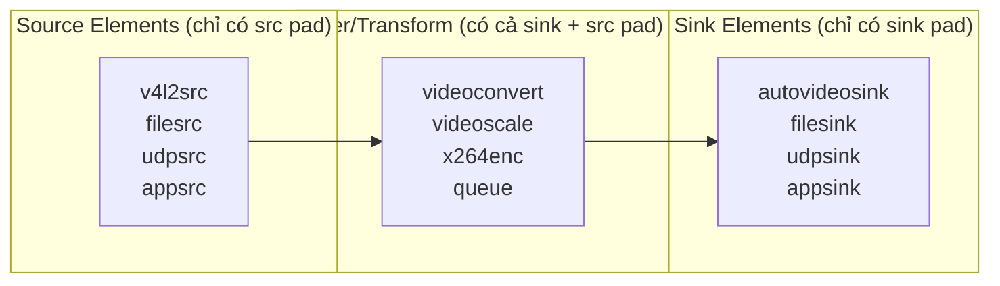

### 📝 Pipeline ví dụ — Từ đơn giản đến phức tạp

**Pipeline 1: Preview camera (đơn giản nhất)**
```bash
gst-launch-1.0 \
    v4l2src device=/dev/video0 ! \
    videoconvert ! \
    autovideosink
```
- `v4l2src`: lấy frame từ camera
- `videoconvert`: chuyển format pixel (ví dụ YUYV → BGRx để hiển thị)
- `autovideosink`: tự chọn video sink phù hợp (X11, Wayland, fbdev)

**Pipeline 2: Capture + Encode H.264 + Lưu file**
```bash
gst-launch-1.0 \
    v4l2src device=/dev/video0 ! \
    video/x-raw,format=NV12,width=1920,height=1080,framerate=30/1 ! \
    videoconvert ! \
    x264enc bitrate=4000 speed-preset=ultrafast tune=zerolatency ! \
    h264parse ! \
    mp4mux ! \
    filesink location=recording.mp4
```
- `video/x-raw,...`: **caps filter** — ép source output format cụ thể
- `x264enc`: software H.264 encoder (cho dev). Production dùng hardware encoder: `omxh264enc` (OMX), `v4l2h264enc` (V4L2 M2M)
- `tune=zerolatency`: giảm encoding latency (quan trọng cho automotive)
- `h264parse`: parse H.264 NAL units cho muxer
- `mp4mux`: đóng gói thành container MP4

**Pipeline 3: Capture + Hiển thị + Stream qua network (dùng `tee`)**
```bash
gst-launch-1.0 \
    v4l2src device=/dev/video0 ! \
    video/x-raw,format=NV12,width=1280,height=720,framerate=30/1 ! \
    tee name=t \
    \
    t. ! queue leaky=downstream ! videoconvert ! autovideosink \
    \
    t. ! queue leaky=downstream ! videoconvert ! \
         v4l2h264enc ! video/x-h264,level="(string)4" ! \
         rtph264pay config-interval=1 pt=96 ! \
         udpsink host=192.168.1.10 port=5000
```
- `tee`: chia stream thành 2 nhánh (hiển thị local + stream remote)
- `queue leaky=downstream`: nếu consumer chậm → **drop frame cũ** thay vì block pipeline (quan trọng cho real-time)
- `v4l2h264enc`: hardware encoder (SoC specific, zero-copy)

> [!TIP]
> **Debug GStreamer:** Đặt `GST_DEBUG=3` (hoặc cao hơn) để xem log chi tiết. `GST_DEBUG=v4l2src:5` chỉ bật log cho element cụ thể. `gst-inspect-1.0 v4l2src` để xem properties và caps của element.

---

## Câu 19: Camera Lùi / Camera 360 — Thiết Kế Hệ Thống Automotive

### 🔑 Keywords
`rear-view camera`, `surround view (360°)`, `latency budget`, `DMA-BUF`, `zero-copy`, `compositor`, `warp/dewarp`, `ISP (Image Signal Processor)`, `LVDS / MIPI CSI-2`, `failover`, `functional safety`

### 📚 Lý thuyết nền

**Yêu cầu Automotive cho camera lùi (theo FMVSS 111 / UN R158):**
- Hiển thị trong **< 2 giây** sau khi cài số lùi.
- Góc nhìn tối thiểu **130°**.
- Độ phân giải tối thiểu phải nhận diện được vật cản 150mm ở khoảng cách 6m.
- Hoạt động ổn định ở nhiệt độ -40°C đến +85°C.

**Camera 360° (Surround View):**
- 4 camera (trước, sau, trái, phải) → ghép thành ảnh bird-eye view.
- Yêu cầu **đồng bộ** frame giữa 4 camera (< 1 frame drift).
- Cần **dewarp** (sửa méo fisheye) + **stitching** (ghép ảnh) — thường dùng GPU hoặc dedicated hardware.

**Phân tích Latency Budget:**

```
┌─────────────────────────────────────────────────────────┐
│               Latency Budget: < 150ms total              │
├──────────────────┬──────────────────────────────────────┤
│ Giai đoạn        │ Latency mục tiêu                    │
├──────────────────┼──────────────────────────────────────┤
│ Sensor exposure  │ ~16ms (@ 60fps)                     │
│ MIPI CSI-2 transfer │ ~2ms                              │
│ ISP processing   │ ~5ms                                │
│ Encode/Decode    │ Bỏ qua (raw path cho rear camera)    │
│ Compositor/Render│ ~10ms                               │
│ Display output   │ ~16ms (@ 60fps display)             │
│ ─────────────────│──────────────────────────────────────│
│ TỔNG             │ ~50ms (3 frames @ 60fps)            │
└──────────────────┴──────────────────────────────────────┘
```

### 📝 Thiết kế hệ thống

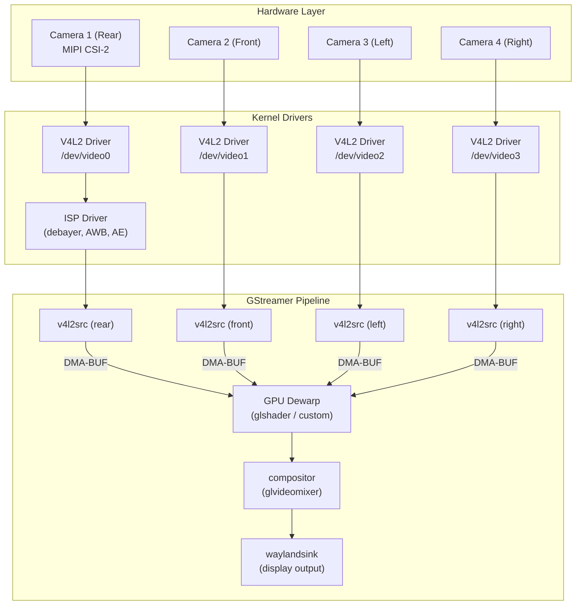

### 📝 Xử lý Latency & Frame Loss

**1. Giảm latency:**
```bash
# Dùng DMA-BUF để zero-copy giữa V4L2 → GPU
gst-launch-1.0 \
    v4l2src device=/dev/video0 io-mode=dmabuf ! \
    video/x-raw,format=NV12,width=1920,height=1080 ! \
    queue max-size-buffers=2 leaky=downstream ! \
    glupload ! \
    glcolorconvert ! \
    glimagesink
```

- `io-mode=dmabuf`: buffer chia sẻ qua DMA-BUF fd → **không copy** dữ liệu giữa camera driver và GPU.
- `max-size-buffers=2`: chỉ giữ 2 buffer → frame cũ bị drop thay vì tích tụ.
- `leaky=downstream`: khi queue đầy, drop frame **cũ nhất** (quan trọng: frame mới nhất luôn được ưu tiên).

**2. Xử lý frame loss:**
```python
# Trong application code (dùng GStreamer Python binding)
def on_bus_message(bus, message):
    if message.type == Gst.MessageType.QOS:
        # Quality of Service — frame bị drop
        running, timestamp, jitter, proportion, quality = \
            message.parse_qos()
        if proportion > 1.5:
            # Giảm resolution để giữ framerate
            caps = Gst.Caps.from_string(
                "video/x-raw,width=640,height=480")
            capsfilter.set_property("caps", caps)
    
    elif message.type == Gst.MessageType.ERROR:
        err, debug = message.parse_error()
        # Camera disconnect → switch sang backup
        pipeline.set_state(Gst.State.NULL)
        switch_to_backup_camera()

    elif message.type == Gst.MessageType.ELEMENT:
        structure = message.get_structure()
        if structure.get_name() == "v4l2src-error":
            # V4L2 specific error
            handle_v4l2_error(structure)
```

**3. Failover (chuyển camera dự phòng):**
```bash
# Dùng input-selector để chuyển giữa 2 nguồn
gst-launch-1.0 \
    input-selector name=sel ! autovideosink \
    v4l2src device=/dev/video0 ! queue ! sel.sink_0 \
    v4l2src device=/dev/video1 ! queue ! sel.sink_1

# Khi camera chính fail, app gửi signal:
# sel.set_property("active-pad", sel.get_static_pad("sink_1"))
```

### 🏭 Kinh nghiệm dự án

> *"Trong dự án surround-view trên R-Car H3, latency ban đầu là ~200ms (không đạt yêu cầu 150ms). Phân tích bằng `GST_TRACER=latency` và `gst-shark` thấy bottleneck ở `videoconvert` (CPU-based color conversion chiếm ~80ms). Giải pháp: chuyển sang `glcolorconvert` (GPU-based) + dùng DMA-BUF zero-copy giữa V4L2 và GPU. Kết quả: latency giảm xuống ~50ms. Thêm vào đó, dùng `queue leaky=downstream` cho mỗi nhánh camera để nếu 1 camera lag, không block pipeline chung."*

---

# PHỤ LỤC

## A. Bảng Tổng Hợp Các Lệnh Debug Hay Dùng

| Lĩnh vực | Lệnh | Mục đích |
|-----------|-------|----------|
| **Kernel** | `dmesg -w` | Xem kernel log real-time |
| | `cat /proc/interrupts` | Thống kê interrupt |
| | `cat /proc/meminfo` | Thông tin bộ nhớ |
| | `lsmod` | Liệt kê modules |
| | `modinfo <module>` | Thông tin module |
| **Boot** | `systemd-analyze blame` | Thời gian boot từng service |
| | `journalctl -b` | Log từ lần boot gần nhất |
| **Device Tree** | `dtc -I dtb -O dts board.dtb` | Decompile DTB → DTS |
| | `ls /proc/device-tree/` | Xem DT trên target |
| **CAN** | `candump -td -e can0` | Dump frame + timestamp + error |
| | `ip -s link show can0` | Thống kê interface |
| | `canbusload can0@500000` | Đo bus load |
| **Camera** | `v4l2-ctl --list-devices` | Liệt kê video device |
| | `media-ctl -p` | Media graph |
| | `GST_DEBUG=3 gst-launch-1.0 ...` | Debug GStreamer |
| **Performance** | `perf top` | CPU hotspot |
| | `trace-cmd record -p function_graph` | Function trace |
| | `htop` | Process monitor |

## B. Checklist Trước Khi Vào Phỏng Vấn

- [ ] Hiểu rõ **kernel space vs user space** — giải thích được MMU, system call flow
- [ ] Biết **cross-compile** kernel — từ toolchain đến config
- [ ] Mô tả được **boot sequence** 4 giai đoạn + debug từng bước
- [ ] Phân biệt **layer / recipe / BitBake** trong Yocto
- [ ] Viết được **recipe cơ bản** và biết cách đưa vào image
- [ ] Hiểu **3 loại driver** và khi nào dùng loại nào
- [ ] Viết được **platform driver** với Device Tree binding
- [ ] Debug module bằng **dmesg / printk / ftrace**
- [ ] Giải thích **CAN frame** structure, arbitration, error states
- [ ] Cấu hình **SocketCAN** và dùng can-utils
- [ ] Hiểu **V4L2 buffer model** (MMAP, USERPTR, DMABUF)
- [ ] Xây dựng **GStreamer pipeline** và giải thích từng element
- [ ] Thiết kế hệ thống camera automotive với **yêu cầu latency**

## C. Mẹo Trả Lời Phỏng Vấn

1. **Cấu trúc STAR:** Situation → Task → Action → Result. Kể câu chuyện dự án thật.
2. **Đi từ tổng quan → chi tiết:** Bắt đầu bằng high-level concept, rồi deep dive khi được hỏi thêm.
3. **Thừa nhận giới hạn:** "Tôi chưa làm CAN FD nhưng hiểu lý thuyết và sẵn sàng học" tốt hơn là bịa.
4. **Vẽ diagram:** Xin phép vẽ trên giấy/whiteboard khi giải thích flow phức tạp.
5. **Liên hệ thực tế:** Luôn kết nối lý thuyết với kinh nghiệm dự án cụ thể.

---

*Hết tài liệu — Chúc bạn phỏng vấn thành công! 🚀*
