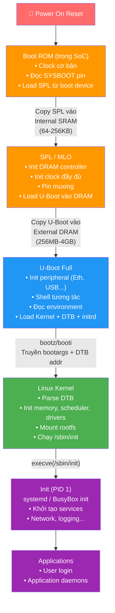
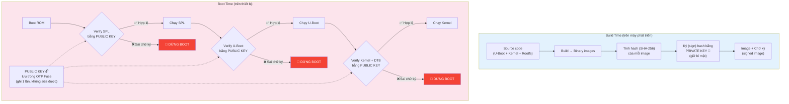
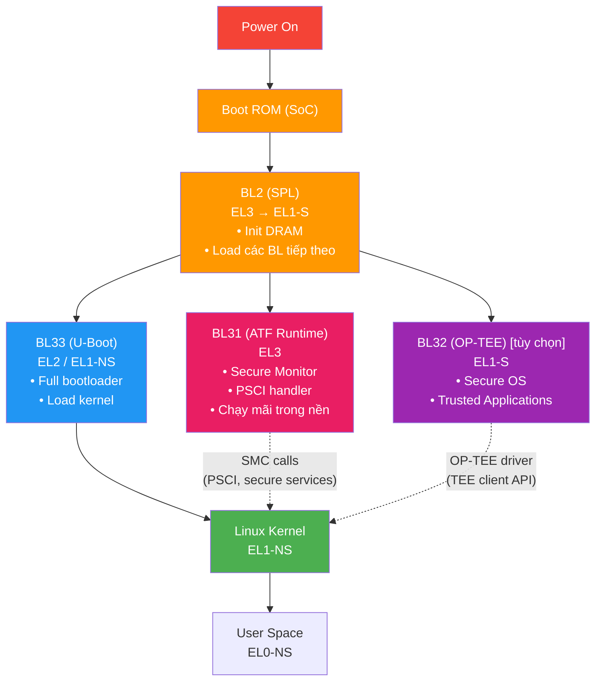
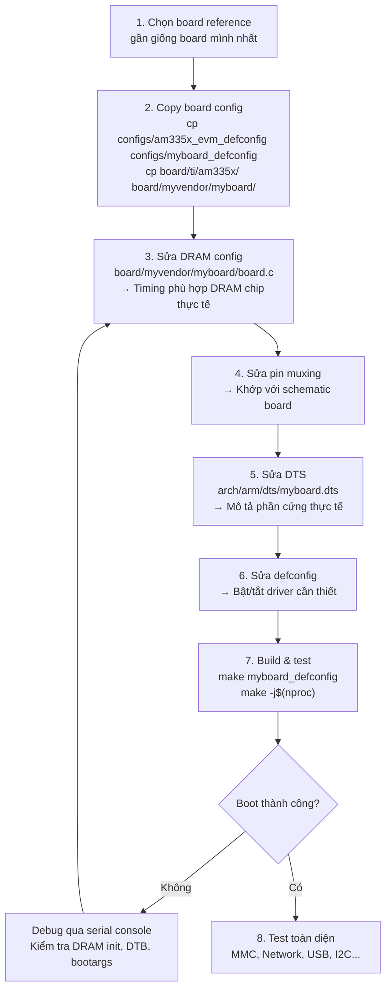

# 📘 U-Boot & Boot Architecture — Kiến Thức Toàn Diện

*Tổng hợp lý thuyết + giải đáp thắc mắc + kinh nghiệm thực tế*
_Cập nhật: 2026-11-21_

---

## Mục lục

1. [Tổng quan — Tại sao cần Bootloader?](#1-tổng-quan--tại-sao-cần-bootloader)
2. [Boot Stage 1: Boot ROM (Primary Boot)](#2-boot-stage-1-boot-rom-primary-boot)
3. [Boot Stage 2: SPL / MLO (Secondary Program Loader)](#3-boot-stage-2-spl--mlo-secondary-program-loader)
4. [Boot Stage 3: U-Boot (Full Bootloader)](#4-boot-stage-3-u-boot-full-bootloader)
5. [Boot Stage 4: Linux Kernel](#5-boot-stage-4-linux-kernel)
6. [Toàn bộ Boot Flow — Sơ đồ tổng hợp](#6-toàn-bộ-boot-flow--sơ-đồ-tổng-hợp)
7. [Secure Boot — Bảo mật chuỗi boot](#7-secure-boot--bảo-mật-chuỗi-boot)
8. [ARM Trusted Firmware (ATF) Architecture](#8-arm-trusted-firmware-atf-architecture)
9. [U-Boot Commands — Lệnh thường dùng](#9-u-boot-commands--lệnh-thường-dùng)
10. [Device Tree trong Boot Process](#10-device-tree-trong-boot-process)
11. [Porting U-Boot cho Board Mới](#11-porting-u-boot-cho-board-mới)
12. [Câu hỏi phỏng vấn thường gặp](#12-câu-hỏi-phỏng-vấn-thường-gặp)

---

## 1. Tổng quan — Tại sao cần Bootloader?

### Vấn đề cơ bản

Khi bạn bật nguồn (power on) một board embedded, CPU **không thể chạy Linux kernel ngay được**. Lý do:

1. **DRAM chưa được khởi tạo** — Kernel cần RAM để chạy, nhưng DRAM controller cần được cấu hình (timing, frequency, bank mapping...) trước khi sử dụng.
2. **CPU chưa biết load gì, từ đâu** — Kernel nằm ở flash/eMMC/SD card, CPU cần chương trình để đọc kernel ra và đặt vào RAM.
3. **Các peripheral chưa sẵn sàng** — Clock chưa được setup, pin chưa được cấu hình (mux), power domain chưa được bật.

**→ Vì vậy cần một chuỗi chương trình "mồi" (bootloader chain) để khởi tạo phần cứng từng bước, rồi cuối cùng mới load và chạy kernel.**

### So sánh: Vi điều khiển (MCU) vs. Embedded Linux (SoC)

> **❓ Câu hỏi của bạn:** "Vi điều khiển có chương trình ROM không? Khi khởi động thì VĐK vô main luôn không?"

| Tiêu chí | Vi điều khiển (MCU) — ví dụ STM32 | Embedded Linux SoC — ví dụ AM335x, i.MX6 |
|-----------|-------------------------------------|------------------------------------------|
| **Có Boot ROM?** | ✅ Có — nhưng rất nhỏ | ✅ Có — phức tạp hơn nhiều |
| **Boot ROM làm gì?** | Khởi tạo clock cơ bản, đọc vector table từ Flash, nhảy đến `Reset_Handler` | Khởi tạo clock cơ bản, đọc SYSBOOT pin, load SPL từ boot device |
| **Có vào main() ngay?** | ❌ Không ngay. Flow: `Reset_Handler` → startup code (`.s` file) → setup stack, copy `.data`, clear `.bss` → gọi `SystemInit()` → gọi `main()` | ❌ Không. Qua 3-4 giai đoạn bootloader trước khi kernel chạy |
| **Có linker script?** | ✅ `.ld` file định nghĩa vùng nhớ Flash/SRAM | ✅ Mỗi stage có linker script riêng |
| **DRAM?** | Không có DRAM (chỉ SRAM tích hợp, 64-512KB) | Có DRAM ngoài (256MB-4GB), cần bootloader khởi tạo |
| **Thời gian boot** | ~ms (vào main() gần như ngay) | ~giây (qua nhiều stage) |

**Tóm lại:** Cả MCU và SoC đều có Boot ROM. Sự khác biệt chính là SoC cần **nhiều giai đoạn boot hơn** vì phần cứng phức tạp hơn (DRAM, nhiều bus, nhiều peripheral).

> **Giải thích thêm về MCU boot flow:**
> ```
> Power On → CPU đọc vector table tại địa chỉ 0x0000_0000 (hoặc 0x0800_0000 trên STM32)
>          → Lấy giá trị Stack Pointer (SP) từ word đầu tiên
>          → Lấy địa chỉ Reset_Handler từ word thứ 2
>          → Nhảy đến Reset_Handler (assembly startup code)
>          → Setup stack, copy initialized data (.data) từ Flash vào SRAM
>          → Clear .bss section
>          → Gọi SystemInit() (cấu hình clock, PLL)
>          → Gọi main()
> ```
> Linker script (`.ld`) cho biết **Reset_Handler nằm ở đâu**, **vùng nhớ Flash bắt đầu/kết thúc ở đâu**, **SRAM dùng thế nào**.

---

## 2. Boot Stage 1: Boot ROM (Primary Boot)

### Boot ROM là gì?

Boot ROM là **chương trình cố định (factory-programmed) bên trong SoC**, nằm trong vùng ROM nội bộ của chip. Đặc điểm:

- **Không thể sửa đổi** — được ghi vào silicon khi sản xuất chip
- **Nằm trong SoC** — không phải trên flash hay SD card bên ngoài
- **Kích thước rất nhỏ** — vài KB đến vài chục KB
- **Chạy đầu tiên** khi CPU nhận power-on reset

### Boot ROM làm gì?

```
Power On Reset
     │
     ▼
┌─────────────────────────────────┐
│         Boot ROM (trong SoC)    │
│                                 │
│  1. Khởi tạo CPU clock cơ bản  │
│  2. Khởi tạo stack pointer     │
│     (trên internal SRAM)       │
│  3. Đọc SYSBOOT pins           │
│  4. Thử load SPL từ boot       │
│     device theo thứ tự ưu tiên │
│  5. Nếu tìm thấy → nhảy đến   │
│     SPL entry point             │
│  6. Nếu không tìm thấy →       │
│     thử device tiếp theo       │
│     hoặc vào recovery mode      │
└─────────────────────────────────┘
```

### SYSBOOT Pins — Cơ chế chọn Boot Device

> **❓ Câu hỏi của bạn:** "SYSBOOT_PIN thì ở chương trình boot nào cũng có hay là tùy thuộc SoC?"

**Trả lời:** Tên gọi và cơ chế **khác nhau tùy SoC**, nhưng **mọi SoC đều có cơ chế tương tự** để chọn boot device. Ví dụ:

| SoC | Tên cơ chế | Cách hoạt động |
|-----|-----------|---------------|
| **TI AM335x** (BeagleBone) | `SYSBOOT[4:0]` | 5 pin, mỗi tổ hợp = 1 thứ tự boot device |
| **NXP i.MX6/8** | `BOOT_CFG` + `BOOT_MODE` | Fuse bits + 2 pin chọn chế độ (internal boot / serial download) |
| **Allwinner** (Orange Pi) | `FEL` button | Nhấn nút FEL khi boot → vào USB download mode |
| **Rockchip** | `EMMC_RST` / `Maskrom` button | Nút hoặc short pad để vào download mode |
| **STM32MP1** | `BOOT[2:0]` | 3 pin, chọn NAND/SD/eMMC/Serial |
| **Raspberry Pi** (BCM2835) | Không có pin, cố định | Boot ROM luôn tìm `bootcode.bin` trên SD card |

**Ví dụ cụ thể — TI AM335x SYSBOOT:**

```
SYSBOOT[4:0] = 11100b → Boot order: MMC1 → MMC0 → UART0 → USB
SYSBOOT[4:0] = 11000b → Boot order: SPI0 → MMC0 → USB → UART0
```

Trên BeagleBone Black, SYSBOOT mặc định boot từ eMMC. Nhấn nút S2 (boot button) → kéo SYSBOOT xuống → boot từ SD card thay vì eMMC.

> **Tại sao Boot ROM code không sửa được?**
> - Được mask vào silicon (mask ROM) trong quá trình sản xuất chip
> - Đây là thiết kế có chủ đích: đảm bảo luôn có chương trình để khôi phục board, kể cả khi flash bị xóa sạch
> - Nếu boot ROM bị lỗi → phải đổi revision chip (rất tốn kém)

### Giới hạn của Boot ROM

- **Không có DRAM driver** → chỉ dùng được internal SRAM (thường 64–256KB)
- **Chỉ hỗ trợ giao thức đọc cơ bản** → đọc từ MMC/NAND/SPI ở chế độ đơn giản
- **Không có filesystem driver phức tạp** → chỉ đọc raw sector hoặc FAT đơn giản
- **→ Vì vậy cần SPL/MLO: chương trình đủ nhỏ để nằm trong SRAM, nhưng đủ thông minh để khởi tạo DRAM**

---

## 3. Boot Stage 2: SPL / MLO (Secondary Program Loader)

### SPL là gì?

SPL (Secondary Program Loader) là **phiên bản rút gọn của U-Boot**, đủ nhỏ để chạy trong internal SRAM. Trên TI SoC, SPL được gọi là **MLO (Memory LOader)**.

> **❓ Câu hỏi của bạn:** "Ở chương trình khác thì có phải là MLO không?"

**Trả lời:** Tên gọi **khác nhau tùy SoC/vendor**, nhưng bản chất giống nhau:

| SoC / Platform | Tên file SPL | Ghi chú |
|----------------|-------------|---------|
| **TI AM335x** | `MLO` | Viết tắt Memory LOader |
| **TI AM57xx/AM64x** | `tiboot3.bin` | Tên mới trên TI K3 platform |
| **NXP i.MX6** | `SPL` | Tên chuẩn U-Boot |
| **NXP i.MX8** | `flash.bin` | SPL + ATF + firmware gộp lại |
| **Samsung Exynos** | `BL1` / `BL2` | Theo chuẩn ARM Trusted Firmware |
| **Rockchip** | `idbloader.img` | SPL + TPL gộp |
| **Raspberry Pi** | `bootcode.bin` → `start.elf` | Không dùng U-Boot SPL, GPU chạy trước CPU! |

### SPL chạy ở đâu?

```
┌─────────────────────────────────────────────────────────┐
│                        SoC                              │
│                                                         │
│  ┌──────────┐    ┌────────────────────┐                 │
│  │   CPU    │    │  Internal SRAM     │                 │
│  │          │───▶│  (OCRAM / SRAM)    │                 │
│  │          │    │  64KB – 256KB      │                 │
│  └──────────┘    │                    │                 │
│                  │  ┌──────────────┐  │                 │
│                  │  │  SPL/MLO     │  │  ◄── Boot ROM   │
│                  │  │  chạy ở đây  │  │      load vào   │
│                  │  └──────────────┘  │      đây        │
│                  └────────────────────┘                 │
│                                                         │
│  ┌────────────────────┐                                 │
│  │  DRAM Controller   │ ◄── SPL khởi tạo cái này       │
│  └────────┬───────────┘                                 │
└───────────┼─────────────────────────────────────────────┘
            │
            ▼
┌────────────────────────┐
│   External DRAM        │
│   (256MB – 4GB)        │
│                        │
│   ┌──────────────────┐ │
│   │   U-Boot Full    │ │  ◄── SPL load U-Boot
│   │   chạy ở đây     │ │      vào đây
│   └──────────────────┘ │
└────────────────────────┘
```

### SPL làm gì? (Chi tiết)

| Bước | Hành động | Tại sao cần? |
|------|-----------|-------------|
| 1 | **Khởi tạo CPU clock / PLL** | Tăng tốc CPU từ clock mặc định (vài MHz) lên tốc độ cần thiết (vài trăm MHz – GHz) |
| 2 | **Cấu hình pin muxing** | Trên SoC, mỗi pin có thể đảm nhiệm nhiều chức năng (GPIO / UART / I2C...). Cần chọn đúng chức năng |
| 3 | **Khởi tạo serial console** | Để có thể in log debug ra UART |
| 4 | **Khởi tạo DRAM controller** | **Quan trọng nhất!** Cấu hình timing (CAS latency, tRCD, tRP...), frequency, bank mapping. Sai → DRAM không dùng được hoặc bị lỗi ngẫu nhiên |
| 5 | **Khởi tạo boot device** | Cấu hình MMC/NAND/SPI controller ở chế độ nhanh hơn Boot ROM |
| 6 | **Load U-Boot full vào DRAM** | Đọc `u-boot.img` từ boot device, copy vào địa chỉ xác định trong DRAM |
| 7 | **Nhảy đến U-Boot entry point** | Chuyển quyền điều khiển cho U-Boot |

> **❓ Câu hỏi của bạn:** "SPL load ở địa chỉ 0x20000 — tại sao lại là địa chỉ này?"

**Trả lời:** Địa chỉ load **tùy thuộc vào SoC**. `0x20000` là địa chỉ internal SRAM trên một số SoC TI. Mỗi SoC có memory map khác nhau:

| SoC | Địa chỉ Internal SRAM | Kích thước |
|-----|----------------------|-----------|
| TI AM335x | `0x402F_0400` | 128KB |
| NXP i.MX6 | `0x0090_0000` | 128-256KB |
| NXP i.MX8M | `0x007E_1000` | 256KB |
| STM32MP1 | `0x2FFC_0000` | 256KB |

Địa chỉ chính xác được quy định trong **Technical Reference Manual (TRM)** của SoC.

---

## 4. Boot Stage 3: U-Boot (Full Bootloader)

### U-Boot là gì?

U-Boot (Das U-Boot — Universal Boot Loader) là bootloader **mã nguồn mở** phổ biến nhất cho embedded Linux. Chạy trong DRAM (đã được SPL khởi tạo), có đầy đủ tính năng:

### U-Boot làm gì?

```
┌─────────────────────────────────────────────────────────────┐
│                     U-Boot Full                             │
│                                                             │
│  1. Khởi tạo thêm peripheral                               │
│     • Ethernet, USB, Display, I2C, SPI                      │
│     • PCI/PCIe (nếu có)                                     │
│                                                             │
│  2. Cung cấp shell tương tác (qua UART)                     │
│     • Cho phép người dùng nhập lệnh                        │
│     • Chỉnh sửa biến môi trường (bootargs, bootcmd...)     │
│                                                             │
│  3. Hỗ trợ nhiều giao thức load kernel                      │
│     • MMC/SD: fatload, ext4load                             │
│     • Network: tftp, nfs, dhcp                              │
│     • USB: usb start; fatload usb                           │
│     • NAND/NOR flash: nand read                             │
│                                                             │
│  4. Load 3 thứ vào DRAM:                                    │
│     • Kernel image (zImage / Image)                         │
│     • Device Tree Blob (.dtb)                               │
│     • Initial ramdisk — initramfs (nếu có)                  │
│                                                             │
│  5. Truyền thông tin cho kernel:                             │
│     • bootargs (kernel command line)                        │
│     • Địa chỉ DTB trong RAM                                │
│                                                             │
│  6. Nhảy đến kernel entry point (bootz / booti / bootm)     │
│     → Từ đây U-Boot không chạy nữa                         │
└─────────────────────────────────────────────────────────────┘
```

### U-Boot Environment Variables (Biến môi trường)

Biến môi trường là cách U-Boot lưu trữ **cấu hình boot** một cách linh hoạt. Các biến quan trọng:

| Biến | Mô tả | Ví dụ |
|------|-------|-------|
| `bootcmd` | Lệnh tự động chạy khi boot | `fatload mmc 0:1 0x82000000 zImage; bootz 0x82000000 - 0x88000000` |
| `bootargs` | Kernel command line | `console=ttyO0,115200n8 root=/dev/mmcblk0p2 rw rootwait` |
| `bootdelay` | Số giây đợi trước khi chạy `bootcmd` | `3` (nhấn phím bất kỳ để vào shell) |
| `ipaddr` | IP của board | `192.168.1.100` |
| `serverip` | IP của TFTP server | `192.168.1.1` |
| `loadaddr` | Địa chỉ RAM để load file | `0x82000000` |
| `fdtaddr` | Địa chỉ RAM để load DTB | `0x88000000` |
| `ethaddr` | MAC address | `00:11:22:33:44:55` |

**Lưu trữ environment:**
- Lưu trên **MMC** (partition riêng hoặc raw sector)
- Hoặc trên **SPI NOR Flash** (sector riêng)
- Hoặc trên **NAND Flash**
- Nơi lưu được cấu hình trong `defconfig` của U-Boot (`CONFIG_ENV_IS_IN_MMC`, `CONFIG_ENV_IS_IN_SPI_FLASH`...)

### U-Boot Boot Command Flow

```
U-Boot khởi động
     │
     ▼
Đọc environment từ storage
     │
     ▼
In banner: "U-Boot 2023.01 (Jan 01 2023)"
     │
     ▼
Đếm ngược bootdelay (3s...)
     │
     ├── Người dùng nhấn phím → Vào U-Boot shell
     │   │
     │   ▼
     │   => (prompt) ← chờ lệnh
     │
     └── Hết thời gian → Chạy bootcmd tự động
         │
         ▼
    fatload mmc 0:1 ${loadaddr} zImage
         │
         ▼
    fatload mmc 0:1 ${fdtaddr} board.dtb
         │
         ▼
    setenv bootargs console=ttyO0,115200 root=/dev/mmcblk0p2 rw
         │
         ▼
    bootz ${loadaddr} - ${fdtaddr}
         │
         ▼
    "Starting kernel ..."
    → U-Boot chuyển quyền cho kernel, không chạy nữa
```

### Các lệnh boot kernel

| Lệnh | Dùng cho | Giải thích |
|-------|---------|-----------|
| `bootm` | uImage (legacy) | Kernel image có U-Boot header (mkimage) |
| `bootz` | zImage (ARM32) | Kernel nén zlib, phổ biến trên ARM 32-bit |
| `booti` | Image (ARM64) | Kernel không nén, dùng trên AArch64 |

**Cú pháp:** `bootz <kernel_addr> <initrd_addr> <dtb_addr>`
- Nếu không có initrd, dùng `-`: `bootz 0x82000000 - 0x88000000`

---

## 5. Boot Stage 4: Linux Kernel

Sau khi U-Boot gọi `bootz/booti/bootm`:

```
Kernel nhận quyền điều khiển
     │
     ▼
Giải nén (nếu là zImage)
     │
     ▼
head.S / head.o — Assembly entry point
     │
     ├── Kiểm tra CPU mode (phải ở SVC/EL1)
     ├── Tắt MMU và cache
     ├── Thiết lập page table tạm thời
     └── Bật MMU
     │
     ▼
start_kernel() — C entry point
     │
     ├── setup_arch(): parse DTB, cấu hình memory
     ├── mm_init(): khởi tạo memory management
     ├── sched_init(): khởi tạo scheduler
     ├── init_IRQ(): khởi tạo interrupt controller
     ├── time_init(): khởi tạo timer
     ├── console_init(): khởi tạo UART console
     │   → Từ đây có thể printk ra serial ←
     ├── rest_init():
     │   ├── Tạo kernel thread "init" (PID 1)
     │   └── Tạo kernel thread "kthreadd" (PID 2)
     │
     ▼
kernel_init() — PID 1
     │
     ├── Mount rootfs (từ bootargs: root=/dev/mmcblk0p2)
     ├── Tìm và chạy init program:
     │   1. Thử /sbin/init
     │   2. Thử /etc/init
     │   3. Thử /bin/init
     │   4. Thử /bin/sh (last resort)
     │
     ▼
Init process (systemd / BusyBox init / SysVinit)
     │
     ▼
User-space services khởi chạy
     │
     ▼
Login prompt hoặc application tự chạy
```

> **Điểm quan trọng:** Dòng **"Starting kernel ..."** là log cuối cùng của **U-Boot**, không phải kernel. Nếu không thấy log tiếp sau dòng này → kernel chết trước khi kịp init console (xem debug guide trong file interview).

---

## 6. Toàn bộ Boot Flow — Sơ đồ tổng hợp



### Memory Layout trong quá trình boot

```
Thời điểm 1: Boot ROM đang chạy
┌──────────────────────────────────────┐
│          SoC Internal SRAM           │
│  0x402F_0400 ┌─────────────────────┐ │
│              │   Boot ROM stack    │ │
│              │   + variables       │ │
│              └─────────────────────┘ │
│          External DRAM: CHƯA DÙNG ĐƯỢC│
└──────────────────────────────────────┘

Thời điểm 2: SPL đang chạy
┌──────────────────────────────────────┐
│          SoC Internal SRAM           │
│  0x402F_0400 ┌─────────────────────┐ │
│              │      SPL code       │ │
│              │      + stack        │ │
│              │      + heap         │ │
│              └─────────────────────┘ │
│          External DRAM: ĐANG KHỞI TẠO │
└──────────────────────────────────────┘

Thời điểm 3: U-Boot đang chạy
┌──────────────────────────────────────┐
│          External DRAM (512MB)       │
│  0x8000_0000 ┌─────────────────────┐ │
│              │                     │ │
│              │   (trống)           │ │
│              │                     │ │
│  0x8080_0000 ├─────────────────────┤ │
│              │   U-Boot code       │ │
│              │   + BSS + Stack     │ │
│  0x808F_FFFF ├─────────────────────┤ │
│              │   U-Boot heap       │ │
│              │   (malloc pool)     │ │
│              ├─────────────────────┤ │
│              │   Environment       │ │
│              ├─────────────────────┤ │
│              │   (trống — để load  │ │
│              │    kernel, dtb...)  │ │
│  0x9FFF_FFFF └─────────────────────┘ │
└──────────────────────────────────────┘

Thời điểm 4: Kernel đã được load
┌──────────────────────────────────────┐
│          External DRAM (512MB)       │
│  0x8000_0000 ┌─────────────────────┐ │
│              │   (exception vect.) │ │
│  0x8000_8000 ├─────────────────────┤ │
│              │   Kernel Image      │ │
│              │   (zImage/Image)    │ │
│  0x80XX_XXXX ├─────────────────────┤ │
│              │   (trống)           │ │
│  0x8800_0000 ├─────────────────────┤ │
│              │   Device Tree Blob  │ │
│  0x88XX_XXXX ├─────────────────────┤ │
│              │   initramfs (opt.)  │ │
│              ├─────────────────────┤ │
│              │   (trống)           │ │
│  0x9FFF_FFFF └─────────────────────┘ │
└──────────────────────────────────────┘
```

---

## 7. Secure Boot — Bảo mật chuỗi boot

### Vấn đề: Tại sao cần Secure Boot?

Nếu không có Secure Boot, kẻ tấn công có thể:
- **Thay thế kernel** bằng phiên bản có backdoor
- **Sửa đổi U-Boot** để bỏ qua xác thực
- **Flash rootfs giả** chứa malware
- **Cài đặt firmware độc hại** vào ECU trên xe → nguy hiểm tính mạng

### Nguyên lý hoạt động

Secure Boot dùng **cryptographic signature** (chữ ký số) để xác minh tính toàn vẹn của từng stage boot:



### Chain of Trust (Chuỗi tin cậy)

```
Boot ROM (tin cậy tuyệt đối — không sửa được)
   │  verify ✅
   ▼
SPL (đã xác thực)
   │  verify ✅
   ▼
U-Boot (đã xác thực)
   │  verify ✅
   ▼
Kernel + DTB (đã xác thực)
   │  verify ✅ (dm-verity)
   ▼
Rootfs (đã xác thực)
```

**Root of Trust (Gốc tin cậy):** Boot ROM + Public Key trong OTP fuse. Vì cả hai đều **không thể sửa đổi**, nên chuỗi trust bắt đầu từ điểm đáng tin cậy tuyệt đối.

### Giải thích kỹ thuật chi tiết

> **❓ Từ note của bạn:** "Có thuật toán công thức gì đấy mã hóa 1 chiều"

**Thuật toán sử dụng:**

1. **Hashing (SHA-256):** Thuật toán một chiều — từ dữ liệu tính ra hash (256 bit), nhưng **không thể** từ hash suy ngược ra dữ liệu. Dù image hàng GB, hash chỉ 32 byte. Thay đổi 1 bit dữ liệu → hash thay đổi hoàn toàn.

2. **Asymmetric Encryption (RSA-2048 / ECDSA):** Dùng cặp khóa:
   - **Private key** (🔑 bí mật): dùng để **ký** (sign). Chỉ developer/vendor giữ.
   - **Public key** (🔓 công khai): dùng để **xác thực** (verify). Lưu trong SoC (OTP fuse).

**Quy trình verify trên thiết bị:**
```
1. Boot ROM đọc image từ flash
2. Boot ROM tính hash SHA-256 của image → H1
3. Boot ROM dùng Public Key giải mã chữ ký (signature) → H2
4. So sánh H1 == H2?
   → Bằng nhau: image chưa bị sửa đổi → cho phép boot
   → Khác nhau: image bị tamper → DỪNG
```

### OTP Fuse (One-Time Programmable)

- Là vùng nhớ **ghi một lần duy nhất** trong SoC
- Sau khi ghi Public Key vào fuse → **không thể thay đổi** kể cả khi có physical access
- Trên NXP i.MX: gọi là **SRK (Super Root Key) fuse**
- Trên TI AM335x: gọi là **SECMEM**
- **⚠️ Lưu ý:** Sau khi "close" (lock) device, chỉ có image signed đúng mới chạy được. Nếu mất private key → board thành cục gạch!

---

## 8. ARM Trusted Firmware (ATF) Architecture

### Tổng quan

ARM Trusted Firmware (ATF), nay gọi là **TF-A (Trusted Firmware-A)**, định nghĩa kiến trúc phần mềm bảo mật trên ARM. Nó chia thực thi thành các **Exception Level (EL)** và **Security State (Secure/Non-secure)**.

### ARM Exception Levels

```
┌─────────────────────────────────────────────────────────────┐
│                    Exception Levels (ARM64)                  │
│                                                             │
│  ┌────────────────────────────────────────────────────────┐ │
│  │ EL3 — Secure Monitor (highest privilege)              │ │
│  │ • ATF BL31 (EL3 Runtime / Secure Monitor)             │ │
│  │ • Chuyển đổi giữa Secure ↔ Non-secure world           │ │
│  │ • Xử lý SMC (Secure Monitor Call)                     │ │
│  │ • PSCI (Power State Coordination Interface)            │ │
│  └────────────────────────────────────────────────────────┘ │
│                          │  SMC                             │
│          ┌───────────────┼───────────────┐                  │
│          ▼                               ▼                  │
│  ┌─────────────────────┐  ┌─────────────────────────────┐  │
│  │  Secure World       │  │  Non-Secure (Normal) World  │  │
│  │                     │  │                             │  │
│  │ EL1-S: Secure OS    │  │ EL2: Hypervisor             │  │
│  │  (OP-TEE, Trusty)   │  │  (KVM, Xen)                │  │
│  │                     │  │                             │  │
│  │ EL0-S: Trusted App  │  │ EL1: Linux Kernel           │  │
│  │  (TA — key storage, │  │  (drivers, scheduler...)    │  │
│  │   DRM, crypto...)   │  │                             │  │
│  │                     │  │ EL0: User Applications      │  │
│  │                     │  │  (apps, daemons...)         │  │
│  └─────────────────────┘  └─────────────────────────────┘  │
└─────────────────────────────────────────────────────────────┘
```

### ATF Boot Stages (BL1 → BL33)

ATF định nghĩa các **Boot Loader stage** chuẩn:

| Stage | Tên | Chạy ở đâu | Nhiệm vụ |
|-------|-----|-----------|-----------|
| **BL1** | AP Trusted Boot ROM | ROM / SRAM, EL3 | Reset handler, khởi tạo cơ bản, verify + load BL2 |
| **BL2** | Trusted Boot Firmware | SRAM, EL1-S | Khởi tạo security, DRAM. Load BL31, BL32, BL33 |
| **BL31** | EL3 Runtime (Secure Monitor) | DRAM, EL3 | Chạy suốt vòng đời hệ thống. Xử lý SMC, PSCI. Chuyển đổi Secure ↔ Non-secure |
| **BL32** | Secure-EL1 Payload | DRAM, EL1-S | Secure OS (OP-TEE). Tùy chọn — không bắt buộc |
| **BL33** | Non-secure Firmware | DRAM, EL2/EL1 | **U-Boot** hoặc UEFI. Đây là bootloader thông thường |

### ATF Boot Flow (trên platform thực tế, ví dụ NXP i.MX8M)



### Mapping ATF stages với tên file thực tế

| ATF Stage | Tên file thực tế (ví dụ i.MX8M) | Nguồn |
|-----------|----------------------------------|-------|
| BL1 | (trong Boot ROM) | Silicon vendor |
| BL2 | `SPL` hoặc `flash.bin` (gộp) | U-Boot SPL build |
| BL31 | `bl31.bin` | ATF build: `make PLAT=imx8mm bl31` |
| BL32 | `tee.bin` | OP-TEE build |
| BL33 | `u-boot-nodtb.bin` + `u-boot.dtb` | U-Boot build |

**Trên i.MX8M, tất cả được gộp lại thành `flash.bin`:**
```bash
# Build flash.bin cho i.MX8M Mini
mkimage_imx8 -soc imx8mm \
    -append bl31.bin \
    -append tee.bin \
    -append u-boot-nodtb.bin \
    -append u-boot.dtb \
    -out flash.bin
```

---

## 9. U-Boot Commands — Lệnh thường dùng

### Nhóm 1: Thông tin & Environment

```bash
# Hiện phiên bản U-Boot
=> version

# Xem tất cả biến môi trường
=> printenv

# Xem 1 biến cụ thể
=> printenv bootargs

# Đặt biến
=> setenv bootargs 'console=ttyS0,115200 root=/dev/mmcblk0p2 rw rootwait'

# Lưu env vào flash (persistent)
=> saveenv

# Reset env về mặc định
=> env default -a
```

### Nhóm 2: Bộ nhớ

```bash
# Đọc bộ nhớ (memory display)
=> md.b 0x80000000 0x40    # 64 bytes, hiện theo byte
=> md.w 0x80000000 0x20    # 64 bytes, hiện theo word (16-bit)
=> md.l 0x80000000 0x10    # 64 bytes, hiện theo long (32-bit)

# Ghi bộ nhớ
=> mw.l 0x80000000 0xDEADBEEF 4    # Ghi 4 lần 0xDEADBEEF

# Copy bộ nhớ
=> cp.b 0x80000000 0x81000000 0x1000    # Copy 4KB

# So sánh bộ nhớ
=> cmp.b 0x80000000 0x81000000 0x1000

# Test DRAM
=> mtest 0x80000000 0x81000000    # Memory test (Ctrl+C để dừng)
```

### Nhóm 3: Storage (MMC/NAND/Flash)

```bash
# MMC
=> mmc list                        # Liệt kê MMC device
=> mmc dev 0                       # Chọn MMC device 0
=> mmc info                        # Thông tin device
=> mmc part                        # Liệt kê partition
=> mmc rescan                      # Re-scan (nếu mới cắm SD)

# Load file từ FAT partition
=> fatload mmc 0:1 0x82000000 zImage           # Device 0, partition 1
=> fatload mmc 0:1 0x88000000 am335x-bbb.dtb

# Load file từ ext4 partition
=> ext4load mmc 0:2 0x82000000 /boot/zImage

# Liệt kê file
=> fatls mmc 0:1
=> ext4ls mmc 0:2 /boot/
```

### Nhóm 4: Network

```bash
# Cấu hình network
=> setenv ipaddr 192.168.1.100
=> setenv serverip 192.168.1.1
=> setenv ethaddr 00:11:22:33:44:55

# Ping
=> ping 192.168.1.1

# TFTP — load file từ server
=> tftp 0x82000000 zImage
=> tftp 0x88000000 board.dtb

# NFS boot
=> setenv bootargs 'root=/dev/nfs nfsroot=192.168.1.1:/nfs/rootfs,v3 ip=dhcp'

# DHCP
=> dhcp
```

### Nhóm 5: Boot

```bash
# Boot kernel (ARM32)
=> bootz 0x82000000 - 0x88000000

# Boot kernel (ARM64)
=> booti 0x82000000 - 0x88000000

# Boot legacy uImage
=> bootm 0x82000000 - 0x88000000

# Reset board
=> reset

# Chạy bootcmd
=> run bootcmd

# Chạy script (chuỗi lệnh đã lưu trong biến)
=> setenv myboot 'fatload mmc 0:1 ${loadaddr} zImage; bootz ${loadaddr} - ${fdtaddr}'
=> run myboot
```

### Nhóm 6: Device Tree trong U-Boot

```bash
# Đặt địa chỉ FDT
=> fdt addr 0x88000000

# In toàn bộ device tree
=> fdt print

# In một node cụ thể
=> fdt print /memory
=> fdt print /chosen

# Sửa property
=> fdt set /chosen bootargs 'console=ttyS0,115200'

# Kiểm tra kích thước
=> fdt header
```

---

## 10. Device Tree trong Boot Process

### Device Tree là gì?

Device Tree (DT) là **cấu trúc dữ liệu** mô tả phần cứng cho kernel. Thay vì hardcode thông tin phần cứng trong kernel, DT tách biệt **mô tả phần cứng** ra khỏi **code driver**.

### Tại sao cần Device Tree?

**Trước kia (không có DT):**
- Mỗi board ARM có riêng một file `board-xxx.c` trong kernel
- Thêm board mới = sửa kernel code = phải rebuild kernel
- Linus Torvalds nổi tiếng vì đã phàn nàn về sự "bừa bãi" của ARM board files

**Bây giờ (có DT):**
- **Một kernel binary** chạy trên **nhiều board** khác nhau
- Chỉ cần thay DTB file → kernel tự biết phần cứng khác

### Cách Device Tree đi qua boot flow

```
1. Developer viết .dts (Device Tree Source) — text file
                    │
                    ▼
2. dtc (Device Tree Compiler) biên dịch → .dtb (binary blob)
                    │
                    ▼
3. .dtb được đặt trên boot device (SD card, flash...)
                    │
                    ▼
4. U-Boot load .dtb vào RAM (fatload mmc 0:1 ${fdtaddr} board.dtb)
                    │
                    ▼
5. U-Boot có thể sửa DTB (thêm bootargs, MAC address...)
                    │
                    ▼
6. U-Boot truyền địa chỉ DTB cho kernel (bootz ... ${fdtaddr})
                    │
                    ▼
7. Kernel parse DTB → biết phần cứng → probe đúng driver
```

### Ví dụ DTS cơ bản

```dts
/dts-v1/;

/ {
    model = "My Custom Board";
    compatible = "myvendor,myboard", "ti,am335x";

    /* Mô tả CPU */
    cpus {
        cpu@0 {
            compatible = "arm,cortex-a8";
            clock-frequency = <1000000000>;  /* 1GHz */
        };
    };

    /* Mô tả RAM */
    memory@80000000 {
        device_type = "memory";
        reg = <0x80000000 0x20000000>;  /* 512MB tại 0x80000000 */
    };

    /* Thông tin boot cho kernel */
    chosen {
        stdout-path = &uart0;  /* Console output */
        /* bootargs có thể được U-Boot thêm vào */
    };

    /* UART */
    uart0: serial@44e09000 {
        compatible = "ti,am335x-uart";
        reg = <0x44e09000 0x2000>;    /* Địa chỉ register */
        interrupts = <72>;             /* IRQ number */
        clock-frequency = <48000000>;  /* 48MHz */
        status = "okay";
    };

    /* I2C */
    i2c0: i2c@44e0b000 {
        compatible = "ti,omap4-i2c";
        reg = <0x44e0b000 0x1000>;
        interrupts = <70>;
        clock-frequency = <400000>;    /* 400kHz (Fast mode) */
        status = "okay";

        /* Sensor trên I2C bus */
        temperature-sensor@48 {
            compatible = "ti,tmp102";
            reg = <0x48>;              /* I2C address */
        };
    };
};
```

---

## 11. Porting U-Boot cho Board Mới

### Khi nào cần port U-Boot?

Khi bạn thiết kế **board custom** (không phải dev kit sẵn có), bạn cần port U-Boot để khớp với phần cứng thực tế: DRAM type/size khác, flash khác, pin muxing khác, peripheral khác.

### Quy trình porting



### Cấu trúc thư mục U-Boot

```
u-boot/
├── arch/arm/
│   ├── cpu/           # CPU-specific code (ARMv7, ARMv8)
│   ├── dts/           # Device Tree Sources cho các board
│   │   ├── am335x-boneblack.dts
│   │   └── myboard.dts        ← THÊM
│   └── mach-*/        # SoC-specific code
├── board/
│   ├── ti/am335x/     # Board reference
│   └── myvendor/
│       └── myboard/   ← THÊM
│           ├── board.c         # Board init code
│           ├── Kconfig
│           └── Makefile
├── configs/
│   ├── am335x_evm_defconfig
│   └── myboard_defconfig      ← THÊM
├── drivers/           # Device drivers
├── include/
│   └── configs/
│       └── myboard.h          ← THÊM (board config header)
├── cmd/               # U-Boot commands
└── common/            # Common code
```

---

## 12. Câu hỏi phỏng vấn thường gặp

### Q1: "Mô tả quá trình boot từ khi bật nguồn đến khi Linux chạy"

**Trả lời mẫu:**
> "Khi bật nguồn, CPU chạy Boot ROM — chương trình cố định trong SoC. Boot ROM đọc SYSBOOT pin để biết boot từ đâu (eMMC, SD, NAND...), rồi load SPL vào internal SRAM.
>
> SPL là phiên bản rút gọn của U-Boot, nhiệm vụ chính là khởi tạo DRAM controller. Sau khi DRAM sẵn sàng, SPL load U-Boot full vào DRAM.
>
> U-Boot full cung cấp shell tương tác, đọc environment, load kernel image + Device Tree vào RAM, truyền bootargs cho kernel rồi nhảy đến kernel entry point.
>
> Kernel parse DTB, khởi tạo các subsystem (memory, scheduler, drivers), mount rootfs, và chạy /sbin/init (PID 1) để bắt đầu user space."

### Q2: "Tại sao cần SPL? Sao U-Boot không load trực tiếp từ Boot ROM?"

**Trả lời:**
> "Vì Boot ROM chạy trên internal SRAM rất nhỏ (64-256KB), không đủ chỗ cho U-Boot full (~500KB-1MB). Hơn nữa, Boot ROM không có DRAM driver — mà U-Boot cần chạy trong DRAM. SPL là bước trung gian: đủ nhỏ cho SRAM, đủ thông minh để khởi tạo DRAM."

### Q3: "Secure Boot hoạt động thế nào?"

**Trả lời:**
> "Secure Boot sử dụng public-key cryptography. Developer sign image bằng private key. Public key được ghi vào OTP fuse trong SoC (ghi 1 lần, không sửa được). Khi boot, Boot ROM verify chữ ký SPL bằng public key. SPL verify U-Boot. U-Boot verify kernel. Nếu bất kỳ stage nào verify fail → dừng boot. Đây gọi là Chain of Trust — mỗi stage đã xác thực sẽ verify stage tiếp theo."

### Q4: "Board treo ở 'Starting kernel...' — bạn debug thế nào?"

**Trả lời:**
> "Dòng đó là log cuối của U-Boot, kernel chưa kịp setup console. Tôi sẽ:
> 1. Thêm `earlycon=...` vào bootargs để có log từ rất sớm
> 2. Kiểm tra DTB — node memory có đúng kích thước RAM không
> 3. Kiểm tra kernel đúng ARCH (ARM32 vs ARM64)
> 4. Dùng `md` trong U-Boot verify kernel nằm đúng địa chỉ
> 5. Nếu vẫn không có log → dùng JTAG đặt breakpoint tại `start_kernel`"

### Q5: "U-Boot environment lưu ở đâu? Nếu bị corrupt thì sao?"

**Trả lời:**
> "Environment lưu trên storage (MMC, NOR flash, NAND) tại offset cấu hình trong defconfig. U-Boot hỗ trợ redundant environment — lưu 2 bản, dùng flag xác định bản nào mới nhất. Nếu cả 2 bị corrupt, U-Boot dùng default environment compiled trong binary."

---

*Hết tài liệu — Chúc bạn hiểu rõ U-Boot và boot process! 🚀*
